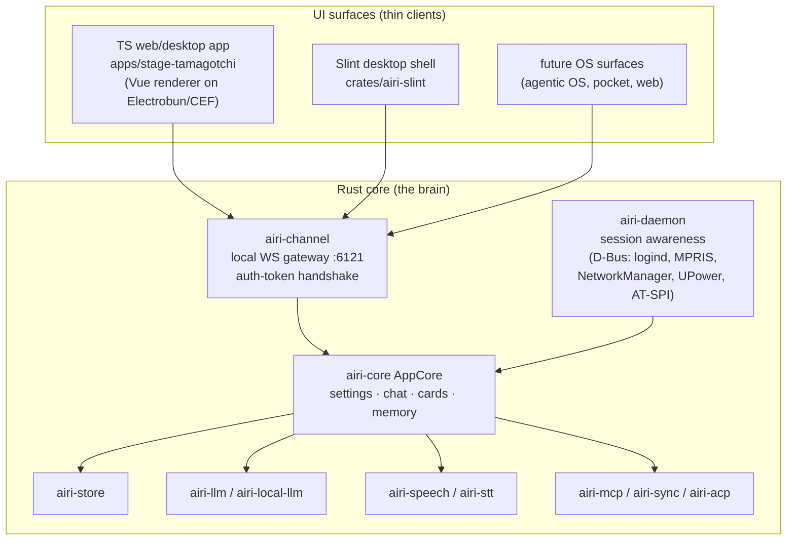

# AIRI Documentation — Start Here

This directory is the engineering record of AIRI. `README.md` (this file) states the
architecture philosophy and maps everything else. When a doc here contradicts the code,
the code wins — and the doc gets fixed.

## The philosophy: one core, many surfaces

AIRI is pivoting from "a desktop pet app" to **the agent runtime core of a personal
agentic OS**. That pivot dictates the architecture:

> **One long-lived Rust core owns state and business logic. Every UI — the polished web
> app, the native Slint desktop shell, future surfaces — is a thin client over the same
> contracts.**

Why this shape:

- **No logic forks.** Two UI stacks (TypeScript and Rust) implementing the same features
  independently will drift; every feature would be paid for twice. Business logic lands
  once, in the core.
- **The daemon outlives the UI.** An agentic OS companion must keep perceiving, deciding,
  and acting while windows come and go. A UI-restart must not reset the agent's mind.
  `crates/airi-daemon` already exists as a systemd/D-Bus-activated session daemon, and
  `crates/airi-channel` runs the authenticated local WebSocket gateway both UI stacks
  speak.
- **Performance and footprint.** The TS desktop app carries an entire browser-shell
  runtime (now Electrobun/CEF instead of Electron) per surface. A native core plus thin
  views is the honest end state; the polished Vue renderer remains valuable as one of
  those views, not as the brain.

## Target architecture

## Where we actually are today

Be honest about the gap; do not pretend the port is done.

| Surface / component | State | Where its logic lives today |
|---|---|---|
| TS web/desktop app (`apps/stage-tamagotchi`) | Polished, daily-driver. Main process ported in place from Electron to **Electrobun 2** (`design-electrobun-port.md`). | **All business logic still in TypeScript** (`src/main/**` + `packages/*`). This is the strangler's starting point, not a finished client. |
| Slint desktop shell (`crates/airi-slint`) | Booting profile/settings/store/provider repo, optional gateway, spine rendering. | Rust, via `airi-core`; UI-feature parity with the TS app is partial. |
| Rust core (`airi-core`, `airi-store`, `airi-llm`, …) | Real foundation: typed settings sections, streaming chat pipeline with persistence, character cards (CCv2/v3 + `airi` ext), memory lanes. | Growing toward parity service by service. |
| `airi-daemon` | Shipped: systemd `Type=dbus` unit + D-Bus activation (`packaging/`), six T0 awareness sources, opt-in AT-SPI, redacted audit JSONL. | Rust. The OS-integration anchor — awareness runs even with no UI open. |

## The migration path (strangler, not big-bang)

1. **Polish what ships.** The TS app on Electrobun remains the flagship; keep it working
   at every step. `docs/port-manifest/` is the feature/IPC/store inventory — treat it as
   the parity ledger the Rust core must satisfy.
2. **Move one service at a time** TS → Rust (`airi-core`), behind the existing eventa /
   gateway contracts, with the TS UI consuming the Rust service as soon as it reaches
   parity for that service. No feature may exist long-term in both stacks.
3. **UIs become views.** The Vue renderer and the Slint shell both consume the core
   through `airi-channel`'s gateway protocol (already implemented on both sides).
   Renderer-side business logic shrinks to view-models.
4. **The daemon is the OS seam.** Presence, awareness, and autonomous cycles (see
   `design-agentic-os.md`) belong to `airi-daemon`/`airi-core`, not to any window.

## Rules for contributors

- **Contract first.** A new cross-boundary feature starts as a contract (eventa
  definitions, gateway messages), not as UI code. Renderer and shell both implement the
  contract; neither invents private business logic.
- **No new TS business logic in main processes** unless it is explicitly temporary and
  tracked in the parity ledger for its Rust counterpart.
- **Single source of truth per domain**: settings shape in `airi-store` sections,
  persistence inventory in `data-catalog.md`, TS internals map in `rosetta-stone.md`.
- **The TS app must stay shippable** while the core grows. Every migration step ends
  with both surfaces working.

## How docs/ is organized

- **Canonical, always current** (referenced by AGENTS.md, skills, scripts — do not move):
  `rosetta-stone.md` (TS internals map), `data-catalog.md` (persistence inventory),
  `settings-yaml.md`, `project-testing-parity.md`, `project-specialized-skills.md`,
  `port-manifest/` (Electrobun port parity ledger).
- **Architecture blueprints** — how things work today or the approved design for what
  lands next. Prefixes: `arch-*` (subsystem architecture), `design-*` (feature/system
  design; the authoritative ones), `research-*` / `analysis-*` / `blueprint-*`
  (investigations and viability reports), `feat-*`, `catalog-*`, `provider-catalog.md`.
- **Active proposals** (`proposal-*`, `project-*`): RFCs and plans still being executed.
  When one ships or dies, it moves to `archive/` and gets a row in
  [`archive/README.md`](./archive/README.md).
- **History**: `archive/` — completed handoffs, point-in-time model reviews, resolved
  bug investigations, superseded proposals, and the Qt→Slint port record
  (`archive/qt-port/`). The archive README indexes every entry.
- **Docs website**: `.vitepress/` + `content/` (en / ja / zh-Hans) build the public site
  (`srcDir: content` — the top-level engineering docs are not part of the site build).
  Site machinery (`package.json`, `netlify.toml`, `scripts/`, `shared-sidebar.ts`,
  `*.d.ts`, `uno.config.ts`, `tsconfig.json`) lives alongside.

### Reading order for the core/daemon pivot

1. `design-agentic-os.md` — presence, autonomy, and the heartbeat/autonomous-cycle
   inversion; the behavioral philosophy of an OS-resident agent.
2. `design-electrobun-port.md` — how the flagship TS surface runs today without Electron.
3. `crates/airi-channel/src/lib.rs` — the gateway protocol both UIs already speak.
4. `crates/airi-core/src/lib.rs` — what the Rust core already owns.
5. `docs/port-manifest/features.md` — the parity surface the core must cover.
6. `rosetta-stone.md` — the map of the TS app you are strangling.
