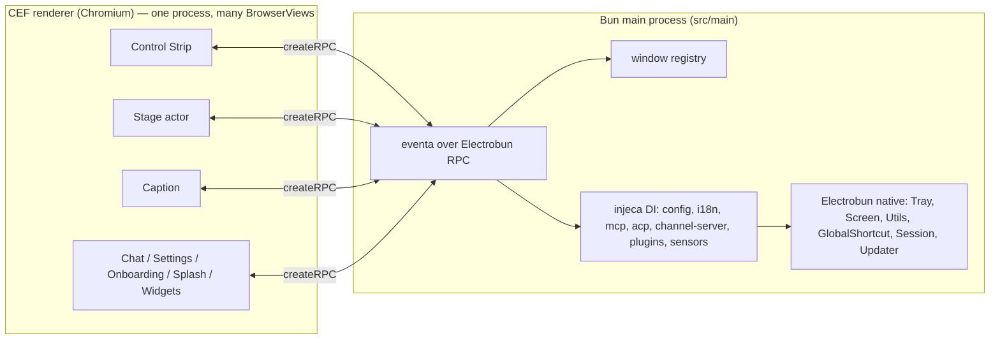

# Port Plan — AIRI Desktop: Electron → Electrobun 2

**Status:** active · **Started:** 2026-11-13 · **Target runtime:** Electrobun 2.0.6 / Hutch 0.29.0 / Bun 1.4.4
**Ported in place:** `apps/stage-tamagotchi` (Electron 40 + electron-vite + electron-builder)

This document is the design contract for the port. It records what was verified against the
real Electrobun 2.0.6 SDK (not doc summaries), the decisions taken, and the wave order.
Implementation status lives in the wave sections, not in prose elsewhere.

---

## 1. Decisions

| # | Decision | Value | Why |
|---|---|---|---|
| 1 | Mutate in place | `apps/stage-tamagotchi` keeps its name, `src/` layout, package name and app id; `electrobun.config.ts` + `hutch.config.ts` land at the app root | User decision. One app, not two: the Electron shell is not kept as a parallel implementation. The old build chain is deleted rather than left beside the new one. |
| 2 | Package manager | **pnpm** via `hutch.config.ts → packageManager: "pnpm"` | User requirement. Hutch then delegates resolution to pnpm, never writes `hutch.lock` for this app, never touches `pnpm-lock.yaml`, and never runs lifecycle scripts. |
| 3 | Renderer | **CEF** (`bundleCEF: true`, `defaultRenderer: "cef"`) on linux/mac/win | Keeps Chromium semantics: WebGPU/Dawn/Vulkan switches, `SharedArrayBuffer`, `-webkit-app-region: drag`, `backdrop-filter`, `<webview>`, `getDisplayMedia`. On Linux CEF is process-wide, so **every** window in the process is CEF. |
| 4 | First landing | Boot shell only | Prove the process skeleton, the RPC bridge, the window registry and the overlay story before moving services. |

### 1.1 Consequences of decision 3 that must be designed around

- Linux picks **one** renderer per process (`libNativeWrapper.so`: `WebKitWebViewImpl` *or*
  `CEFWebViewImpl`). A native and a CEF view cannot coexist on Linux. On macOS/Windows they can.
- CEF flags replace `app.commandLine.appendSwitch`: everything in
  `apps/stage-tamagotchi/src/main/index.ts:200-227` becomes `build.linux.chromiumFlags`.
- `bundleCEF` costs ~183 MB (linux-x64 CEF archive) on top of the ~23 MB core archive.

### 1.2 Verified capability matrix (Electrobun 2.0.6)

Read from `electrobun-core-linux-x64.tar.gz` (`api/`, `libNativeWrapper.so` symbols) and a
scaffolded project at `/tmp/vueprobe/probe-app` (devkit projected at `.hutch/devkit`).

| Capability | Electrobun 2.0.6 | Notes |
|---|---|---|
| Typed RPC | ✅ `createRPC`, `RPCSchema`, `BrowserView.defineRPC` (main), `Electroview.defineRPC` (view) | Request/response + main→view messages. No view→main *unsolicited* handler registry, so eventa's bidirectional model needs a multiplex layer (wave 1: `packages/electrobun-eventa`). |
| Transparent frameless window | ✅ `transparent`, `titleBarStyle: "hidden"`, `passthrough` | Linux: `X11: Created transparent window with 32-bit ARGB visual`, `gdk_window_input_shape_combine_region`, `CEF: Transparent window input handling enabled`. |
| Click-through (ignore mouse events) | ⚠️ creation-time `passthrough` + runtime `webviewSetPassthrough` / `<electrobun-webview passthrough>` | **No `setIgnoreMouseEvents(bool,{forward})` toggle** like Electron. Caption fades in/out by toggling passthrough; verify toggle latency on the target WM. |
| Always on top | ⚠️ `setAlwaysOnTop(bool)` only | No macOS `screen-saver` level, no numeric level. Control Strip > Stage > Caption z-order must be expressed by creation order / focus or dropped. Linux maps to `_NET_WM_STATE_ABOVE` + `gtk_window_set_keep_above`. |
| Visible on all workspaces | ✅ `setVisibleOnAllWorkspaces` | No `{skipTransformProcessType}` variant. |
| Tray + menu | ⚠️ `Tray({title,image,template})` with `setTitle/setImage/setMenu/setVisible/getBounds/remove/on('tray-clicked')`; `ApplicationMenu`, `ContextMenu` | Linux backend is Ayatana AppIndicator: **menus and menu actions only** — no primary-icon activation (`tray.on("tray-clicked")` never fires there; enforced by `api/shared/linux-tray-contract.test.ts`). GTK application menus and `showContextMenu` are **no-ops on Linux** (`proc/linux.md`). Needs a host AppIndicator backend (GNOME: an extension). |
| Global shortcuts | ✅ `GlobalShortcut.register/unregister/isRegistered` | X11-based; no Wayland portal. Mic-toggle (Scroll/Caps/Num lock keys) still needs native polling — see `koffi`. |
| Screen / displays | ⚠️ `Screen.{getPrimaryDisplay,getAllDisplays,getCursorScreenPoint,captureRegion,getMouseButtons}` | No `getDisplayMatching`, no DIP↔screen `dipToScreenPoint/Rect` helpers, no `scaleFactor` guarantee. All bounds math in `windows/shared/display.ts` must be re-derived. |
| Dialog / clipboard / notification / shell | ✅ `Utils.{openFileDialog,showMessageBox,showNotification,clipboard*,openExternal,openPath,moveToTrash,showItemInFolder,paths}` | `paths.userData` replaces `app.getPath('userData')`. |
| Session/cookies | ⚠️ `Session.fromPartition(p).{getCookies,setCookie,removeCookie,clearCookies,clearStorageData}` | No `session.webRequest` header rewriting. The CORS-bypass feature needs a different mechanism (wave 4). |
| Updater | ✅ `Updater` | Replaces `electron-updater`. `release.baseUrl` + `artifacts/*-update.json`. |
| Screen capture | ⚠️ `Screen.captureRegion(rect)` + Wayland portal capture in the native layer | No `desktopCapturer.getSources`, no per-window thumbnails, no `setDisplayMediaRequestHandler`. |
| Power/session events | ❌ none | `powerMonitor` (suspend/resume/lock/unlock), `powerSaveBlocker`, `getSystemIdleTime` have no equivalent. The renderer's deep-standby trigger needs a native helper or is dropped. |
| safeStorage | ❌ none | libp2p identity/pairing persistence must use a different store (wave 4). |
| Single instance | ❌ none | Implement in Bun (lockfile or unix socket). |
| Chromium switches | ⚠️ `chromiumFlags` (CEF only) | Replaces `appendSwitch`. |
| `<webview>` tag | ✅ `electrobun-webview` (CEF/native, `masks`, `passthrough`) | Replaces Electron `webviewTag: true`; used by settings/onboarding card import previews. |
| `views://` prod scheme | ✅ `build.copy` destinations become `views://<name>/index.html` | Replaces `loadFile(join(rendererDir,'index.html'), {hash})`; `libs/electron/location.ts` is rewritten, and the `ERR_ABORTED -3` hash-route workaround goes away. |

### 1.3 Ported surface, measured

The RPC contract is the port's critical path, so its size is recorded rather than estimated.

| Surface | Count | Source |
|---|---|---|
| Distinct `eventa:invoke\|event:electron:*` channels | **227** (191 invoke + 36 event) | `apps/stage-tamagotchi/src/shared/eventa.ts` ∪ `packages/electron-eventa/src` ∪ `packages/stage-shared/src` |
| Channels declared in `shared/eventa.ts` itself | 101 | same file |
| Domains | 29 (`windows` 43, `libp2p` 24, `discord` 22, `agentic` 21, `acp` 13, `window` 12, `screen`/`auto-updater` 9, `sensors` 8, `plugins`/`mcp`/`beat-sync` 7, `vision`/`dock-mode` 6, …) | grouped by tag prefix |
| Renderer files touching the bridge | **77** across `apps/stage-tamagotchi/src/renderer`, `packages/stage-ui`, `packages/stage-pages` | grep for `window.electron` / `getIpcRenderer` / `@proj-airi/electron-vueuse` |
| `isStageTamagotchi()` call sites that gate desktop behaviour | **56** | grep |

Consequence: the bridge must be replaced by a **drop-in adapter** (`packages/electrobun-eventa`) that keeps
`createContext(...)` / `defineInvoke` / `defineInvokeHandler` signatures and the `{ id, type, payload }`
envelope, and by a **shim object** at `window.electron` so the runtime predicates keep answering truthfully.
Rewriting 77 call sites is the alternative and was rejected on cost.

---

## 2. Architecture



In-place layout after the port:

| Path | Origin | Change |
|---|---|---|
| `electrobun.config.ts`, `hutch.config.ts` | new | Hutch/Electrobun app + task config |
| `vite.config.ts` | replaces `electron.vite.config.ts` | plain Vite for the renderer, same plugins/aliases |
| `src/main/index.ts` | rewritten | Bun main bootstrap: registry, RPC, shutdown coordinator |
| `src/main/rpc/index.ts` | new | `BrowserView.defineRPC` handlers (ported `main/**/rpc/index.electron.ts`) |
| `src/main/windows/registry.ts`, `src/main/app/shutdown.ts`, `src/main/app/single-instance.ts` | new | Electron runtime replacements |
| `src/renderer/**` | unchanged content | built by the new Vite config |
| `packages/electrobun-eventa` | new package | `createMainContext`/`createViewContext`, drop-in for `@moeru/eventa/adapters/electron/{main,renderer}` |
| `build/`, `resources/` (icons, entitlements) | existing | reused as-is; `electrobun.config.ts` points `mac.icons`/`win.icon`/`linux.icon` at them and copies `resources/` |
| `electron.vite.config.ts`, `scripts/ensure-electron.js`, `electron-builder.config.ts`, `electron-builder.yml`, `dev-app-update.yml` | deleted | replaced by the three config files above |

### 2.1 Bridge replacement

Electron: `preload → contextBridge → window.electron.ipcRenderer → eventa electron adapter`.

Electrobun: no preload injection is needed; the view uses `Electroview.defineRPC` from
`electrobun/view`, and `packages/electrobun-eventa` provides `createMainContext(viewRpc)` /
`createViewContext(rpc)` with the **same signature** as
`@moeru/eventa/adapters/electron/{main,renderer}`, so the ~40 `useElectronEventa*` call sites
and the `defineInvokeHandler(context, tag, fn)` services port without being rewritten.

Multiplexing: eventa rides on two RPC methods — an `eventa:emit` request (either direction)
and a main→view `eventa:emit` message — carrying the identical `{ id, type, payload }` envelope
the Electron adapter uses, so payloads and tags stay wire-compatible.

### 2.2 Runtime environment flags (must not change in this port)

`vite.config.ts` keeps the Electron build's defines **verbatim**:

```ts
define['import.meta.env.RUNTIME_ENVIRONMENT'] = '\'electron\''
// development → 'server', production → 'file'
define['import.meta.env.URL_MODE'] = '\'server\' | \'file\''
```

- `isStageTamagotchi()` in `packages/stage-shared/src/environment.ts` is an exact string
  compare against `'electron'`, and **56 call sites** across `packages/stage-ui`,
  `packages/stage-pages` and `apps/stage-tamagotchi/src/renderer` gate real desktop
  behaviour on it (Control Strip atmosphere/chatbox, WebLLM platform detection, data
  maintenance, sandbox manager, onboarding copy). Flipping the value to `'electrobun'`
  makes the predicate false and silently degrades the whole desktop surface to web
  behaviour. **Follow-up (wave 2, separate change):** make the predicate true for the
  Electrobun shell — either keep the value `'electron'` permanently, or change
  `isStageTamagotchi()` to `RUNTIME_ENVIRONMENT === 'electron' || RUNTIME_ENVIRONMENT === 'electrobun'`
  and add a matching `isElectronWindow()` bridge-presence test.
- `isUrlMode('file' | 'server')` must keep returning what the Electron build returned
  (server in dev, file in prod): `withBase()` and the `views://` asset URLs depend on it.

### 2.3 Renderer-side Electron sniffs (needs a shim, wave 2)

The Electrobun view will **not** have `window.electron`, but these runtime predicates read it
directly:

| Site | Reads |
|---|---|
| `packages/stage-ui/src/composables/use-process-spawner.ts:31` (re-exported at :216, used at :32/:60/:134) | `Boolean(window?.electron)` |
| `packages/stage-shared/src/window.ts` — `isElectronWindow(window)` | `isStageTamagotchi() && 'electron' in window` |
| `apps/stage-tamagotchi/src/renderer/utils/electron.ts` — `getIpcRenderer()` / `getPlatform()` | `window.electron.ipcRenderer`, `window.platform` |
| `packages/electron-vueuse/src/composables/use-electron-eventa-context.ts` — `resolveIpcRenderer()` | `globalThis.window.electron.ipcRenderer` |

**Recommendation:** install an equivalent bridge object at module scope in
`src/renderer/main.ts` and `src/renderer/splash.main.ts` —
`window.electron = { ipcRenderer: <eventa-over-RPC shim> }` and
`window.platform = 'linux' | 'darwin' | 'win32'`, both backed by
`packages/electrobun-eventa`'s view adapter. That keeps **77 call sites** unchanged and
confines the change to one file per HTML entry point.

**Alternative:** port all 77 sites to call the Electrobun view RPC directly. It removes the
Electron-shaped vocabulary for good, but it edits three published packages
(`stage-ui`, `stage-shared`, `electron-vueuse`) plus the renderer, and every one of those
sites needs the same `import`/hook plumbing the shim would provide once. Decide when the
adapter lands, not before.

---

## 3. Waves

| Wave | Scope | Exit criterion |
|---|---|---|
| 1 | App config + Bun main + RPC contract/adapter + registry + shutdown + splash & Control Strip windows | `hutch run dev` shows Control Strip and splash; RPC round-trip green |
| 2 | Renderer build reuse: full Vue/Vite/UnoCSS/vue-router/i18n pipeline, three MPA entries, asset + model download plugins, `window.electron`/`window.platform` shim (§2.3); `RUNTIME_ENVIRONMENT` stays `'electron'` (§2.2) | Every reachable route renders in the CEF view at parity with Electron |
| 3 | Remaining 10 windows: stage, caption, chat, settings, onboarding, customizer, notice, about, devtools, widgets | Each window opens, renders, and round-trips its own RPC |
| 4 | Services + gap fills: config/persistence paths, CORS bypass, safeStorage replacement, screen capture, updater, single instance, tray | Feature parity on the surfaces the user can reach |
| 5 | Packaging: icons, `release.baseUrl`, update channel, deb/rpm/flatpak/dmg, CI matrix | Installed app launches and self-updates |

### 3.1 Explicit drops (recorded so they are not silently lost)

- Chromium `appendSwitch` GPU/Ozone tuning → `chromiumFlags` (CEF); Ozone/Wayland/Dawn/GlobalShortcutsPortal switches have no CEF equivalent.
- `powerMonitor`-driven deep standby (`electronWindowLifecycleChanged` reason `suspend`) — no native source; needs a helper or removal.
- `webContents.capturePage()` ghost-capture of the stage (`stage:capture-window`) → `Screen.captureRegion` or a canvas readback.
- `dialog.showErrorBox` in the LevelDB guard → `Utils.showMessageBox`; the guard only protects a Chromium-backed profile and must be re-evaluated against the CEF profile.
- `session.defaultSession.webRequest` CORS bypass → a Bun-side proxy (wave 4).
- Desktop tray left-click → show main window: no Linux equivalent; the menu must carry that action.
- Dead code found during the survey, to be dropped rather than ported: `windows/dashboard/*`, `windows/inlay/*` (never imported), `createSystemPreferencesService` (never called), `sticker.html` (referenced, never built), `exposeWithCustomAPI` (zero callers), `renderer/utils/windows.ts` Tauri no-ops, `renderer/composables/runtime.ts` hardcoded `'electron'` stub.
- `electron-builder`-only packaging scripts: `build:win`, `build:mac`, `build:deb`, `build:rpm` all collapsed to `pnpm run build` (one `hutch electrobun build --env=stable` produces the platform artifact); `scripts/copy-deps.ts`, `scripts/package-win-zip.ts` and `scripts/utils.ts` (electron-builder `Configuration` reader) are now dead and get deleted with wave 5.

### 3.2 Verified so far (2026-11-13)

| Claim | Evidence |
|---|---|
| Full Vue renderer builds under plain Vite from `apps/stage-tamagotchi/vite.config.ts` | `NODE_OPTIONS=--max-old-space-size=12288 hutch pm exec -- vite build` → `✓ built in 1m 55s`, 276 MB `dist/`, all three HTML entries emitted |
| Built HTML is `views://`-safe | `dist/{index,splash,beat-sync}.html` contain **zero** absolute `/assets/...` refs; all 7/4/4 asset refs are relative |
| Hutch honours `packageManager: "pnpm"` | `hutch electrobun config --env=dev` merged output; pnpm resolves and installs the workspace |
| Bun resolves `paths` only from the nearest `tsconfig.json` (ignores `references`) | isolated repro in `/tmp/aliasprobe`; `apps/stage-tamagotchi/tsconfig.json` now `extends` `tsconfig.node.json` so the main-process aliases apply |
| `hutch pm exec` drops Node's heap flag | `vite build` OOMs at ~2 GB; restating `NODE_OPTIONS=--max-old-space-size=12288` in `hutch.config.ts` fixes it |
| Bun main bundle builds clean | `bun build src/main/index.ts --target=bun --external koffi --external active-win` → **1334 modules, 6.71 MB, 0 errors** |
| The built main process boots into the Electrobun native runtime | staged the release libs and ran it: `setJSUtils called…`, `GlobalShortcut: Starting event loop thread`, `GlobalShortcut: X11 display opened successfully for shortcuts`, `GlobalShortcut: Event loop ready` — i.e. Bun → Electrobun FFI → X11 is real |
| Electrobun SDK must resolve from the Hutch devkit, not node_modules | the `electrobun` npm package is a bootstrap that throws on import by design; `tsconfig.node.json` `paths` now maps `electrobun`/`electrobun/main`/`electrobun/view` into `.hutch/devkit/api/**` so bare `bun build` resolves the real SDK (without it the bundle contains `lib/moved.cjs` and throws at first import) |
| `electrobun-eventa` adapter is a drop-in for the Electron adapter pair | 5/5 tests pass, `tsc --noEmit` clean; `extraRequestHandlers` on `defineElectrobunRPC` is the inbound seam (not in the public type) |
| `?asset` imports replaced | all 17 `import icon from '...?asset'` sites now use `src/main/assets.ts` runtime paths (electron-vite-only syntax; Bun cannot resolve it) |

### 3.2.1 Wave 1 end state (verified by running the app)

The built app **launches and stays up** under a headless display:

```
hutch electrobun build --env=dev
cd build/dev-linux-x64/AIRI-dev && xvfb-run --auto-servernum \
  --server-args="-screen 0 1920x1080x24" ./bin/launcher
```

Observed, in order: `X11: Created transparent window with 32-bit ARGB visual` →
`CEF: OSR enabled for window 16777218, size 420x560` (splash) →
`CEF: Transparent window input handling enabled for window 1` →
`X11: Created transparent window…` → `CEF: OSR enabled … size 56x668` (Control Strip) →
`[injeca] RUNNING` (DI start succeeded, no `DI start failed`) →
`WebSocket server started` on 6121 → clean CEF shutdown on SIGTERM, exit 0.

Two errors remain, both intentional: `Optional service not started (services:discord)` and
`[Mic Toggle] Error registering global shortcut` — the wave-4 stubs, logged rather than fatal.

| Claim | Evidence |
|---|---|
| CEF renderer renders the real Vue app from `views://` | `scripts/linux-window-render-smoke.ts` → `ok: true`, `mainWindowUrl: views://main/index.html`, `visibilityState: visible`, 960x1044, screenshot written |
| Renderer runs the actual app, not a placeholder | 545 renderer console diagnostics from real code paths (530 warnings incl. live i18n missing-key messages from the settings pages), plus 15 `Error: Electron IPC not available` — the expected bridge gap below |
| Transparency, click-through and always-on-top all work on Linux/CEF | the four native log lines above; `libNativeWrapper.so` exposes `CEFWebViewImpl::setTransparent/setPassthrough` and links `gdk_window_input_shape_combine_region` |
| DI graph resolves with the unported surfaces stubbed | `[injeca] RUNNING`; every window `provide` resolves; `notPortedWindow` raises only on a real property read (a throwing `build` aborts `injeca`, which is why the handles are inert Proxies) |
| No real `electron` package in the bundle | `electron` is aliased to `src/main/electron-shim.ts` in `electrobun.config.ts` **and** kept out of `external`; `bun build` then emits the shim, not `getElectronPath()` |
| `crossws` needs an explicit Bun adapter | `crossws/server` resolves to the Node adapter under Bun (`[crossws] Using Node.js adapter in an incompatible environment`); aliasing `crossws/server` → `crossws/server/bun` fixes it until Hutch forwards `--conditions` |

**Last wave-1 gap (next task):** the renderer still has no `window.electron`. 15 errors read
`Error: Electron IPC not available` from `packages/electron-vueuse`'s
`resolveIpcRenderer()`, which looks for `globalThis.window.electron.ipcRenderer`. The fix is the
§2.3 shim: in `src/renderer/main.ts` and `splash.main.ts`, install
`window.electron = { ipcRenderer: <eventa-over-RPC shim> }` plus `window.platform`, backed by
`@proj-airi/electrobun-eventa`'s view adapter. That keeps all 77 call sites working unchanged.

### 3.3 Build-chain swap (this change)

| Item | State |
|---|---|
| `electrobun.config.ts`, `hutch.config.ts`, `vite.config.ts` | new; `electron.vite.config.ts`, `scripts/ensure-electron.js`, `electron-builder.config.ts`, `electron-builder.yml`, `dev-app-update.yml`, `tsconfig.preload.json` (preload is Electron-only) deleted |
| Renderer Vite build | `hutch pm exec -- vite build` → `✓ built`, `dist/{index,splash,beat-sync}.html` all relative; **needs `NODE_OPTIONS=--max-old-space-size=12288`** (Hutch drops the flag the old build passed) |
| Electrobun build | `hutch electrobun build --env=dev` → `build/dev-linux-x64/AIRI-dev/`, CEF + Dawn bundled; the window smoke boots it and reaches `DevTools listening on ws://127.0.0.1:9222` |
| Icons | `linux.icon` resolves inside the *packaged* tree, so it names a `build.copy` destination (`resources/icon-512.png`), not the repo path; `mac.icons`/`win.icon` still point into `build/` |
| CI | `.github/workflows/ci-linux-window-smoke.yml` "Provision Electron binary" + "Verify Electron binary" → one `hutch electrobun prepare` step (both jobs) |
| Still dead, deleted with wave 5 | `scripts/copy-deps.ts`, `scripts/package-win-zip.ts`, `scripts/utils.ts` (electron-builder `Configuration`), and the deb/rpm/flatpak/DMG artifact scripts that assumed `electron-builder` output under `dist/` |

---

## 4. Verification

- `pnpm -F @proj-airi/stage-tamagotchi typecheck` — Bun main + shared contract.
- `pnpm -F @proj-airi/stage-tamagotchi build` — CEF bundle produced under `artifacts/`.
- `hutch run dev` — manual: each window opens, drag, dock, collapse/notch hover, click-through at the notch edge.
- `pnpm -F @proj-airi/electrobun-eventa test` — adapter contract (bidirectional events, invoke, error propagation, dispose, view scoping).
- Root `pnpm typecheck` must stay green: the renderer is shared, not copied, so package types keep flowing from the existing packages.
