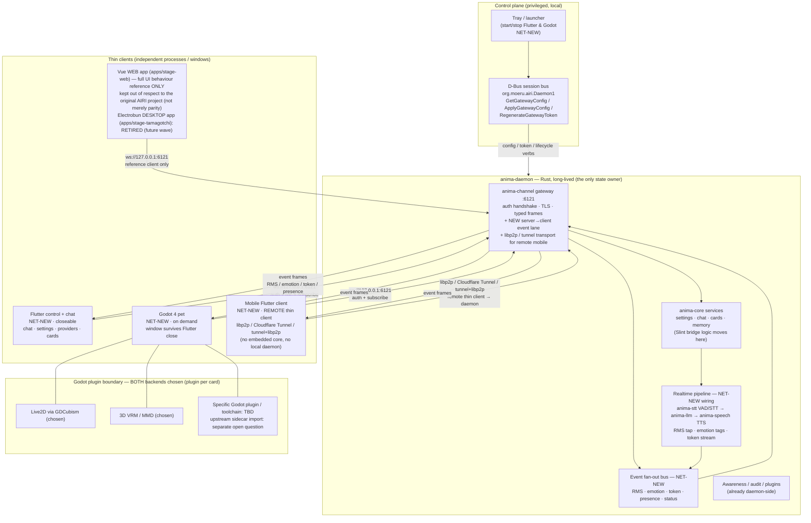

<!-- SPDX-License-Identifier: GPL-3.0-or-later -->
# Design: Flutter Control Surface + On-Demand Godot Pet (GUI Pivot)

**Status:** active · **Date:** 2026-11-21 · **Owner:** project lead
**Scope:** the next GUI generation of AIRI, after the Slint native shell is retired.

This document is the authoritative design contract for the GUI pivot. It is deliberately
written in the same register as [`design-daemon-gateway.md`](./design-daemon-gateway.md),
[`design-daemon-client.md`](./design-daemon-client.md) and
[`design-electrobun-port.md`](./design-electrobun-port.md): decisions, evidence, waves and
exit criteria — not a status log. Completion state belongs in Beads; when code contradicts
this document, the code wins and this document gets fixed.

## 0. How to read this document: verified vs net-new

An external "Gemini opinion" was supplied as **input**, not as fact. Every claim in it was
checked against the tree. The result is recorded in
[§6 Gemini proposal — what is real in-tree vs net-new](#6-gemini-proposal--what-is-real-in-tree-vs-net-new).
Throughout this document:

- **Verified** means the thing exists today, with a file/line citation you can open.
- **Net-new** means it does not exist and must be designed and built as part of this pivot.
- **Reused** means it exists and is carried forward unchanged, or changed only additively.

Nothing in this document authorizes deleting a forensic audit archive, changing the wire
protocol incompatibly, or merging/rebasing/pushing upstream.

---

## 1. Problem statement

AIRI currently ships, or has shipped, three GUI generations: the polished Vue app on
Electrobun/CEF (`apps/stage-tamagotchi`), the native Slint shell (`crates/anima-slint`), and
the web app. The Slint shell duplicates business logic in Rust bridges while the daemon and
core are simultaneously becoming the single owner of state. Maintaining two independent
implementations of the same features (settings, chat, providers, memory, cards, audio) is the
cost the "one core, many surfaces" philosophy exists to avoid
([`docs/README.md`](./README.md)). The requested pivot resolves this by making the daemon the
only owner of business logic and replacing the Slint GUI with two purpose-built thin clients:

- **Flutter** — the control/chat surface. It can be closed without killing the agent or the
  pet.
- **Godot 4** — the pet renderer, started on demand. Its window can stay alive while the
  Flutter dashboard is closed.
- **Vue web app** — remains the working reference for *full UI behaviour*, kept **out of
  respect to the original AIRI project** (user, 2026-11-21), not merely as a parity target.
  The reference is specifically `apps/stage-web` (the Vue **web** app), **not**
  `apps/stage-tamagotchi` (the Electrobun desktop app). The Electrobun/Vue **desktop** app is
  **retired** (decision C, 2026-11-21); its retirement is a future wave — do not delete it here.

The hard constraint that shapes every wave: **today the gateway cannot push events**. Every
post-auth server frame is a reply to a client frame
(`SessionOutcome::replies_only`, `crates/anima-channel/src/session.rs:95-101`), and the only
registered daemon handler is `core.status`
(`crates/anima-daemon/src/gateway.rs:444-453`). Lip-sync, emotion and token streaming therefore
cannot be built as a GUI feature first — the protocol lane must land first.

---

## 2. Decisions

| # | Decision | Value | Why / evidence |
|---|---|---|---|
| 1 | Rust core & gateway | **Reuse `anima-daemon` + `anima-channel` (WS :6121). Do not replace them.** | Verified: authenticated WS gateway with loopback `ws://` / forced `wss://` + locally minted CA, first-message auth (close 1008), 0600 config + UUID token, D-Bus control plane `org.moeru.airi.Daemon1`, and a Rust-canonical specta wire schema drift-checked by `pnpm check:wire-types` (`package.json:20`, generated `packages/server-shared/src/types/generated/anima-channel.ts`). Replacing it would duplicate security, config adoption and TS bindings for no measured gain. |
| 2 | Wire protocol evolution | **Additive server→client event frame + event vocabulary in `crates/anima-channel/src/wire.rs`. Keep protocol version 1.** | Verified gap: `GatewayServerFrame` (`wire.rs:220-275`) has only Auth/Authenticated/Pong/Heartbeat/Rpc/Error; all replies flow through `SessionOutcome::replies_only` (`session.rs:95-101`). `design-daemon-client.md:17-19` (decision 3) already records that a new event lane is required before its Slice C. This is that lane. |
| 3 | Control surface | **Flutter** control/chat app, independent WS client, no local store writer. | Net-new. Must obey decision 1 of `design-daemon-client.md`: the daemon is the single owner of core state; the client holds view state only. |
| 4 | Pet renderer | **Godot 4 + plugins**, on demand, independent WS client; pet window outlives the Flutter window. **Both backends: Live2D via GDCubism AND 3D (VRM/MMD), plugin-selected per card.** | Net-new. Rendering/asset expertise already in-tree is `crates/anima-render` (spine/vrm); the Slint-specific `spine_render.rs`/`spine_rt.rs` adapters are **not** the reusable core. Decision A resolved 2026-11-21: both backends chosen (plugin per card). The specific Godot plugin/toolchain approach is still to be worked out. No GDCubism/VRM/MMD-in-Godot code exists in-tree yet. On desktop, Godot's own scene/animation system means the TypeScript avatar-driving glue (ACT token parsing, expression dispatch, Stage UI context bridge, BroadcastChannel expression relays) does **not** need porting — the daemon emits high-level events (lip-sync RMS, emotion tags, acting cues) that Godot maps into its animation state; this removes bridge boilerplate, not the event→animation mapping. Food for thought (user, 2026-11-21, `airi-wxp.4.8`): the TypeScript glue is still worth *reading* as a reference — not to port, but to learn how existing models' emotion/expression mappings work and re-express that mapping knowledge in Godot's animation state, mapping them to LLM-driven emotion keys for richer expression; "don't port the glue" ≠ "ignore the knowledge in it". Whether to import the upstream Godot sidecar (`docs/UPSTREAM_RADAR.md`, `docs/project-selective-upstream-sync-shortlist.md`) remains a separate open sub-question. |
| 5 | Web app / desktop app | **Vue web app remains the full-UI behaviour reference only; the Electrobun/Vue desktop app is RETIRED.** Vue is a reference WS client. | Verified: the Vue renderer is the daily-driver surface (`design-electrobun-port.md`); its full behaviour is the parity ledger. The kept reference is specifically `apps/stage-web` (Vue **web**), **not** `apps/stage-tamagotchi` (Electrobun), retained **out of respect to the original AIRI project** (user, 2026-11-21), not merely as a parity target. Decision C resolved 2026-11-21: retire the Electrobun desktop app. Its retirement is a **future wave — do NOT delete now**. The shim-retirement work (airi-vxt) is delivered; its remaining scope is superseded by retirement. Do not fork business logic into Dart or GDScript to "catch up" — extend the daemon and rebind all clients. |
| 6 | Slint cutover | **Big-bang deletion of the Slint GUI after domain migration — no surviving fallback.** Move only its business logic into `anima-daemon`. | Net-new deletion; cutover decision resolved 2026-11-21. Once the §4 ports land, delete Slint in one cutover; no Slint fallback path survives. 1,728 lines of `.slint` markup, `run_ui()` (`crates/anima-slint/src/main.rs:100-241`) and Slint-only render adapters go; the bridge logic in §4 is ported, not thrown away. |
| 7 | Realtime pipeline ownership | **The daemon owns VAD/STT → LLM → TTS and emits events.** | **Net-new integration.** The Rust crates exist (`anima-stt`, `anima-llm`, `anima-speech`, `anima-render/src/vrm/lipsync.rs`) but `anima-daemon/Cargo.toml:17-29` links **none** of them. Slint's hearing/speech bridges are intent-only ("nothing pumps audio into the pipeline yet" — `bridges/hearing.rs:22-23`; "in-app playback is not wired" — `bridges/speech.rs:44`). Live lip-sync today is a TS BroadcastChannel (`packages/stage-shared/src/beat-sync/eventa.ts:21-31`). |
| 8 | Control plane & process lifecycle | **D-Bus stays for privileged verbs; tray/GUI drives Flutter/Godot process lifecycle.** | D-Bus methods verified in `crates/anima-daemon/src/control.rs:39,218-231`. Tray-driven launch/stop of GUI processes is net-new and must not become a new privileged data path: the daemon owns state, GUIs are clients. |
| 9 | Serialization strategy | **Keep JSON text frames over the existing WS. MessagePack and UDS are parked, not adopted.** | The external proposal suggests MessagePack and local UDS; neither is justified here. UDS was already evaluated and parked in `design-daemon-gateway.md:110-157` (browser/CEF and mobile clients cannot use it; two transports means two auth stories). MessagePack would need a new codec, new generated bindings for three languages, and a reason — no profiling has supplied one. Revisit only with measurements. |
| 10 | Mobile runtime shape | **Mobile is a REMOTE client of the desktop `anima-daemon` over libp2p, or Cloudflare Tunnel, or tunnel+libp2p. No embedded `flutter_rust_bridge` core; no separate local mobile daemon.** | Decision B resolved 2026-11-21: the user explicitly rejected both original options (embedded `flutter_rust_bridge` core; separate daemon process). Preserves the "one long-lived core" invariant — mobile is a thin client. Requires the security/trust model to cover libp2p peer identity and tunnel trust, not only `wss://` + local CA (see §8). `design-daemon-gateway.md` threat model needs a future update for libp2p/tunnel — do not edit that doc as part of this pivot. |

---

## 3. Architecture

Invariants implied by the diagram:

1. **One state writer.** No Flutter, Godot or Vue process owns settings, chat sessions, cards
   or memory. They hold view state only. This restates `design-daemon-client.md` decision 1
   for the new clients.
2. **No client-to-client dependency.** Flutter does not proxy Godot, and Godot does not talk
   to Flutter. Both are peers on the gateway. Closing Flutter cannot stop the pet.
3. **Events flow one way.** The event lane is daemon→clients. Client→daemon remains the
   existing `rpc` request/reply family; a client wanting more/different events uses an
   explicit subscribe RPC, never a reverse event.
4. **Pet rendering is a client concern.** Expression/pose mapping from RMS/emotion events into
   the avatar lives in Godot plugins. `crates/anima-render/src/vrm/lipsync.rs` is the proven
   smoothing algorithm (fast attack, ~120 ms exponential decay, `[0,1]` clamp) to reproduce
   on the Godot side, not a daemon responsibility. Both Live2D (GDCubism) and 3D (VRM/MMD)
   backends are supported, selected per card by plugin (decision A, 2026-11-21).
5. **Mobile is remote, not a second core.** It reaches the daemon over libp2p / Cloudflare
   Tunnel / tunnel+libp2p as a thin client — no embedded `flutter_rust_bridge` core and no
   separate local mobile daemon (decision B, 2026-11-21).
6. **No fallback GUI survives the cutover.** Slint is deleted big-bang after domain migration,
   and the Electrobun desktop app is retired (future wave); Vue web is the behaviour reference.

---

## 4. What must move into `anima-daemon` / be deleted with Slint

### 4.1 Ports from Slint bridges into the daemon

Every row is a *verified* current location. "Destination" is where the responsibility lands;
exact Rust module layout is a Wave-1 implementation detail.

| Current location (verified) | What it owns today | Destination | Notes |
|---|---|---|---|
| `crates/anima-slint/src/bridges/mod.rs:46-61` | Global store roots: `SMOKE`, `SETTINGS`, `PROFILE`, `PROFILE_EXPLICIT`, `PROVIDERS`, `DATABASE`, `RUNTIME` | `anima-daemon` service state | Statics → injected services. `SMOKE` is a GUI-only flag; it does **not** move. |
| `crates/anima-slint/src/main.rs:54-75` | Profile resolution, `Database::open`, `SettingsStore`, `ProviderRepo`, Tokio runtime handle bootstrap | Daemon bootstrap | The daemon already runs as a session service; add these stores once, not per GUI process. |
| `crates/anima-slint/src/bridges/chat.rs` | Streaming chat state, sessions, transcript messages, broadcast→unbounded-channel drain | `anima-core`/daemon chat service + Wave-0 token events | Known limit to carry forward: switching away mid-stream loses the un-persisted assistant delta (persisted at stream end) — `chat.rs:25-27`. |
| `crates/anima-slint/src/bridges/daemon.rs` (incl. audit hooks) | Audit archive entry point `clear_audit()` | Daemon audit service | Path contract `crates/anima-channel/src/audit.rs:14-27`; retention policy is fixed by `decision-audit-archive-retention.md` — **no GUI deletion path, archives retained forever**. |
| `bridges/capture.rs`, `bridges/hearing.rs`, `bridges/speech.rs` | Audio/voice **intent and settings only** | Daemon realtime pipeline | Net-new: wire `anima-stt` (16 kHz mono capture, 32 ms chunks, RMS meter, Silero VAD v5 ONNX, STT clients), `anima-llm` (streaming), `anima-speech` (TTS + `SpeechEvent::Amplitude` RMS tap at ~15-40 Hz, barge-in). |
| `bridges/providers.rs`, `settings_chat.rs`, `settings_general.rs`, `settings_sections.rs`, `settings_stage.rs` | Provider + settings domain | Daemon settings/provider services | Settings shape stays in `anima-store` sections (single source of truth per `docs/README.md`). |
| `bridges/cards.rs`, `data.rs`, `memory.rs` | Cards, data vault, memory journal | Daemon card/data/memory services | Reuse existing `anima-core`/`anima-store` implementations; do not create a second writer. |
| `bridges/mcp.rs`, `acp.rs`, `discord.rs`, `discord_gateway.rs`, `sync.rs` | External integrations | Daemon services + protocol equivalents | Today reached through eventa channels; see the triage below. |
| `bridges/i18n.rs`, `shell.rs`, `update.rs` | Startup state, shell/version, update checks | Split: startup/i18n state → daemon; shell/update UI → dropped or tray | Pure window chrome does not move to the daemon. |
| `bridges/stage.rs`, `spine.rs`, `mmd.rs`, `theme.rs`, `desktop.rs`, `windows.rs` | Stage/render/model/window state | Mostly **deleted**; avatar model config may become daemon RPC | Rendering moves to Godot plugins; reuse `crates/anima-render` knowledge, not Slint adapters. |

### 4.2 eventa channel triage (consequence of deleting the desktop main process)

The Electrobun port doc measures 227 distinct eventa channels and 77 renderer bridge call
sites (`design-electrobun-port.md:72-76`). With Slint deleted (big-bang, 2026-11-21) and the
Electrobun desktop app retired (decision C, 2026-11-21 — retirement is a future wave, do not
delete now), those channels split three ways:

| Class | Examples | Action |
|---|---|---|
| Desktop-main-only | window chrome, splash choreography, dialogs, toasts, devtools trace | **Drop** with Slint/Electrobun. No protocol equivalent. |
| Daemon-worthy | gateway config, plugins, MCP, ACP, Discord, beat-sync, i18n/startup state | **Port** to gateway `rpc` verbs / Wave-0 event vocabulary. |
| Renderer-internal | `BroadcastChannel('airi::beat-sync')` (`packages/stage-shared/src/beat-sync/eventa.ts:21-31`) | **Not IPC.** Keep inside a single client or replace with daemon events for cross-client sync. |

### 4.3 Delete with Slint

- `crates/anima-slint/src/ui/**/*.slint` — **1,728 lines** of markup (verified by `wc -l`).
- `run_ui()` and Slint platform wiring — `crates/anima-slint/src/main.rs:100-241`.
- Slint-only render adapters `spine_render.rs` / `spine_rt.rs`. Reusable rendering lives in
  `crates/anima-render` (spine/vrm); Godot gets its own plugin path.
- Slint-side global store ownership once §4.1 is ported (no competing writer —
  `design-daemon-client.md` decision 1).
- The Slint WS client plan recorded as not-yet-built in
  `design-daemon-gateway.md:176-177` — retired, replaced by the Flutter and Godot clients.
- Desktop-main-only eventa channels (§4.2).
- **Must not delete:** the audit archives under `<data_dir>/anima-slint/audit/`. Their path
  retains the `anima-slint` component for compatibility, and
  `decision-audit-archive-retention.md` forbids any GUI deletion path and retains every
  `.cleared-*` file forever. Deleting the Slint *app* is not permission to delete its
  *forensic history*.

---

## 5. Open decisions requiring user input

Status as of **2026-11-21**: decisions **A, B and C are RESOLVED** and recorded below. They
remain in this table as the authoritative decision record; none is a blocker any more. Any
future questions on **binding strategy** or **tray/lifecycle ownership** (rows D/E/F, if added)
remain **OPEN** — the user has not decided those and this document does not hard-code an answer.
Also **OPEN** (food for later thought, 2026-11-21): on mobile the Flutter control UI and the Godot
pet must share **one mobile screen** and the composition approach is an undecided future design
question — desktop's separate-window model does not apply (bead `airi-wxp.4.7`).

| ID | Question | Resolution / options | Blocks | Notes |
|---|---|---|---|---|
| **A — RESOLVED 2026-11-21** | Godot character backend | **Both Live2D via GDCubism AND 3D (VRM/MMD), plugin-selected per card.** (Original options: (1) Live2D only via GDCubism; (2) 3D only (VRM/MMD); (3) both, plugin-selected — option 3 chosen.) | Wave 4 (Godot renderer) — unblocked | Determines the plugin boundary, asset pipeline, licensing and whether `crates/anima-render`'s VRM lip-sync logic is ported to GDScript or superseded by Cubism parameter mapping. No GDCubism/VRM/MMD-in-Godot code exists in-tree today. The specific Godot plugin/toolchain approach is still to be worked out. **Still OPEN (separate sub-question):** whether to import the upstream Godot sidecar (`docs/UPSTREAM_RADAR.md`, `docs/project-selective-upstream-sync-shortlist.md`) — not resolved here. |
| **B — RESOLVED 2026-11-21** | Mobile runtime shape | **Mobile is a REMOTE client of the desktop anima-daemon over libp2p, or Cloudflare Tunnel, or tunnel+libp2p. No embedded `flutter_rust_bridge` core, no separate local mobile daemon.** (Both original options — embedded `flutter_rust_bridge` core; separate daemon process with the same WS protocol — explicitly rejected.) | Post-pivot mobile wave / Wave 7 — unblocked | Preserves the "one long-lived core" invariant; mobile is a thin client. Requires the security/trust model to cover libp2p peer identity and tunnel trust, not only `wss://` + local CA (see §8). Per the user (2026-11-21), when no PC is available the daemon may instead be hosted under **Termux on Android** as a separately installed alternative host — this does not reverse D4: no embedded core and no bundled local daemon remain rejected. Flutter/Godot clients stay thin in every topology specifically for battery life. `design-daemon-gateway.md` threat model needs a future update for libp2p/tunnel — do not edit that doc here. |
| **C — RESOLVED 2026-11-21** | Fate of the Electrobun/Vue **desktop** app | **RETIRE the Electrobun desktop app; keep the Vue web app as the full-UI behaviour reference only.** (Original options: (1) keep as a shipped reference client; (2) retire it, keeping Vue web as the behaviour reference only — option 2 chosen.) | Wave 5/6 — resolved | The kept reference is specifically `apps/stage-web` (Vue **web**), retained **out of respect to the original AIRI project** (user, 2026-11-21), not merely as a parity target — **not** `apps/stage-tamagotchi` (Electrobun), which is the app retired. Determines whether the Electrobun bridge, 227 eventa channels and packaging chain remain a maintenance obligation (they do not once retired). **Stage-tamagotchi/Electrobun retirement is a future wave — do NOT delete it now.** The shim-retirement work (airi-vxt) is delivered; its remaining scope is superseded by retirement. |

---

## 6. Gemini proposal — what is real in-tree vs net-new

The external proposal described "headless/tray Rust daemon + Flutter control/chat + on-demand
Godot pet, with Rust owning VAD/STT/LLM/TTS and broadcasting lip-sync RMS (~30-60 Hz), emotion
tags and token streams; MessagePack over local WS/UDS; tray-driven process lifecycle." Its
shape agrees with the user's pivot, but most of its mechanics are not present today. Verified
line by line:

| Gemini claim | In-tree reality (verified) | Verdict |
|---|---|---|
| Rust daemon exists | `crates/anima-daemon` with WS gateway (`gateway.rs`), D-Bus control plane (`control.rs:39`), core status handler (`gateway.rs:444-453`), systemd activation | **Reused** (already shipped) |
| Headless / tray operation | Daemon is headless and D-Bus-activated; **no tray process-lifecycle implementation exists** | **Partly real / net-new tray** |
| Rust owns VAD/STT/LLM/TTS | Crates exist: `anima-stt` (Silero VAD v5, 16 kHz mono capture, RMS), `anima-llm` (streaming), `anima-speech` (`SpeechEvent`, barge-in, RMS tap), `anima-render/src/vrm/lipsync.rs`. But `anima-daemon/Cargo.toml:17-29` links **none** of them; Slint bridges are intent-only (`hearing.rs:22-23`, `speech.rs:44`) | **Net-new integration** |
| Server broadcasts RMS / emotion / token streams | `GatewayServerFrame` has **no event frame** (`wire.rs:220-275`); all server frames are replies (`session.rs:95-101`); only 4 built-in RPC actions (`dispatch.rs:255-258`) and 1 daemon handler (`core.status`) | **Net-new** — Wave 0 blocks everything |
| "~30-60 Hz" lip-sync RMS | In-tree tap emits ~15-40 Hz sample-aligned windows (`anima-speech/src/types.rs:118-120`); existing live lip-sync is a TS BroadcastChannel (`beat-sync/eventa.ts:21-31`); VRM smoothing exists (`lipsync.rs:3-7`) | **Number not verified** — pick a rate in Wave 0/2; do not copy 30-60 Hz |
| MessagePack over local WS | Gateway speaks JSON text frames (`wire.rs:3-10`, `session.rs`); no codec abstraction for a second format | **Net-new, unjustified** — parked (decision 9) |
| Unix Domain Sockets | Already evaluated and parked for browser/CEF + mobile incompatibility and dual-transport cost (`design-daemon-gateway.md:110-157`) | **Parked, not adopted** |
| Flutter control/chat client | No `flutter*` path in-tree (glob verified) | **Net-new** |
| Godot 4 pet renderer | No `godot*` path in-tree (glob verified) | **Net-new** |
| Tray-driven lifecycle | No tray implementation in the daemon | **Net-new** |

The proposal is a useful *target shape*, not a description of current code. Only the first row
is already true.

---

## 7. Waves (dependency-ordered)

Wave 0 is the foundation: without a server-initiated event lane, no GUI can show live lip-sync,
emotion or tokens. Waves 3 and 4 may run in parallel after Wave 2, now that decision A is
resolved (2026-11-21: both Live2D and 3D, plugin-selected per card).

### Wave 0 — Additive server→client event lane and event vocabulary

**Scope**

- Add a new server→client frame variant in `crates/anima-channel/src/wire.rs` (e.g.
  `GatewayServerFrame::Event { … }`) with a typed envelope: event kind, subject (character/actor
  id), monotonic sequence, source timestamp, and a JSON payload. Keep `type`-tagged JSON and
  protocol version 1; never change existing `auth`/`rpc` semantics
  (`design-daemon-client.md:17-19`).
- Define the initial **event vocabulary** (payloads are additive structs, specta-registered):
  - `lip_sync.rms` — `{ actor_id, level: f32, seq, ts_ms }` (rate TBD in Wave 2; not assumed
    30-60 Hz);
  - `emotion.tag` — `{ actor_id, tag, intensity, seq, ts_ms }`;
  - `token.delta` — `{ session_id, message_id, delta, index, final, seq, ts_ms }`;
  - `presence.changed` — `{ subject, state, seq, ts_ms }`;
  - `status.changed` — coarse, secret-free health (mirror the `CoreStatusReply` discipline at
    `wire.rs:120-150`: no tokens, keys, prompts or paths).
- Add a subscribe/unsubscribe RPC so clients opt in per subject; default to no events for
  unsubscribed sessions so existing Vue/Electrobun clients are unaffected.
- Add a shared, bounded event bus in the daemon and fan-out from the gateway's connection
  threads. Define backpressure explicitly: high-rate events (`lip_sync.rms`, `token.delta`)
  are **drop-oldest / coalescing**; control events (`presence`, `status`) are queued.
  `anima-channel` has no tokio and is thread-per-connection (`server.rs:5`), so the bus must not
  block a reader thread.
- Bindings: regenerate the TS file and keep `pnpm check:wire-types` (`package.json:20`) green —
  this serves the Vue reference client. Land a generator plan for **Dart** (Flutter) and
  **GDScript/C#** (Godot) clients with checked-in generated files and a drift check mirroring
  the TS one. The three clients decode the same schema; none hand-writes event shapes.

**Exit criteria**

- A unit/integration test proves the server emits an event with **no preceding client frame**,
  and that an unsubscribed session receives none.
- `pnpm check:wire-types` and `cargo test --workspace --locked` pass.
- Generated TS bindings consumed by a tiny Vue-side probe; Dart/GDScript generator design
  recorded (generated stubs may land in Wave 3/4).
- Event vocabulary table and backpressure policy documented here (this section) match code.

### Wave 1 — Daemon absorbs Slint state and configuration

**Scope:** port §4.1 store roots/bootstrap and settings/providers/cards/memory/session
services; register read/write RPC verbs with sanitized replies; keep the D-Bus control plane
for privileged verbs; adopt the existing config path rather than minting a second one.

**Exit criteria:** daemon starts headless with no GUI attached; settings/providers/cards/session
RPC round-trips green; no Slint code is needed to read or write core state; `core.status`
still passes its no-secrets test (`gateway.rs:908-914`).

### Wave 2 — Daemon-owned realtime pipeline

**Scope:** link `anima-stt`, `anima-llm`, `anima-speech` into `anima-daemon` (currently absent from
`anima-daemon/Cargo.toml`); drive capture → VAD → STT → LLM stream → TTS; emit Wave-0 events for
token deltas, `SpeechEvent::Started/Amplitude/Done/Aborted/Error`, emotion tags and presence;
implement barge-in; choose and document the actual RMS rate (verify against the ~15-40 Hz
in-tree tap before promising anything).

**Exit criteria:** with **no GUI running**, the daemon produces a coherent event stream for a
scripted turn (tokens → speech amplitude → done) verified by a WS probe; replaying the same
turn is deterministic enough for a test; no audio work remains in any Slint bridge.

### Wave 3 — Flutter control/chat client

**Scope:** thin WS client with generated Dart bindings; chat streaming UI, settings,
providers, cards; subscribe to the event vocabulary; tray/launcher can start the pet process;
client holds view state only.

**Exit criteria:** end-to-end chat against the daemon works; closing and relaunching Flutter
loses no core state; stopping Flutter leaves the daemon and (if running) the pet alive.

### Wave 4 — Godot 4 on-demand pet renderer

**Scope:** Godot client with generated GDScript/C# bindings; consume `lip_sync.rms` and
`emotion.tag`; implement expression/pose mapping (reproduce `lipsync.rs` smoothing if using a
morph-target avatar); window lifecycle so the pet can stay while Flutter is closed; plugin
boundary wired per **resolved decision A (2026-11-21): both Live2D via GDCubism AND 3D
(VRM/MMD), plugin-selected per card**. The specific Godot plugin/toolchain approach is still to
be worked out. No GDCubism/VRM/MMD-in-Godot code exists in-tree yet. Whether to import the
upstream Godot sidecar (`docs/UPSTREAM_RADAR.md`,
`docs/project-selective-upstream-sync-shortlist.md`) remains a separate open sub-question and is
not resolved by this wave.

**Exit criteria:** pet animates lip-sync and emotion from daemon events; survives Flutter
closure; can be started/stopped on demand; both avatar backends and per-card plugin selection
recorded in this document (decision A, 2026-11-21) before implementation begins.

### Wave 5 — Vue reference reconciliation

**Scope:** consume Wave-0 events in the Vue **web** reference client; publish the full
UI-behaviour parity ledger against Vue; update `rosetta-stone.md` and the port manifest with the
new client topology; apply **resolved decision C (2026-11-21)**: the Vue web app is the
full-UI behaviour reference only and the Electrobun desktop app is retired. Electrobun /
stage-tamagotchi **retirement is a future wave — do NOT delete it in this wave**. The
shim-retirement work (airi-vxt) is delivered; its remaining scope is superseded by retirement.

**Exit criteria:** every user-visible behaviour has exactly one owning daemon service and a
documented reference in Vue web; no feature implemented twice in Dart/GDScript and TS; the
Electrobun desktop app is not yet deleted from the tree.

### Wave 6 — Slint big-bang deletion and doc convergence

**Scope:** **big-bang deletion after domain migration — no surviving fallback** (Slint cutover
decision resolved 2026-11-21). Only after the §4.1 ports and Wave 1 domain migration land,
delete §4.3 in one cutover; remove `crates/anima-slint` from the workspace; update AGENTS.md,
`docs/README.md`, `rosetta-stone.md` and `design-daemon-gateway.md` so Slint is described as
retired rather than live. Preserve audit archives (no deletion path). Do not delete the
Electrobun desktop app here — its retirement is a separate future wave (decision C).

**Exit criteria:** `cargo test --workspace --locked` green with Slint gone; no Slint fallback
path survives; no doc still names Slint as a shipping GUI; archive files untouched;
stage-tamagotchi/Electrobun still present pending its own retirement wave.

### Wave 7 — Packaging, tray, mobile, Electrobun retirement (follow-up)

**Scope:** tray lifecycle polish and installers; the mobile client per **resolved decision B
(2026-11-21)** — a REMOTE thin client of `anima-daemon` over libp2p, or Cloudflare Tunnel, or
tunnel+libp2p, hosted on the PC or, when no PC is available, under **Termux on Android** as an
alternative host, with **no embedded `flutter_rust_bridge` core and no bundled local daemon**.
The Flutter/Godot UI stays thin in every topology to save battery life. The security/trust model
must cover libp2p peer identity and tunnel trust; `design-daemon-gateway.md` threat model needs a
future update for libp2p/tunnel. Also schedule
the **stage-tamagotchi/Electrobun desktop retirement (decision C)** as a future wave — do not
delete it now. Lifecycle ownership (tray vs daemon) remains an OPEN item (row D/E/F) and must
not be assumed.

**Exit criteria:** installed artifacts run; mobile is a remote thin client over
libp2p/tunnel with no embedded core or local daemon; libp2p/tunnel trust-model update recorded
as a follow-up; Electrobun retirement scheduled, not silently executed.

---

## 8. Risks and non-goals

- **No rate limiting or backpressure exists today.** `anima-channel` has no rate limiter; the
  gateway has a 1 MiB frame cap (`MAX_WS_PAYLOAD_BYTES`, `crates/anima-channel/src/ws.rs:341`),
  a 75 s dead-peer TTL (`DEAD_PEER_TTL`, `server.rs:41`) and thread-per-connection handling
  (`server.rs:5`). A high-rate event stream multiplied by several clients needs the Wave-0
  bounded bus and drop policy; without it, a slow client or a noisy producer can stall reader
  threads. (The Gemini proposal assumed 30-60 Hz, but the verified in-tree `SpeechEvent::Amplitude`
  tap emits ~15-40 Hz — see §6; do not copy 30-60 Hz.) Large payloads (base64 images) must be
  chunked out-of-band, not pushed as events.
- **Thread-per-connection, no async in `anima-channel`.** Fan-out must not call blocking writes
  from the pipeline. Treat the event bus as the only crossing point; profile before adding any
  second transport.
- **Security posture must expand for remote mobile.** Local clients keep the existing
  token-only auth, same-uid trust, no revocation of live sessions on rotation, LAN/VPN-only
  posture recorded in `design-daemon-gateway.md:53-91`, with `wss://` mandatory beyond loopback
  and the Godot client's TLS trust path designed, not assumed. Decision B (2026-11-21) adds a
  REMOTE mobile client over **libp2p, Cloudflare Tunnel, or tunnel+libp2p**, so the trust model
  must now also cover **libp2p peer identity** and **tunnel trust** — not only `wss://` + local
  CA. A daemon hosted under **Termux on Android** is another deployment topology the same trust
  model must cover. The Flutter/Godot UI stays thin in every topology for **battery life**; no
  embedded core and no bundled daemon are still rejected. `design-daemon-gateway.md`'s threat
  model needs a **future update** for libp2p/tunnel; that doc is not edited as part of this pivot.
- **Forensic archives have no GUI deletion path.** Per `decision-audit-archive-retention.md`,
  `.cleared-*` archives accumulate forever and must not gain a Flutter/Slint/Godot delete
  button. Wave 6 deletes the *app*, not the archives.
- **Specta drift.** Adding wire types changes the generated TS file; Dart/GDScript generation
  is net-new and must gain equivalent drift checks or the three clients will diverge.
- **Decisions recorded; remaining open sub-questions must not be assumed.** A, B and C are
  resolved as of 2026-11-21 and no longer block Waves 4/5/7. Still OPEN: whether to import the
  upstream Godot sidecar (`docs/UPSTREAM_RADAR.md`,
  `docs/project-selective-upstream-sync-shortlist.md`), plus any binding-strategy or
  tray/lifecycle-ownership questions (rows D/E/F). None may be hard-coded as answered.
- **Non-goals for this pivot:** changing auth/token model, introducing MessagePack or UDS,
  reworking the Godot asset pipeline into `anima-render`, adding GUI audit deletion, or porting
  upstream code without separate authorization.

---

## 9. Canonical cross-links

- [`design-daemon-gateway.md`](./design-daemon-gateway.md) — gateway topology, TLS/auth
  threat model, D-Bus control plane, parked transports (do not re-derive here). Its threat
  model needs a **future update** for libp2p peer identity and Cloudflare Tunnel trust
  (decision B, 2026-11-21); not edited as part of this pivot.
- [`UPSTREAM_RADAR.md`](./UPSTREAM_RADAR.md) and
  [`project-selective-upstream-sync-shortlist.md`](./project-selective-upstream-sync-shortlist.md)
  — reference for the still-OPEN sub-question of importing the upstream Godot sidecar
  (decision A does not resolve this). More broadly, upstream AIRI is retained as a tracked,
  read-only reference and a source of features selectively adopted into the Rust core via
  these documents; this pivot does **not** authorize any upstream fetch, merge, rebase or push.
- [`design-daemon-client.md`](./design-daemon-client.md) — the client contract this document
  inherits; decision 3 is the original requirement for the Wave-0 event lane, decisions 1/5
  the single-writer and sequencing rules.
- [`rosetta-stone.md`](./rosetta-stone.md) — concept→code map; the source of truth for where
  TS behaviour lives before and after the move.
- [`design-electrobun-port.md`](./design-electrobun-port.md) — measured Vue/Electrobun surface
  and eventa channel counts that §4.2 triages; resolved decision C (2026-11-21: retire the
  Electrobun desktop app) concerns this surface.
- [`decision-audit-archive-retention.md`](./decision-audit-archive-retention.md) — mandatory
  retention/no-GUI-deletion policy that constrains the Slint deletion in Wave 6.
- [`docs/README.md`](./README.md) — "one core, many surfaces" philosophy; this document
  updates its surface list when Wave 6 lands.
