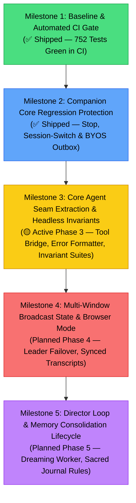

# Canonical Test Suite Catalog, Assertion Matrix & Regression Parity Blueprint

**Document ID:** `docs/project-testing-parity.md`
**Status:** Living Canonical Catalog & Strategy · Active
**Last Verified Baseline:** 2026-11-08 (Coverage Pass: root wiring of nan0-runtime / speech-transformer-chem / speech-transformer-math + full catalog reconciliation; verified with `pnpm vitest run`, `--coverage`, and `node scripts/audit-test-catalog.mjs`)
**Monorepo Coverage Baseline:** **372 root-collected test suites · 4,437 root-collected tests (4,429 passing, 8 skipped, 0 failures)** — this catalog records 367 suites / 4,438 tests; see the §1.1 note for the reconciliation scope
**CI Automated Enforcement:** Active via `.github/workflows/ci.yml` (`unit-test` job)
**Related Documents:**
- [`AGENTS.md`](../AGENTS.md) — Critical git status reporting and commit/release safety rules.
- [`docs/rosetta-stone.md`](./rosetta-stone.md) — Canonical concept-to-file path index.
- [`docs/project-specialized-skills.md`](./project-specialized-skills.md) — Skill domain catalog (including `airi-codebase-verification`).
- [`docs/archive/architecture-chat-orchestrator-decomposition.md`](./archive/architecture-chat-orchestrator-decomposition.md) — Core agent seam extraction specification.
- [`docs/UPSTREAM_RADAR.md`](./UPSTREAM_RADAR.md) — Upstream commit delta & PR tracking ledger.

> [!IMPORTANT]
> **Consult Section 1 of this catalog before assuming a feature lacks test coverage or authoring duplicate test files.** Whenever adding, renaming, or refactoring test suites, update this catalog and run `node scripts/audit-test-catalog.mjs` to maintain repository integrity.

---

## 1. Canonical Test Suite Catalog & Domain Inventory

### 1.1 Monorepo Package Summary
| Package / Workspace | Test Suites (Files) | Total Tests | Primary Subsystem Focus |
|---|:---:|:---:|---|
| [`packages/stage-ui`](../packages/stage-ui) | 254 | 3,053 | Arcade, Chat, Pacing, WebGPU Workers, BYOS Sync, Providers, Live2D, Memory, Artistry, Proactivity, MCP, Gemini Live Bidi, Chat Input Bridge, Audio Device Routing, Local Mesh Renderer Store, Agentic OS Nap & Presence, Nap-Chat Session Memory, Search Index Chunking, FlowMDM, Tool-Call Budget, Math Speech |
| [`packages/nan0-runtime`](../packages/nan0-runtime) | 26 | 355 | Nan0 Cognition Runtime, Thought Engine, Emotional Dynamics, Goal & Prediction Systems, Kernel↔Jev bridge, Subconscious Shadow Engine |
| [`packages/live2d-runtime`](../packages/live2d-runtime) | 5 | 79 | Live2D Scripting DSL VM, Command Parser, Selector, Template, VarStore |
| [`packages/stage-pages`](../packages/stage-pages) | 4 | 47 | Settings Topology & Devtools Context Flow Formatters |
| [`apps/stage-tamagotchi`](../apps/stage-tamagotchi) | 22 | 197 | Desktop Multi-Window, Display Bounds, Location, Widgets, Airi Plugins, Agentic Companion Share, Local Mesh (libp2p) Identity / Pairing / Transport / Config, Nap-Chat Protocol, Agentic HTTP Boundary |
| [`apps/server`](../apps/server) | 4 | 29 | Server Character & Provider API Endpoints / Services |
| [`packages/pipelines-audio`](../packages/pipelines-audio) | 4 | 30 | Audio Speech Pipeline, Lead Coordinator, Pause Aligner, TTS Chunker |
| [`packages/stage-shared`](../packages/stage-shared) | 9 | 78 | Audio Format Detection, Text Normalization, Caption Sentiment Scoring, Directional Light Orbit, Local Storage Manual Reset, Peers & Transport Registry |
| [`packages/cap-vite`](../packages/cap-vite) | 4 | 22 | Capacitor Vite Plugin, CLI Integration & Native Wrappers |
| [`packages/plugin-sdk`](../packages/plugin-sdk) | 1 | 22 | Plugin SDK Host Core Lifecycle |
| [`packages/server-runtime`](../packages/server-runtime) | 5 | 21 | Server Route Middleware, Config, Env, Server Bootstrap |
| [`packages/server-sdk`](../packages/server-sdk) | 2 | 7 | Server SDK Client & Node Process Utilities |
| [`packages/server-shared`](../packages/server-shared) | 1 | 1 | Server-Shared Entry-Point Loading |
| [`packages/speech-transformer-chem`](../packages/speech-transformer-chem) | 6 | 38 | Chemistry Spoken-Text Renderer and Per-Locale Word Tables (root-collected since 2026-11-08) |
| [`packages/speech-transformer-math`](../packages/speech-transformer-math) | 10 | 346 | Math Spoken-Text Renderer, Lowering/Parsing/Rendering, and Per-Locale Word Tables (root-collected since 2026-11-08) |
| [`packages/model-driver-magic-live2d`](../packages/model-driver-magic-live2d) | 4 | 21 | Live2D Pose Driver, Filter, and Pose Coverage |
| [`packages/motion-driver-magic`](../packages/motion-driver-magic) | 3 | 12 | Motion Crossfade, VAR/HMM Generators |
| [`packages/stage-ui-live2d`](../packages/stage-ui-live2d) | 1 | 7 | Live2D Focus Bias Composable |
| [`packages/stage-ui-mmd`](../packages/stage-ui-mmd) | 4 | 20 | MMD Morphs, Morph Constants, Model & Zip Loaders |
| [`packages/stage-ui-three`](../packages/stage-ui-three) | 2 | 5 | Three.js Trace Context & Scene Snapshots |
| [`packages/vite-plugin-warpdrive`](../packages/vite-plugin-warpdrive) | 2 | 19 | WarpDrive URL Rendering and S3 Provider |
| [`integrations/oh-my-pi/airi-plugin-oh-my-pi`](../integrations/oh-my-pi/airi-plugin-oh-my-pi) | 3 | 16 | Oh-My-Pi Plugin Config, Format, and Index Gating |
| [`packages/i18n`](../packages/i18n) | 1 | 3 | Canonical Locales Discovery, Base YAML Syntax/Duplicates, Onboarding V3 100% Parity Assertion |

| **Monorepo Vitest Baseline** | **372 Suites** | **4,437 Tests** | **Automated Zero-Failure Headless Test Baseline** |

> [!NOTE]
> **2026-11-08 reconciliation.** The root `vitest.config.ts` projects array previously omitted `packages/nan0-runtime`, `packages/speech-transformer-chem`, and `packages/speech-transformer-math`, so 42 suites / 739 tests never ran under root `pnpm test` or in CI. All three are root-collected since 2026-11-08 (see the `Reconciled Upstream Suites` section in §1.2 for the suites this uncovered). The remaining difference between the baseline row above and this catalog's row counts is the five new suites added in this pass (mock contract, background seeding, turn-chunker, tool-call-budget, math-speech) plus the compaction distill test, catalogued here; environment-gated skips (`llm.test.ts` OpenRouter key, S3/Aliyun credentials, Live2D scratch models) remain root-collected but contribute 8 skipped tests.
---


## 1.2 Domain Test Matrix & Assertion Boundaries

### Domain Groups

#### Conversational Pacing & Dynamic Spoken Asides
| Invariant / Subsystem | Test Path | Tests | Runner / Env | CI Inclusion | What Assertions Directly Establish | Coverage Boundary & Known Limits |
|---|---|:---:|:---:|:---:|---|---|
| **Turn Pacing Coordinator** | [`packages/stage-ui/src/libs/pacing/turn-pacing-coordinator.test.ts`](../packages/stage-ui/src/libs/pacing/turn-pacing-coordinator.test.ts) | 28 | Node / Fake Timers | Blocking in CI | Fast direct answer suppression (200ms TTFT), 1800ms cold deadline arming, 1200ms vs 1400ms answer vs filler races, barge-in cancellation, long CoT cadence, dynamic asides, deep CoT profiles. | Verifies coordinator timing state and filler decision rules; does not mount AudioContext or verify hardware audio output. |
| **Playback Bridge** | [`packages/stage-ui/src/libs/pacing/pacing-playback-bridge.test.ts`](../packages/stage-ui/src/libs/pacing/pacing-playback-bridge.test.ts) | 26 | Node / Fake Timers | Blocking in CI | Playback bridge integration, filler audio queue scheduling, audio completion handoff to main speech. | Verifies scheduling contracts and event emitters; mocks web audio element playback. |
| **Category Classifier** | [`packages/stage-ui/src/libs/pacing/category-classifier.test.ts`](../packages/stage-ui/src/libs/pacing/category-classifier.test.ts) | 11 | Node / Pure TS | Blocking in CI | Text sentiment, thinking intent, and aside category classification algorithms for aside selection. | Pure deterministic heuristic unit tests; does not exercise LLM-based categorization. |
| **Pacing Audio Cache** | [`packages/stage-ui/src/libs/pacing/pacing-cache.test.ts`](../packages/stage-ui/src/libs/pacing/pacing-cache.test.ts) | 6 | Node / Pure TS | Blocking in CI | Synthesized filler audio LRU caching, key hashing, eviction thresholds, and cache hit metrics. | Verifies in-memory cache data structure; does not test disk persistence or binary codecs. |
| **Pacing Policy** | [`packages/stage-ui/src/libs/pacing/pacing-policy.test.ts`](../packages/stage-ui/src/libs/pacing/pacing-policy.test.ts) | 4 | Node / Pure TS | Blocking in CI | Persisted pacing policy configuration, thresholds, and character card synthesis budget overrides. | Tests Valibot policy parsing and default fallbacks; does not mount Pinia stores. |
| **Pacing Prewarm** | [`packages/stage-ui/src/libs/pacing/pacing-prewarm.test.ts`](../packages/stage-ui/src/libs/pacing/pacing-prewarm.test.ts) | 3 | Node / Pure TS | Blocking in CI | Background audio prewarming and voice pipeline readiness checks. | Verifies prewarm state machine; does not execute actual TTS inference. |

#### Chat Lifecycle, Streaming & Session State
| Invariant / Subsystem | Test Path | Tests | Runner / Env | CI Inclusion | What Assertions Directly Establish | Coverage Boundary & Known Limits |
|---|---|:---:|:---:|:---:|---|---|
| **Stop & Speech Cancellation** | [`packages/stage-ui/src/stores/chat-cancellation.test.ts`](../packages/stage-ui/src/stores/chat-cancellation.test.ts) | 3 | Node / JSDOM Stubs | Blocking in CI | Abort signal triggers during LLM streaming; `stopCurrentGeneration` cancels post-LLM speech when `sending === false` and `isSpeaking === true`; `onGenerationStopped` hook fires; secondary window broadcast stop works. | Verifies store signal propagation, hook emission, and `airi-speaking-state` BroadcastChannel contracts; does not verify actual speaker hardware silencing. |
| **Queue & Cancellation Invariants** | [`packages/stage-ui/src/stores/chat/queue-cancellation.test.ts`](../packages/stage-ui/src/stores/chat/queue-cancellation.test.ts) | 4 | Node / Pinia | Blocking in CI | Q1-Q4, C5: Serial queue dispatch, non-rejecting user Stop, session-scoped pending eviction, and post-cancellation send. | Headless Pinia orchestrator test; mocks provider stream boundary. |
| **Generation Invalidation & Navigation** | [`packages/stage-ui/src/stores/chat/generation-invalidation.test.ts`](../packages/stage-ui/src/stores/chat/generation-invalidation.test.ts) | 3 | Node / Pinia | Blocking in CI | S1-S3: Session navigation changes UI projection without invalidating generation; Stop and reset drop non-cooperative late callbacks. | Headless Pinia orchestrator test; mocks provider stream boundary. |
| **Session Switch Race Safety** | [`packages/stage-ui/src/stores/session-switch-race.test.ts`](../packages/stage-ui/src/stores/session-switch-race.test.ts) | 2 | Node / Pinia | Blocking in CI | Verifies tokens from background session do not leak into active session and restores in-flight stream state on switch back. | Headless Pinia orchestrator test; mocks provider stream boundary. |
| **Lifecycle Hook Determinism** | [`packages/stage-ui/src/stores/chat/lifecycle-contracts.test.ts`](../packages/stage-ui/src/stores/chat/lifecycle-contracts.test.ts) | 5 | Node / Pinia | Blocking in CI | Deterministic hook trace sequences across ordinary, Stop, NO_REPLY, 401/403 failure, and triggerOnly branches. | Tests orchestrator lifecycle hook bus and error cards. |
| **Error Presentation Formatting** | [`packages/stage-ui/src/stores/chat/error-formatter.test.ts`](../packages/stage-ui/src/stores/chat/error-formatter.test.ts) | 6 | Node / Pure TS | Blocking in CI | Formats Markdown error cards, extracts JSON technical details, identifies 401/403/unauthorized auth errors, and provides suggested fixes. | Pure helper unit tests; does not mount Pinia stores or invoke UI renders. |
| **Tool Syntax Recognition & Argument Parsing** | [`packages/stage-ui/src/stores/chat/tool-bridge.test.ts`](../packages/stage-ui/src/stores/chat/tool-bridge.test.ts) | 19 | Node / Pure TS | Blocking in CI | Marker syntax recognition across 5 dialects (`<\|...\|>`, `[call_tool:...]`, `<tool_call>`), lenient JSON parsing recovery, argument key-value decoding, and truncation tolerance. | Pure helper unit tests; does not mount Pinia stores or execute tools. |
| **Intrusion & Climax Prompt Formatting** | [`packages/stage-ui/src/stores/chat/intrusions.test.ts`](../packages/stage-ui/src/stores/chat/intrusions.test.ts) | 18 | Node / Pure TS | Blocking in CI | Pure evaluation of goal-driven Dating Sim victory/defeat climax prompts, elapsed-minute calculation, empty entry support, and dream, journal, and artistry prompt template interpolation. | Pure helper unit tests; does not mount Pinia stores or access staging refs. |
| **Grounding Context Formatting & Assembly** | [`packages/stage-ui/src/stores/chat/grounding-assembler.test.ts`](../packages/stage-ui/src/stores/chat/grounding-assembler.test.ts) | 14 | Node / Pure TS | Blocking in CI | Formatting of 8 contextual grounding blocks (VLM analysis, environmental awareness, STMM/lifetime pass-through, semantic memories, recent topic weights, director scratchpad, salience telemetry), order preservation, and null exclusion. | Pure helper unit tests; does not mount Pinia stores or execute async sensor/memory queries. |
| **Prompt & Grounding Assembly** | [`packages/stage-ui/src/stores/chat/prompt-contracts.test.ts`](../packages/stage-ui/src/stores/chat/prompt-contracts.test.ts) | 6 | Node / Pinia | Blocking in CI | P1-P4, Intrusions: VLM forward timing, image stripping on failure, exact 8-part grounding order, and pre-stream intrusion staging consumption. | Tests prompt assembly and staging clear timing. |
| **Bridged Tool Runtime Loop** | [`packages/stage-ui/src/stores/chat/tool-bridge-runtime.test.ts`](../packages/stage-ui/src/stores/chat/tool-bridge-runtime.test.ts) | 5 | Node / Pinia | Blocking in CI | Maximum 5-round outer bridged loop bound, early round-1 exit, multi-turn tool result association, malformed marker recovery, and marker syntax dialects. | Tests outer bridged loop in performSend; does not test native provider loop in llm.ts. |


| **Message Deduplication & Sync Merge** | [`packages/stage-ui/src/stores/chat/session-message-merge.test.ts`](../packages/stage-ui/src/stores/chat/session-message-merge.test.ts) | 5 | Node / Pure TS | Blocking in CI | Session message deduplication, timestamp sorting, and remote sync merge rules. | Tests pure merge algorithm; does not test remote HTTP sync transport. |
| **Message Payload Sanitization** | [`packages/stage-ui/src/stores/llm.sanitize.test.ts`](../packages/stage-ui/src/stores/llm.sanitize.test.ts) | 5 | Node / Pure TS | Blocking in CI | Stripping images when vision is disabled, converting error roles to user messages, and flattening text parts. | Pure payload transformation unit tests. |
| **Chat Bubble Virtual Keying** | [`packages/stage-ui/src/components/scenarios/chat/message-key.test.ts`](../packages/stage-ui/src/components/scenarios/chat/message-key.test.ts) | 4 | Node / Pure TS | Blocking in CI | Stable key resolution for virtualized chat transcript items with missing IDs or timestamps. | Pure key computation tests; does not mount Vue virtual scroller components. |
| **Chat Scenarios Utility** | [`packages/stage-ui/src/components/scenarios/chat/utils.test.ts`](../packages/stage-ui/src/components/scenarios/chat/utils.test.ts) | 1 | Node / Pure TS | Blocking in CI | Helper functions for chat UI formatting. | Unit helper test. |
| **Multi-Actor Turn Slices** | [`packages/stage-ui/src/utils/chat-actor-slices.test.ts`](../packages/stage-ui/src/utils/chat-actor-slices.test.ts) | 9 | Node / Pure TS | Blocking in CI | Parsing `<\|ACTOR:name\|>` markers, appending actor-aware slices, and demarcating dialogue turns. | Pure slice parsing tests; does not verify stage avatar voice assignment. |
| **Discord Outbound Formatting & Inbound Seams** | [`packages/stage-ui/src/stores/modules/discord-outbound.test.ts`](../packages/stage-ui/src/stores/modules/discord-outbound.test.ts) | 16 | Node / Pure TS | Blocking in CI | Outbound Discord reply formatting (stripping ACT/DELAY tokens, mapping ACTOR prefixes, journal/tool results, error envelopes) and inbound/steer interruption formatting. | Pure transformation unit tests; does not mount Discord bot gateway or Electron IPC. |
| **Gemini Live Multimodal Bidi API Seams** | [`packages/stage-ui/src/stores/modules/gemini-live-seams.test.ts`](../packages/stage-ui/src/stores/modules/gemini-live-seams.test.ts) | 45 | Node / Pure TS | Blocking in CI | Gemini function declaration schema purification ($schema, additionalProperties, anyOf/oneOf nullables, required adjustments), token count integer sanitation, multi-format usage extraction, WebSocket setup message framing with mandatory AUDIO and grounding toggle, 4 marker parsing dialects without regex argument mangling, wire response formatting, turn tool rate limiting, and 16-bit PCM little-endian audio decoding. | Pure protocol transformation and decoder tests; does not connect live WebSocket or stream live microphone audio. |
| **Chat Input Bridge Seams** | [`packages/stage-ui/src/stores/chat/input-bridge.test.ts`](../packages/stage-ui/src/stores/chat/input-bridge.test.ts) | 34 | Node / Pure TS | Blocking in CI | Serialization of broadcast payloads, stripping non-serializable functions and rejecting circular references, chatProvider string ID normalization, clientMessageId echo matching with top-level precedence over nested metadata, triggerOnly verification bypass, inbound action dispatch with cross-session auto-switch, and acknowledgment coordinator lifecycle. | Pure seam unit tests; does not mount Pinia stores, BroadcastChannel, or DOM APIs. |
| **Chat Input Bridge Runtime Relay** | [`packages/stage-ui/src/stores/chat/input-bridge-runtime.test.ts`](../packages/stage-ui/src/stores/chat/input-bridge-runtime.test.ts) | 6 | Node / Pinia & Fake Timers | Blocking in CI | Headless Pinia store runtime relay contracts: secondary-window successful echo resolution, 5000ms timeout rejection and timer/watcher cleanup, transport/serialization failure immediate cleanup, triggerOnly bypass without timer, main window inbound session alignment before ingest and local tool injection into LLM stream, and stop broadcast session cancellation. | Headless Pinia orchestrator test with controlled transport and fake timers; does not mount Electron BrowserWindow or physical WebSocket relays. |
| **Arcade Agent & Turn Execution** | [`packages/stage-ui/src/composables/arcade/arcade-agent.test.ts`](../packages/stage-ui/src/composables/arcade/arcade-agent.test.ts) | 7 | Node / Pinia | Blocking in CI | Resolves arcade profile by game title, initializes idle state, executes turn plan actions sequentially, and handles emergency interrupts. | Headless agent test; mocks game adapter. |
| **Arcade Strategy & Reflex Synthesizer** | [`packages/stage-ui/src/composables/arcade/use-arcade-synthesizer.test.ts`](../packages/stage-ui/src/composables/arcade/use-arcade-synthesizer.test.ts) | 5 | Node / Pure TS | Blocking in CI | Generates persona-driven strategy narrative, tactical directives, hazard avoidance doctrine, 2048 corner-anchoring reflex code, sandbox tick runner with latency profiling, and AcquiredGameKnowledge payload assembly. | Headless composable test; mocks performance timing and simulated frame entropy. |
| **Nap-Chat Model Eligibility, Turn Prompt & Session Lifecycle** | [`packages/stage-ui/src/stores/nap-chat.test.ts`](../packages/stage-ui/src/stores/nap-chat.test.ts) | 26 | Node / Pinia & Fake Timers | Blocking in CI | `isNapChatEligibleModel` allows a local deployment even with a wrong `pricing`, a self-declared free provider, and a curated free-catalog hit on an otherwise-paid provider (including a composite `provider:instance` key against the bare provider), and refuses a non-local non-free model, an unselected model, and an unknown provider key; the turn prompt quotes peer text as conversation input and never as a directive; session lifecycle observes a proposal, accepts only one addressed to this node while echoing the minted nonce, refuses a foreign address silently, refuses a second proposal while a session is open, never accepts when the model gate refuses and publishes nothing, drops turns for a foreign session or peer or off-sequence `seq`, refuses a nonce this node did not mint, ignores a turn above the announced cap, closes locally on a peer close, closes as `stalled` when the silence bound fires and as turn-cap at the cap, hands every closed session to the write-back seam exactly once, and runs both proposer and acceptor through strict alternation. | Headless Pinia store test with a fake timer and a mocked publish/seam boundary; does not open a real libp2p session or invoke an LLM. |
| **Nap-Chat Memory Write-Back & Return Recap** | [`packages/stage-ui/src/stores/nap-chat-surface.test.ts`](../packages/stage-ui/src/stores/nap-chat-surface.test.ts) | 13 | Node / Pinia | Blocking in CI | Persists one agentic ledger event and one dream journal entry per completed session; writes no echo chips, short-term memory, or lifetime memory; writes only the ledger event when the model gate refused; never fires while the user is present; surfaces exactly one recap on the `away → active` and `idle → active` edges and never again, not on a direct `away → idle` transition; consumes a pending recap once across a window restart; never moves the active session id; arms nothing for a stalled or recap-less session; never inscribes without an active session; keeps the ledger payload to an allow-list; never inscribes user session text into the journal entry or the spoken turn. | Headless Pinia store test over stubbed memory and journal seams; does not execute memory consolidation or write to a real IndexedDB store. |

#### Nan0 Cognition Runtime (`packages/nan0-runtime`)
| Invariant / Subsystem | Test Path | Tests | Runner / Env | CI Inclusion | What Assertions Directly Establish | Coverage Boundary & Known Limits |
|---|---|:---:|:---:|:---:|---|---|
| **Nan0 Attention Engine** | [`packages/nan0-runtime/src/attention/Nan0AttentionEngine.test.ts`](../packages/nan0-runtime/src/attention/Nan0AttentionEngine.test.ts) | 3 | Node / Pure TS | Blocking in CI | Attention stream definitions, stream priorities, topic tracking, and observation queueing. | Pure priority queue and state tests. |
| **Nan0 Capability Registry** | [`packages/nan0-runtime/src/capabilities/Nan0CapabilityRegistry.test.ts`](../packages/nan0-runtime/src/capabilities/Nan0CapabilityRegistry.test.ts) | 12 | Node / Pure TS | Blocking in CI | Dynamic capability registration, parameter validation, execution gating, and capability discovery. | Contract registry validation; mocks actual tool execution. |
| **Nan0 Conversation Continuity** | [`packages/nan0-runtime/src/continuity/ConversationContinuity.test.ts`](../packages/nan0-runtime/src/continuity/ConversationContinuity.test.ts) | 17 | Node / Pure TS | Blocking in CI | Conversation thread tracking, topic shift detection, thread resumption, and label normalization. | Deterministic continuity state tests. |
| **Nan0 Decision Engine** | [`packages/nan0-runtime/src/decision/Nan0DecisionEngine.test.ts`](../packages/nan0-runtime/src/decision/Nan0DecisionEngine.test.ts) | 23 | Node / Pure TS | Blocking in CI | Decision evaluation, speak vs silence gating, action authorization, and wait state handling. | Pure decision logic and scoring tests. |
| **Nan0 Kernel Observatory** | [`packages/nan0-runtime/src/diagnostics/Nan0KernelObservatory.test.ts`](../packages/nan0-runtime/src/diagnostics/Nan0KernelObservatory.test.ts) | 18 | Node / Pure TS | Blocking in CI | Diagnostic telemetry collection, event sampling, redaction rules, and bounded event buffers. | In-memory diagnostic ring buffer tests. |
| **Nan0 Emotional Dynamics** | [`packages/nan0-runtime/src/emotional/Nan0EmotionalDynamics.test.ts`](../packages/nan0-runtime/src/emotional/Nan0EmotionalDynamics.test.ts) | 4 | Node / Pure TS | Blocking in CI | Emotional vector baselines, decay half-lives, perturbation rules, mood derivation, and decision shift modifiers. | Pure mathematical affective vector algorithms. |
| **Nan0 Goal Engine** | [`packages/nan0-runtime/src/goals/Nan0GoalEngine.test.ts`](../packages/nan0-runtime/src/goals/Nan0GoalEngine.test.ts) | 4 | Node / Pure TS | Blocking in CI | Goal lifecycle, priority re-ranking, progress tracking, and goal abandonment. | In-memory goal hierarchy tests. |
| **Nan0 Goals State** | [`packages/nan0-runtime/src/goals/Nan0Goals.test.ts`](../packages/nan0-runtime/src/goals/Nan0Goals.test.ts) | 27 | Node / Pure TS | Blocking in CI | Long-term and short-term goal state management, serializable invariants, and completion criteria. | Pure state transformation tests. |
| **Nan0 Heartbeat Engine** | [`packages/nan0-runtime/src/heartbeat/Nan0HeartbeatEngine.test.ts`](../packages/nan0-runtime/src/heartbeat/Nan0HeartbeatEngine.test.ts) | 4 | Node / Fake Timers | Blocking in CI | Heartbeat cadence, autonomous event dispatch, idle ticking, and timer lifecycle. | Unit tests using fake timers; does not mount OS timers. |
| **Nan0 Host Adapter** | [`packages/nan0-runtime/src/host/Nan0HostAdapter.test.ts`](../packages/nan0-runtime/src/host/Nan0HostAdapter.test.ts) | 1 | Node / Pure TS | Blocking in CI | Host adapter binding contracts and observation dispatch verification. | Contract interface check. |
| **Nan0 Actor Identity** | [`packages/nan0-runtime/src/identity/ActorIdentity.test.ts`](../packages/nan0-runtime/src/identity/ActorIdentity.test.ts) | 8 | Node / Pure TS | Blocking in CI | Actor identity preservation, Kyo ownership invariants, alias normalization, and identity protection. | Pure identity rules tests. |
| **Nan0 Pending Intentions** | [`packages/nan0-runtime/src/intentions/Nan0PendingIntentions.test.ts`](../packages/nan0-runtime/src/intentions/Nan0PendingIntentions.test.ts) | 18 | Node / Pure TS | Blocking in CI | Pending intention queueing, fulfillment conditions, expiration timeouts, and priority sorting. | Intention queue state tests. |
| **Nan0 Kernel Autonomy** | [`packages/nan0-runtime/src/kernel/Nan0Autonomy.test.ts`](../packages/nan0-runtime/src/kernel/Nan0Autonomy.test.ts) | 12 | Node / Pure TS | Blocking in CI | Autonomy threshold evaluation, self-directed turn dispatch, and busy-state inhibition. | Autonomous decision state machine tests. |
| **Nan0 Kernel Metabolism** | [`packages/nan0-runtime/src/kernel/Nan0Metabolism.test.ts`](../packages/nan0-runtime/src/kernel/Nan0Metabolism.test.ts) | 3 | Node / Pure TS | Blocking in CI | Metabolic decay rates, energy consumption, recovery cycles, and sleep cycle states. | Mathematical metabolic vector tests. |
| **Nan0 Temporal Autonomy** | [`packages/nan0-runtime/src/kernel/Nan0TemporalAutonomy.test.ts`](../packages/nan0-runtime/src/kernel/Nan0TemporalAutonomy.test.ts) | 8 | Node / Pure TS | Blocking in CI | Time-elapsed event triggers, circadian rhythm adjustments, and autonomous temporal initiation. | Temporal autonomy rules tests. |
| **Nan0 Lifecycle Management** | [`packages/nan0-runtime/src/lifecycle/Nan0Lifecycle.test.ts`](../packages/nan0-runtime/src/lifecycle/Nan0Lifecycle.test.ts) | 10 | Node / Pure TS | Blocking in CI | Kernel boot sequence, clean shutdown, state snapshotting, and crash recovery. | Kernel lifecycle state tests. |
| **Nan0 State Store Persistence** | [`packages/nan0-runtime/src/persistence/LocalStorageStateStore.test.ts`](../packages/nan0-runtime/src/persistence/LocalStorageStateStore.test.ts) | 13 | Node / Pure TS | Blocking in CI | Merge-safe state serialization, schema migration (v1->v3), stale-writer mitigation, and atomic commit. | In-memory mock storage tests; does not mount physical browser IndexedDB. |
| **Nan0 Prediction Engine** | [`packages/nan0-runtime/src/prediction/Nan0PredictionEngine.test.ts`](../packages/nan0-runtime/src/prediction/Nan0PredictionEngine.test.ts) | 3 | Node / Pure TS | Blocking in CI | Behavioral pattern recognition, actor expectation creation, and surprise event generation. | Pattern recognition heuristic tests. |
| **Nan0 Relationship Memory** | [`packages/nan0-runtime/src/relationship/RelationshipMemory.test.ts`](../packages/nan0-runtime/src/relationship/RelationshipMemory.test.ts) | 20 | Node / Pure TS | Blocking in CI | Trust scoring, grievance tracking, grudge resolution, shared moments retention, and Kyo relationship invariants. | Pure relationship record merge and update tests. |
| **Nan0 Temporal System** | [`packages/nan0-runtime/src/temporal/Nan0Temporal.test.ts`](../packages/nan0-runtime/src/temporal/Nan0Temporal.test.ts) | 22 | Node / Pure TS | Blocking in CI | Nan0 clock management, tick intervals, and wall-clock to subjective-time mappings. | Pure time arithmetic tests. |
| **Nan0 Temporal Engine** | [`packages/nan0-runtime/src/temporal/Nan0TemporalEngine.test.ts`](../packages/nan0-runtime/src/temporal/Nan0TemporalEngine.test.ts) | 23 | Node / Pure TS | Blocking in CI | Temporal state reconciliation, time jump detection, and session elapsed time tracking. | Temporal state machine tests. |
| **Nan0 Temporal Event Generator** | [`packages/nan0-runtime/src/temporal/Nan0TemporalEventGenerator.test.ts`](../packages/nan0-runtime/src/temporal/Nan0TemporalEventGenerator.test.ts) | 5 | Node / Pure TS | Blocking in CI | Periodic event synthesis, milestone alerts, and temporal observation generation. | Synthetic observation tests. |
| **Nan0 Thought Engine** | [`packages/nan0-runtime/src/thought/Nan0ThoughtEngine.test.ts`](../packages/nan0-runtime/src/thought/Nan0ThoughtEngine.test.ts) | 32 | Node / Pure TS | Blocking in CI | Narrative-first thought generation, extraction parsing via `NAN0_THOUGHT_EXTRACTION_DELIMITER`, retry policies, and fallback thought records. | Thought engine logic tests with mock LLM client. |
| **Nan0 Session Timeline** | [`packages/nan0-runtime/src/timeline/SessionTimeline.test.ts`](../packages/nan0-runtime/src/timeline/SessionTimeline.test.ts) | 11 | Node / Pure TS | Blocking in CI | Session turn recording, timeline branching, event sequence ordering, and memory snapshot indexing. | Timeline collection tests. |

#### Data Persistence & BYOS Sync Engine
| Invariant / Subsystem | Test Path | Tests | Runner / Env | CI Inclusion | What Assertions Directly Establish | Coverage Boundary & Known Limits |
|---|---|:---:|:---:|:---:|---|---|
| **BYOS Outbox Ledger** | [`packages/stage-ui/src/stores/sync-engine-outbox.test.ts`](../packages/stage-ui/src/stores/sync-engine-outbox.test.ts) | 7 | Node / Memory DB | Blocking in CI | Intercepted IndexedDB writes enqueue to `outbox:queue/*`; suppression when sync is disabled; non-`local:` key filtering; rapid write compaction to latest timestamp; deletion action on `removeItem`; outbox draining on remote 200; outbox retention on remote 500. | Verifies outbox queue state machine in memory; does not test physical cloud S3/R2 endpoints or real network socket timeouts. |
| **Sync Engine Conflict Merge** | [`packages/stage-ui/src/stores/sync-engine-merge.test.ts`](../packages/stage-ui/src/stores/sync-engine-merge.test.ts) | 3 | Node / Pure TS | Blocking in CI | Cloud vs local voice profile reconciliation using Last-Writer-Wins (LWW) by `updatedAt`/`createdAt`. | Verifies data merge functions; does not exercise binary asset reconciliation. |
| **Sync Engine Query Safeguards** | [`packages/stage-ui/src/stores/sync-engine-safeguards.test.ts`](../packages/stage-ui/src/stores/sync-engine-safeguards.test.ts) | 10 | Node / Pure TS | Blocking in CI | Index-driven selective sync session ID extraction for checked characters; zero-read unselected session skipping; up-to-date mergeable key download suppression via timestamps/ETags. | Unit test for index resolution and download suppression; does not test active network sockets. |
| **Character Store Lifecycle** | [`packages/stage-ui/src/stores/character.test.ts`](../packages/stage-ui/src/stores/character.test.ts) | 5 | Node / Pinia | Blocking in CI | Character card selection, active character ID switching, and card metadata reactivity. | Pinia store state tests; does not test filesystem card import/export. |
| **Character Orchestrator** | [`packages/stage-ui/src/stores/character/orchestrator/index.test.ts`](../packages/stage-ui/src/stores/character/orchestrator/index.test.ts) | 2 | Node / Pinia | Blocking in CI | Character orchestrator initialization and teardown. | Store lifecycle test. |
| **Long-Term Text Journal** | [`packages/stage-ui/src/stores/memory-text-journal.test.ts`](../packages/stage-ui/src/stores/memory-text-journal.test.ts) | 18 | Node / Memory DB | Blocking in CI | Sacred Journal entry creation, searching, keyword/token ranking, and local heuristic search fallback when worker is unavailable. | In-memory storage tests; does not test IndexedDB persistence across browser restarts. |
| **Data Maintenance Composable** | [`packages/stage-ui/src/composables/use-data-maintenance.test.ts`](../packages/stage-ui/src/composables/use-data-maintenance.test.ts) | 7 | Node / Pure TS | Blocking in CI | Local data maintenance, stale cleanup, and cache pruning. | Composable state and eviction logic. |
| **Data Vault Tarball Archive Packing** | [`packages/stage-ui/src/utils/data-vault/archive.test.ts`](../packages/stage-ui/src/utils/data-vault/archive.test.ts) | 5 | Node / Pure TS | Blocking in CI | Tarball archive serialization, asset packaging, and manifest creation. | Pure binary tar packing. |
| **Data Vault Tarball Inspector & Validation** | [`packages/stage-ui/src/utils/data-vault/inspector.test.ts`](../packages/stage-ui/src/utils/data-vault/inspector.test.ts) | 6 | Node / Pure TS | Blocking in CI | Tarball archive inspection, checksum verification, and asset extraction validation. | Archive parsing and validation. |

#### Cognitive Memory, Semantic Search & System 1 Coprocessor
| Invariant / Subsystem | Test Path | Tests | Runner / Env | CI Inclusion | What Assertions Directly Establish | Coverage Boundary & Known Limits |
|---|---|:---:|:---:|:---:|---|---|
| **Deterministic Query Analyzer & Temporal Quota** | [`packages/stage-ui/src/libs/search/query-analyzer.test.ts`](../packages/stage-ui/src/libs/search/query-analyzer.test.ts) | 15 | Node / Pure TS | Blocking in CI | Turn-1 anaphora resolution, focus query reformulation, relative calendar date extraction, temporal intent flagging. | Pure algorithmic unit tests; does not make network calls. |
| **Entity Ledger & PCL Supersession** | [`packages/stage-ui/src/libs/search/entity-ledger.test.ts`](../packages/stage-ui/src/libs/search/entity-ledger.test.ts) | 9 | Node / Pure TS | Blocking in CI | Entity extraction, graph traversal, PCL belief claims (new, reinforce, update with supersededBy links, invalidate), sacred journal invariance. | Pure graph and relational ledger unit tests. |
| **Echo Chips & Semantic Anchor Dreaming** | [`packages/stage-ui/src/stores/echo-chips.test.ts`](../packages/stage-ui/src/stores/echo-chips.test.ts) | 3 | Node / Pure TS | Blocking in CI | Turn-as-a-query semantic anchor retrieval via layeredMemory.search, double-duty synthesis schema (pills + claims + mood shift), chip deletion and evidence attachment. | Unit tests with mocked LLM dispatcher; does not hit live inference API. |
| **Agent Tool text_journal.search** | [`packages/stage-ui/src/stores/chat/text-journal-tool.test.ts`](../packages/stage-ui/src/stores/chat/text-journal-tool.test.ts) | 14 | Node / Pure TS | Blocking in CI | Pure Level 1 structured evidence contract, execution timing under 200ms, candidate card extraction without embedded LLM synthesis. | Tool handler contract tests; mocks layered memory search. |
| **System 1 Coprocessor & Decisions Store** | [`packages/stage-ui/src/stores/modules/system-one.test.ts`](../packages/stage-ui/src/stores/modules/system-one.test.ts) | 11 | Node / Pinia | Blocking in CI | System 1 provider registration, Jev decisions API schema dispatch, question triage, batched rerank, and affect classification. | Pinia store logic and mocked Decisions API transport. |
| **Nan0 Cognition & Host Orchestrator Integration** | [`packages/stage-ui/src/stores/modules/nan0.test.ts`](../packages/stage-ui/src/stores/modules/nan0.test.ts) | 9 | Node / Pinia | Blocking in CI | Nan0Kernel lifecycle management, 12-dimensional canonical affect vectors, demandsSilence/pouting computed helpers, executive decision gating (SPEAK/SILENCE), turn preparation, and completion/failure synchronization. | Pinia store logic and mocked Nan0Kernel / reasoningClient. |
| **Prompt Hierarchy Invariants & Grand Symphony** | [`packages/stage-ui/src/stores/chat/prompt-hierarchy-invariants.test.ts`](../packages/stage-ui/src/stores/chat/prompt-hierarchy-invariants.test.ts) | 5 | Node / Pinia | Blocking in CI | Persona message pinning at messages[0], multi-hop tool execution invariance, and 12-subsystem concurrent stress test. | Headless store orchestration tests. |
| **Chat Context Providers Assembly** | [`packages/stage-ui/src/stores/chat/context-providers/context-providers.test.ts`](../packages/stage-ui/src/stores/chat/context-providers/context-providers.test.ts) | 3 | Node / Pure TS | Blocking in CI | Assembly and ordering of dynamic context providers feeding the chat pipeline. | Pure provider contract unit tests. |

#### Local Inference, WebGPU & Audio Processing Workers
| Invariant / Subsystem | Test Path | Tests | Runner / Env | CI Inclusion | What Assertions Directly Establish | Coverage Boundary & Known Limits |
|---|---|:---:|:---:|:---:|---|---|
| **Worker RPC Protocol** | [`packages/stage-ui/src/libs/inference/protocol.test.ts`](../packages/stage-ui/src/libs/inference/protocol.test.ts) | 33 | Node / Pure TS | Blocking in CI | Web Worker request/response message wire framing, error envelopes, and transfer buffers. | Protocol schema validation; does not spin up Web Workers. |
| **Inference Capability Contract** | [`packages/stage-ui/src/libs/inference/contract.test.ts`](../packages/stage-ui/src/libs/inference/contract.test.ts) | 23 | Node / Pure TS | Blocking in CI | Inference engine capability interfaces, input constraints, and output schemas. | Contract definitions and schema assertions. |
| **Web-RWKV Safetensors Parser** | [`packages/stage-ui/src/workers/web-rwkv/safetensors.test.ts`](../packages/stage-ui/src/workers/web-rwkv/safetensors.test.ts) | 21 | Node / ArrayBuffer | Blocking in CI | Binary safetensors header parsing, metadata extraction, and tensor slice byte offsetting. | Pure binary parser tests; does not execute GPU tensor computation. |
| **Local Kokoro TTS Worker** | [`packages/stage-ui/src/libs/inference/adapters/kokoro.test.ts`](../packages/stage-ui/src/libs/inference/adapters/kokoro.test.ts) | 17 | Node / Mocks | Blocking in CI | Phoneme generation, audio buffer assembly, and Kokoro worker adapter interface. | Mocks WebGPU device; does not load ONNX model weights. |
| **Local Whisper STT Worker** | [`packages/stage-ui/src/libs/inference/adapters/whisper.test.ts`](../packages/stage-ui/src/libs/inference/adapters/whisper.test.ts) | 13 | Node / Mocks | Blocking in CI | Streaming audio transcription chunking and Whisper worker adapter messaging. | Mocks WebGPU device; does not execute real microphone input. |
| **GPU Command Executor** | [`packages/stage-ui/src/libs/inference/gpu-executor.test.ts`](../packages/stage-ui/src/libs/inference/gpu-executor.test.ts) | 12 | Node / Mocks | Blocking in CI | WebGPU command pipeline queueing, serial execution, and error boundary handling. | Verifies queue ordering; mocks `GPUDevice`. |
| **GPU Resource Coordinator** | [`packages/stage-ui/src/libs/inference/gpu-resource-coordinator.test.ts`](../packages/stage-ui/src/libs/inference/gpu-resource-coordinator.test.ts) | 11 | Node / Mocks | Blocking in CI | VRAM pressure management, device acquisition locks, and cooperative release. | Verifies lock lifecycle and arbitration logic. |
| **GPU Worker Host** | [`packages/stage-ui/src/libs/inference/gpu-worker-host.test.ts`](../packages/stage-ui/src/libs/inference/gpu-worker-host.test.ts) | 9 | Node / Mocks | Blocking in CI | Web Worker lifecycle, crash recovery heartbeats, and message ping-pong. | Tests host wrapper with mocked Worker instance. |
| **Kokoro Constants & Tokens** | [`packages/stage-ui/src/workers/kokoro/constants.test.ts`](../packages/stage-ui/src/workers/kokoro/constants.test.ts) | 8 | Node / Pure TS | Blocking in CI | Kokoro voice mapping tables and voice token validation. | Pure constant checks. |
| **Web-RWKV Stop Sequence Scanner** | [`packages/stage-ui/src/workers/web-rwkv/stop.test.ts`](../packages/stage-ui/src/workers/web-rwkv/stop.test.ts) | 8 | Node / Pure TS | Blocking in CI | Sliding-window stop token scanner, holdback buffer, and natural end-of-stream flush. | Pure string scanner unit tests. |
| **RMBG Background Removal** | [`packages/stage-ui/src/libs/inference/adapters/background-removal.test.ts`](../packages/stage-ui/src/libs/inference/adapters/background-removal.test.ts) | 7 | Node / Mocks | Blocking in CI | RMBG client adapter messaging and mask processing. | Mocks WebGPU worker. |
| **Needle 2 Subconscious Runtime** | [`packages/stage-ui/src/libs/inference/adapters/needle-client.test.ts`](../packages/stage-ui/src/libs/inference/adapters/needle-client.test.ts) | 5 | Node / Mocks | Blocking in CI | Fast reaction probing (Task 2) and CoT pivot probing (Task 3) client interface. | Verifies client API contracts against mock worker. |
| **Web-LLM Channel Adapter** | [`packages/stage-ui/src/libs/inference/adapters/web-llm-channel.test.ts`](../packages/stage-ui/src/libs/inference/adapters/web-llm-channel.test.ts) | 4 | Node / Mocks | Blocking in CI | Web-LLM streaming communication channel, response packet framing, and abort handling. | Mocks worker channel. |

#### Providers & Model Registries
| Invariant / Subsystem | Test Path | Tests | Runner / Env | CI Inclusion | What Assertions Directly Establish | Coverage Boundary & Known Limits |
|---|---|:---:|:---:|:---:|---|---|
| **Multi-Instance Provider Store** | [`packages/stage-ui/src/stores/providers/runtime/instance-store.phase5.test.ts`](../packages/stage-ui/src/stores/providers/runtime/instance-store.phase5.test.ts) | 21 | Node / Pinia | Blocking in CI | Multi-instance provider store, configuration persistence, active profile selection. | Pinia store state; does not test live network connection. |
| **Credential cache eviction** | [`packages/stage-ui/src/stores/providers/runtime/credential-dispose.test.ts`](../packages/stage-ui/src/stores/providers/runtime/credential-dispose.test.ts) | 6 | Node / Pinia | Blocking in CI | Rotating or deleting a named provider instance evicts its cached SDK client so the new key takes effect; unchanged credentials do not thrash the cache. | Pinia store state with a seeded snapshot; does not test live network calls. |
| **Provider validation redaction** | [`packages/stage-ui/src/stores/providers/runtime/validation.test.ts`](../packages/stage-ui/src/stores/providers/runtime/validation.test.ts) | 2 | Node / Mocks | Blocking in CI | Redacts secrets by key name (accessKeySecret, appKey, secretAccessKey) in the provider-validation IPC payload; leaves non-secret fields intact. | Asserts the payload shape from the mocked ipcRenderer.send call. |
| **Web-RWKV Format Templates** | [`packages/stage-ui/src/stores/providers/web-rwkv/format.test.ts`](../packages/stage-ui/src/stores/providers/web-rwkv/format.test.ts) | 13 | Node / Pure TS | Blocking in CI | Web-RWKV prompt format templates, user/bot turn tags. | Template formatting unit tests. |
| **Ollama Provider Client** | [`packages/stage-ui/src/libs/providers/providers/ollama/index.test.ts`](../packages/stage-ui/src/libs/providers/providers/ollama/index.test.ts) | 9 | Node / Mocks | Blocking in CI | Model enumeration, options mapping, and payload serialization. | Mocks HTTP fetch endpoints. |
| **Amazon Bedrock Provider** | [`packages/stage-ui/src/libs/providers/providers/amazon-bedrock/index.test.ts`](../packages/stage-ui/src/libs/providers/providers/amazon-bedrock/index.test.ts) | 7 | Node / Mocks | Blocking in CI | AWS SigV4 signature generation and Converse API payload formatting. | Mocks AWS REST endpoints. |
| **Aliyun Token Refresh** | [`packages/stage-ui/src/stores/providers/aliyun/token.test.ts`](../packages/stage-ui/src/stores/providers/aliyun/token.test.ts) | 5 | Node / Mocks | Blocking in CI | Token acquisition, refresh cycle timing, and expiry calculation. | Tests token calculation logic with mocked fetch. |
| **OpenAI-Compatible Validator** | [`packages/stage-ui/src/libs/providers/validators/openai-compatible.test.ts`](../packages/stage-ui/src/libs/providers/validators/openai-compatible.test.ts) | 5 | Node / Pure TS | Blocking in CI | Endpoint URL and authentication schema validation. | Pure schema validation. |
| **Audio Format Converters** | [`packages/stage-ui/src/stores/providers/converters.test.ts`](../packages/stage-ui/src/stores/providers/converters.test.ts) | 4 | Node / Pure TS | Blocking in CI | PCM, WAV, MP3, and Base64 format converters. | Audio buffer transformation unit tests. |
| **Provider Registry Wiring** | [`packages/stage-ui/src/stores/providers/registry/index.test.ts`](../packages/stage-ui/src/stores/providers/registry/index.test.ts) | 3 | Node / Pure TS | Blocking in CI | Backend registry registration, capability lookup, and factory resolution. | Registry lookup tests. |
| **Provider Catalog** | [`packages/stage-ui/src/stores/provider-catalog.test.ts`](../packages/stage-ui/src/stores/provider-catalog.test.ts) | 2 | Node / Pure TS | Blocking in CI | Catalog enumeration and model capability filtering. | In-memory catalog inspection. |
| **Portable Provider Runtime Matrix** | [`packages/stage-ui/src/libs/providers/runtime-matrix.test.ts`](../packages/stage-ui/src/libs/providers/runtime-matrix.test.ts) | 162 | Node / Pure TS | Blocking in CI | Universal runtime matrix verifying all 39 provider directories and 40 definitions meet metadata, schema, and localization contracts. | Metadata contract compliance; does not execute live network calls. |
| **Tool Schema Sanitizer** | [`packages/stage-ui/src/libs/providers/tool-schema.test.ts`](../packages/stage-ui/src/libs/providers/tool-schema.test.ts) | 10 | Node / Pure TS | Blocking in CI | Collapses nullable `anyOf` unions into `['string', 'null']` for Azure and Grok, cleans unsupported schema attributes recursively. | Pure JSON schema transformation. |
| **Azure OpenAI Provider** | [`packages/stage-ui/src/libs/providers/providers/azure-openai/index.test.ts`](../packages/stage-ui/src/libs/providers/providers/azure-openai/index.test.ts) | 3 | Node / Pure TS | Blocking in CI | Custom completions endpoint URL mapping, `api-version` injection, and tool schema sanitization. | Tests mapping logic with mocked fetch. |
| **ByteDance Ark Provider Family** | [`packages/stage-ui/src/libs/providers/providers/ark-providers.test.ts`](../packages/stage-ui/src/libs/providers/providers/ark-providers.test.ts) | 2 | Node / Mocks | Blocking in CI | Model ID prefix stripping on chat dispatch, model catalog enumeration, and default regional base URLs. | Mocks `createOpenAI`; does not execute live network calls. |
| **MOSS Audio Utilities** | [`packages/stage-ui/src/stores/providers/moss-audio-utils.test.ts`](../packages/stage-ui/src/stores/providers/moss-audio-utils.test.ts) | 1 | Node / Pure TS | Blocking in CI | Audio chunking and header extraction. | Buffer utility test. |
| **Metadata Contract** | [`packages/stage-ui/src/stores/providers/registry/metadata-contract.test.ts`](../packages/stage-ui/src/stores/providers/registry/metadata-contract.test.ts) | 1 | Node / Pure TS | Blocking in CI | Provider metadata schema compliance. | Contract validation. |
| **Round 2 Speech & Audio Providers** | [`packages/stage-ui/src/stores/providers/round2-providers.test.ts`](../packages/stage-ui/src/stores/providers/round2-providers.test.ts) | 9 | Node / Mocks | Blocking in CI | Registration, synthesis, fallback key inheritance, and audio payload formatting for Voicevox, Aivis, MiniMax, MiMo, and Gemini Speech. | Mocks network endpoints and parent Gemini configuration. |
| **VOICEVOX / Aivis Engine Client** | [`packages/stage-ui/src/stores/providers/voicevox/engine.test.ts`](../packages/stage-ui/src/stores/providers/voicevox/engine.test.ts) | 4 | Node / Mocks | Blocking in CI | Audio query creation, synthesis invocation, speaker enumeration, and custom endpoint handling. | Mocks engine REST endpoints. |
| **PCM16 WAV Audio Encoding** | [`packages/stage-ui/src/stores/providers/wav.test.ts`](../packages/stage-ui/src/stores/providers/wav.test.ts) | 3 | Node / Pure TS | Blocking in CI | PCM16 to WAV containerization, RIFF headers, sample rates, Float32 round-trip conversion. | Pure audio buffer transformation. |
| **SSE Hex Audio Stream Parser** | [`packages/stage-ui/src/stores/providers/sse-audio-stream.test.ts`](../packages/stage-ui/src/stores/providers/sse-audio-stream.test.ts) | 2 | Node / Pure TS | Blocking in CI | SSE stream decoding, hex payload byte extraction, and duplicate final summary chunk skipping. | Pure streaming text/hex parser. |
| **Free AI Hub Provider Resolution** | [`packages/stage-pages/src/pages/settings/providers/free-hub/helpers.test.ts`](../packages/stage-pages/src/pages/settings/providers/free-hub/helpers.test.ts) | 4 | Node / Pure TS | Blocking in CI | Maps Ollama provider IDs to openai-compatible for Free AI Hub while preserving other providers. | Pure helper resolution tests; does not mount Vue component. |
| **Card Generation Thinking Mode Presets** | [`packages/stage-pages/src/pages/settings/airi-card/components/tabs/generation-thinking-presets.test.ts`](../packages/stage-pages/src/pages/settings/airi-card/components/tabs/generation-thinking-presets.test.ts) | 9 | Node / Pure TS | Blocking in CI | Preset definitions for thinking mode disabling variants, active state checking, and non-destructive JSON toggle/merge logic. | Pure helper and preset unit tests; does not mount Vue component. |

#### Avatar, Live2D & Motion Runtime
| Invariant / Subsystem | Test Path | Tests | Runner / Env | CI Inclusion | What Assertions Directly Establish | Coverage Boundary & Known Limits |
|---|---|:---:|:---:|:---:|---|---|
| **Live2D Variable Store** | [`packages/live2d-runtime/test/var-store.test.ts`](../packages/live2d-runtime/test/var-store.test.ts) | 26 | Node / Pure TS | Blocking in CI | Float parameter storage, clamp rules, linear interpolation, and state reset. | Pure VM state tests; does not render WebGL. |
| **Live2D Command Parser** | [`packages/live2d-runtime/test/command-parser.test.ts`](../packages/live2d-runtime/test/command-parser.test.ts) | 19 | Node / Pure TS | Blocking in CI | DSL command tokenizer, argument parsing, syntax error handling. | Pure parser unit tests. |
| **Expression Noise Gate** | [`packages/stage-ui/src/libs/character/expression-noise-gate.test.ts`](../packages/stage-ui/src/libs/character/expression-noise-gate.test.ts) | 16 | Node / Pure TS | Blocking in CI | Emotion jitter suppression and micro-expression hysteresis thresholds. | Mathematical filtering algorithms. |
| **Live2D Script Interpreter VM** | [`packages/live2d-runtime/test/interpreter.test.ts`](../packages/live2d-runtime/test/interpreter.test.ts) | 13 | Node / Pure TS | Blocking in CI | DSL execution VM (`start_mtn`, `change_cos`, timers, instructions). | Verifies instruction execution; does not bind Cubism Core C++ bindings. |
| **Script Template Engine** | [`packages/live2d-runtime/test/template.test.ts`](../packages/live2d-runtime/test/template.test.ts) | 11 | Node / Pure TS | Blocking in CI | Variable interpolation and conditional template evaluation. | Pure string templating tests. |
| **Motion/Expression Candidate Selector** | [`packages/live2d-runtime/test/selector.test.ts`](../packages/live2d-runtime/test/selector.test.ts) | 10 | Node / Pure TS | Blocking in CI | Probabilistic selection, weight clamping, and fallback rules. | Pure selector algorithm tests. |
| **Live2D Motion Settings** | [`packages/stage-ui/src/features/motions/live2d/settings.test.ts`](../packages/stage-ui/src/features/motions/live2d/settings.test.ts) | 4 | Node / Pure TS | Blocking in CI | Breathing multipliers, physics overrides, and motion parameters. | Config parser tests. |
| **Gaze View Target Constraint** | [`packages/stage-ui/src/features/motions/live2d/view-target.test.ts`](../packages/stage-ui/src/features/motions/live2d/view-target.test.ts) | 2 | Node / Pure TS | Blocking in CI | Head turn coordinate mapping and eye-forward constraint. | Mathematical 2D projection checks. |
| **Lip Sync Run Loop** | [`packages/stage-ui/src/components/scenes/runtime.test.ts`](../packages/stage-ui/src/components/scenes/runtime.test.ts) | 1 | Node / Pure TS | Blocking in CI | Loop execution guard when avatar is active vs paused. | State gate unit test. |
| **Motion Magic Composable** | [`packages/stage-ui/src/features/motions/live2d/use-live2d-motion-magic.test.ts`](../packages/stage-ui/src/features/motions/live2d/use-live2d-motion-magic.test.ts) | 1 | Node / Vue | Blocking in CI | Procedural motion overlay composable lifecycle. | Composable initialization. |
| **Live2D Idle Motion Cycle Parser** | [`packages/stage-ui/src/features/motions/live2d/cycle-motions.test.ts`](../packages/stage-ui/src/features/motions/live2d/cycle-motions.test.ts) | 5 | Node / Pure TS | Blocking in CI | Resolves customizer file-path format (`live2d:<filePath>`) against `availableMotions`, matches file basename, supports legacy group/index format, and filters foreign model keys. | Pure parser unit tests; does not mount Live2D stage or execute WebGL Cubism motions. |
| **Live2D Parameter Blend Modes** | [`packages/stage-ui/src/features/motions/live2d/blend-math.test.ts`](../packages/stage-ui/src/features/motions/live2d/blend-math.test.ts) | 12 | Node / Pure TS | Blocking in CI | Cubism Add, Multiply, and Overwrite parameter blending math, intensity scaling, and baseline restoration invariants. | Pure mathematical evaluation tests; does not mount WebGL canvas. |
| **MMD Idle Cycle & Asset URL Resolver** | [`packages/stage-ui/src/features/motions/mmd/cycle-motions.test.ts`](../packages/stage-ui/src/features/motions/mmd/cycle-motions.test.ts) | 7 | Node / Pure TS | Blocking in CI | Strips `mmd:` prefix from idle animation keys, filters out foreign model keys (`live2d:`, `spine:`), and resolves builtin VMD animation URLs correctly across Electron production `file://` protocol, subpath web, and dev root. | Pure parser and URL resolver tests; does not initialize Three.js MMDLoader or WebGL renderer. |

#### Audio Pipeline & Speech Processing
| Invariant / Subsystem | Test Path | Tests | Runner / Env | CI Inclusion | What Assertions Directly Establish | Coverage Boundary & Known Limits |
|---|---|:---:|:---:|:---:|---|---|
| **Pause Aligner** | [`packages/pipelines-audio/src/processors/pause-aligner.test.ts`](../packages/pipelines-audio/src/processors/pause-aligner.test.ts) | 10 | Node / Pure TS | Blocking in CI | Punctuation pause alignment and DELAY token duration insertion. | Pure text processing; does not synthesize PCM audio. |
| **TTS Chunker** | [`packages/pipelines-audio/src/processors/tts-chunker.test.ts`](../packages/pipelines-audio/src/processors/tts-chunker.test.ts) | 8 | Node / Pure TS | Blocking in CI | Sentence-boundary text chunker with punctuation lookahead. | Pure text segmentation. |
| **Playback Lead Coordinator** | [`packages/pipelines-audio/src/processors/lead-coordinator.test.ts`](../packages/pipelines-audio/src/processors/lead-coordinator.test.ts) | 7 | Node / Pure TS | Blocking in CI | Audio playback queue sequencing, jitter buffer, and token ordering. | Queue timing logic; mocks audio hardware sinks. |
| **Speech Store Pitch/Rate Helpers** | [`packages/stage-ui/src/stores/modules/speech.test.ts`](../packages/stage-ui/src/stores/modules/speech.test.ts) | 3 | Node / Pure TS | Blocking in CI | Positive/negative percentage formatting and zero-guarding. | Pure formatting helpers. |
| **Audio Output Device Selection & Routing** | [`packages/stage-ui/src/stores/settings/audio-device.test.ts`](../packages/stage-ui/src/stores/settings/audio-device.test.ts) | 3 | Node / Pinia | Blocking in CI | Output device enumeration, persistence of `settings/audio/output`, dynamic `AudioContext.setSinkId` invocation, and resetState restoration. | Tests Pinia store state and mocked sink routing; does not mount physical OS audio hardware sinks. |
| **Hearing Store & VAD Sensitivity Configuration** | [`packages/stage-ui/src/stores/modules/hearing.test.ts`](../packages/stage-ui/src/stores/modules/hearing.test.ts) | 4 | Node / Pinia | Blocking in CI | VAD threshold defaults and persistence (`settings/hearing/vad-threshold`), detection mode switching (VAD vs manual pure mic), and store reset state restoration. | Tests store reactivity and persistence; does not execute WebGPU Silero inference. |
| **Audio Recorder Lifecycle & Push-to-Talk Safety** | [`packages/stage-ui/src/composables/audio/audio-recorder.test.ts`](../packages/stage-ui/src/composables/audio/audio-recorder.test.ts) | 3 | Node / Pure TS | Blocking in CI | Capture initialization, ScriptProcessor chunk collection, stopRecord WAV encoding, hook invocation, and dropped start-hook guard. | Tests audio graph and hook lifecycle with mocked AudioContext. |
| **End-to-End Speech Pipeline** | [`packages/pipelines-audio/src/speech-pipeline.test.ts`](../packages/pipelines-audio/src/speech-pipeline.test.ts) | 2 | Node / Pure TS | Blocking in CI | Processor chaining, lifecycle initialization, and teardown. | Pipeline architecture test with mock processors. |
| **Voice Input Binding & Audio Pipeline** | [`packages/stage-ui/src/libs/audio/voice-input-binding.test.ts`](../packages/stage-ui/src/libs/audio/voice-input-binding.test.ts) | 15 | Node / Pure TS | Blocking in CI | Audio input device binding, stream capture, and PCM buffer piping. | Mocked audio stream unit tests. |
| **Silero VAD Model Adapter** | [`packages/stage-ui/src/stores/ai/models/vad.test.ts`](../packages/stage-ui/src/stores/ai/models/vad.test.ts) | 6 | Node / Pure TS | Blocking in CI | Silero VAD ONNX model loading, voice probability inference, and threshold gating. | Adapter interface tests with mocked ONNX runtime. |

#### Autonomous Systems, Artistry, Proactivity & Tool Hub
| Invariant / Subsystem | Test Path | Tests | Runner / Env | CI Inclusion | What Assertions Directly Establish | Coverage Boundary & Known Limits |
|---|---|:---:|:---:|:---:|---|---|
| **Artistry ComfyUI Template & Concept Stacks** | [`packages/stage-ui/src/stores/modules/artistry-template.test.ts`](../packages/stage-ui/src/stores/modules/artistry-template.test.ts) | 16 | Node / Pure TS | Blocking in CI | Workflow template parsing, prompt injection, exposed fields whitelist security boundary, seed auto-randomization, recursive placeholder replacement (`{{PROMPT}}`, `{{IMAGE}}`), and Autonomous Director "Keep Base, Refresh Modifiers" concept stack resolution. | Pure graph and stack transformations; does not execute live ComfyUI REST endpoints or WebGPU generation. |
| **Proactivity, Telemetry & Gating** | [`packages/stage-ui/src/stores/proactivity.test.ts`](../packages/stage-ui/src/stores/proactivity.test.ts) | 20 | Node / Pure TS | Blocking in CI | Busy-pipe mutex check (suppressing proactive evaluation during active speech/stream/dream/typing), sensor payload formatting (idle, window history, load, volume, metrics), NO_REPLY control sentinel recognition, and prefix-cache aligned tail directive framing. | Pure telemetry and state evaluation tests; does not poll real OS sensors. |
| **Proactivity Heartbeat Failure Logging** | [`packages/stage-ui/src/stores/proactivity-errors.test.ts`](../packages/stage-ui/src/stores/proactivity-errors.test.ts) | 2 | Node / Pinia Mocks | Blocking in CI | Appends `heartbeat_failed` events to eventLogStore when LLM provider is unconfigured/offline or when LLM generation throws an error (e.g. 429 rate limit or timeout). | Headless Pinia store test; mocks OS sensors, LLM generate, and storage repos. |
| **Vision ChronoLog & Entity Orchestrator** | [`packages/stage-ui/src/stores/modules/vision/orchestrator.test.ts`](../packages/stage-ui/src/stores/modules/vision/orchestrator.test.ts) | 6 | Node / Pure TS | Blocking in CI | ChronoLog entry appending, bounded log truncation, Entity Ledger entity label and attribute enrichment, and clearLog state resets. | Pure orchestrator data flow unit tests. |
| **MCP Tool Bridge & Titration** | [`packages/stage-ui/src/stores/mcp-tool-bridge.test.ts`](../packages/stage-ui/src/stores/mcp-tool-bridge.test.ts) | 13 | Node / Pure TS | Blocking in CI | MCP tool bridge registration and `window.__AIRI_MCP_BRIDGE__` exposure, automatic `mcp.json` config reconciliation for allowed tools (`web_search`, `filesystem`), background `applyAndRestart` execution, and per-card tool titration rules. | Tests bridge contracts and config reconciliation; does not spawn physical MCP child processes. |
| **Nap State Derivation from Canonical Presence** | [`packages/stage-ui/src/stores/agentic.test.ts`](../packages/stage-ui/src/stores/agentic.test.ts) | 10 | Node / Pinia | Blocking in CI | Nap is entered exactly at the shared presence AFK threshold with no timer of its own, follows a card-configured threshold change, exits the moment the user is present again, stays inactive when nap is disabled however long the user is away, naps while the autonomous mode is `disabled` (rest vs act-while-unobserved), refuses while the chat pipe is busy, refuses a scheduled cycle, keeps resting while a dream evaluation runs, and does not run concurrently with a heartbeat evaluation. | Headless Pinia store test with a stubbed presence source; does not poll real OS sensors or mount Electron windows. |
| **Presence as Single Writer of the Raw Idle Signal** | [`packages/stage-ui/src/stores/presence-signal.test.ts`](../packages/stage-ui/src/stores/presence-signal.test.ts) | 16 | Node / Pinia | Blocking in CI | `writeIdleTimeSec` ignores `undefined` and a non-numeric reading rather than resetting presence to active; no second exported setter exists; the AFK threshold resolves from the active card; `isUserAway(minutes)` keeps the `\|\| 5` fallback and never asserts the user is gone without a reading; provider resolution takes the largest idle reading, skips non-answerers, rejects duplicate ids, and rejects when every provider throws; add/remove leaves the consumer API shape plus screen-lock and sleep availability transitions intact. | Headless Pinia store test over the pluggable provider contract; does not bind real OS sensor hooks. |
| **Dream State & Heartbeat AFK Gates on the Canonical Source** | [`packages/stage-ui/src/stores/dream-state-gate.test.ts`](../packages/stage-ui/src/stores/dream-state-gate.test.ts) | 10 | Node / Pinia | Blocking in CI | `strictAfkGating` does not consolidate below the AFK threshold and does above it; `dreamState.afkThresholdMinutes = 15` clears at 960s but not 600s; the dreamState and heartbeat thresholds stay independent; `force` bypasses the AFK gate entirely; no gating at all when `strictAfkGating` is disabled; the heartbeat is suppressed while AFK without reaching the provider and unsuppressed below the threshold. | Headless Pinia store test; mocks the consolidation and provider boundaries rather than running memory consolidation. |


#### Desktop Shell & Electron Integration
| Invariant / Subsystem | Test Path | Tests | Runner / Env | CI Inclusion | What Assertions Directly Establish | Coverage Boundary & Known Limits |
|---|---|:---:|:---:|:---:|---|---|
| **Multi-Display Bounds & DPI** | [`apps/stage-tamagotchi/src/main/windows/shared/display.test.ts`](../apps/stage-tamagotchi/src/main/windows/shared/display.test.ts) | 11 | Node / Electron Mocks | Blocking in CI | Multi-monitor bounds computation, DPI scaling, and screen edge clamping. | Math/geometry calculation tests; mocks Electron `screen` API. |
| **Built-in Desktop Widgets** | [`apps/stage-tamagotchi/src/renderer/stores/tools/builtin/widgets.test.ts`](../apps/stage-tamagotchi/src/renderer/stores/tools/builtin/widgets.test.ts) | 10 | Node / Pinia | Blocking in CI | Widget visibility toggles, state persistence, and widget registration. | Pinia store logic; does not render Electron widget windows. |
| **Display Location Calculation** | [`apps/stage-tamagotchi/src/main/libs/electron/location.test.ts`](../apps/stage-tamagotchi/src/main/libs/electron/location.test.ts) | 3 | Node / Pure TS | Blocking in CI | Window coordinate math and snap positioning calculations. | Pure coordinate math. |
| **Main Process Plugin Host** | [`apps/stage-tamagotchi/src/main/services/airi/plugins/index.test.ts`](../apps/stage-tamagotchi/src/main/services/airi/plugins/index.test.ts) | 3 | Node / Electron Mocks | Blocking in CI | Electron main process plugin discovery and registration. | Plugin host mock assertions. |
| **Stage Three.js Diagnostics** | [`apps/stage-tamagotchi/src/renderer/stores/stage-three-runtime-diagnostics.test.ts`](../apps/stage-tamagotchi/src/renderer/stores/stage-three-runtime-diagnostics.test.ts) | 3 | Node / Pinia | Blocking in CI | Three.js WebGL renderer FPS monitoring and frame drop metrics. | Diagnostic store metrics calculations. |
| **Stage Window Lifecycle** | [`apps/stage-tamagotchi/src/renderer/stores/stage-window-lifecycle.test.ts`](../apps/stage-tamagotchi/src/renderer/stores/stage-window-lifecycle.test.ts) | 4 | Node / Pinia | Blocking in CI | Window open/close lifecycle, reactive stage pausing on suspend/minimize, and store event cleanup. | Store reactivity and event cleanup tests. |
| **Desktop Window & Power Lifecycle Service** | [`apps/stage-tamagotchi/src/main/services/electron/window.test.ts`](../apps/stage-tamagotchi/src/main/services/electron/window.test.ts) | 6 | Node / Electron Mocks | Blocking in CI | Electron window lifecycle states (show/hide/minimize/restore) and powerMonitor screen-lock/suspend/resume throttling events. | Service-level mock assertions; mocks Electron `powerMonitor` and `BrowserWindow`. |
| **External Link Scheme Guard** | [`apps/stage-tamagotchi/src/main/windows/shared/open-external.test.ts`](../apps/stage-tamagotchi/src/main/windows/shared/open-external.test.ts) | 3 | Node / Electron Mocks | Blocking in CI | Only `http:`/`https:` reach `shell.openExternal`; `ms-msdt:`, `smb:` and `file:` are dropped, and an unparsable URL is dropped without throwing. | Mocks Electron `shell`; does not open a real browser or OS handler. |
| **Shell Spawner Allowlist** | [`apps/stage-tamagotchi/src/main/services/electron/process-spawner.test.ts`](../apps/stage-tamagotchi/src/main/services/electron/process-spawner.test.ts) | 3 | Node / Eventa Mocks | Blocking in CI | `execFile` runs a bare argv with no shell, a basename outside the allowlist is rejected, and a payload `env` cannot replace `PATH`/`HOME`/`LD_PRELOAD`/`NODE_OPTIONS`. | Drives the real invoke handler with `@guiiai/logg` stubbed; does not spawn a real process. |
| **Remote Debug CDP Client** | [`apps/stage-tamagotchi/scripts/lib/remote-debug.test.ts`](../apps/stage-tamagotchi/scripts/lib/remote-debug.test.ts) | 4 | Node / EventEmitter Mocks | Blocking in CI | Chrome DevTools Protocol client connection, WebSocket event piping, evaluate command execution, and error handling. | Protocol mock unit tests. |
| **Startup Milestone Resources** | [`packages/stage-ui/src/stores/startup-resources.test.ts`](../packages/stage-ui/src/stores/startup-resources.test.ts) | 16 | Node / Pinia | Blocking in CI | Milestone register/start/complete/skip/fail transitions, 4-milestone progress arithmetic, skipped stage-actor counting as finished, recovery from failed via skip (continue-without-avatar), restart from failed on retry, duplicate ID validation, async run runner, and reset. | Headless Pinia store test; does not mount Electron windows or IPC. |
| **Arcade Acquired Knowledge** | [`packages/stage-ui/src/stores/modules/arcade-knowledge.test.ts`](../packages/stage-ui/src/stores/modules/arcade-knowledge.test.ts) | 5 | Node / Pinia | Blocking in CI | Arcade knowledge profile persistence, play session tracking, high score updates, deletion, and JSON export/import. | Headless Pinia store test with mock storage. |
| **Local Mesh Renderer Store Actions** | [`packages/stage-ui/src/stores/modules/libp2p.test.ts`](../packages/stage-ui/src/stores/modules/libp2p.test.ts) | 6 | Node / Pinia | Blocking in CI | The local-mesh action surface actually reaching main: the invoker is called on success and `enabled` is committed only then, a rejected action is visible through `lastError` rather than failing silently, the `pending` guard blocks a double start, the transport list reaching main is sanitised, an identical-content echo from main is a no-op, and a real change is applied exactly once. | Headless Pinia store test. The **only** mock is `@proj-airi/electron-vueuse` (the seam turning an eventa descriptor into a callable); `window` and `RUNTIME_ENVIRONMENT` are primed before module evaluation so `isElectronWindow()` sees a renderer. Does not mount a real Electron BrowserWindow. |

#### Local Mesh (libp2p) Identity, Pairing, Transport & Config (`apps/stage-tamagotchi`)
| Invariant / Subsystem | Test Path | Tests | Runner / Env | CI Inclusion | What Assertions Directly Establish | Coverage Boundary & Known Limits |
|---|---|:---:|:---:|:---:|---|---|
| **Identity & Keychain** | [`apps/stage-tamagotchi/src/main/services/airi/libp2p/identity.test.ts`](../apps/stage-tamagotchi/src/main/services/airi/libp2p/identity.test.ts) | 11 | Node / Electron Mocks | Blocking in CI | Refuses to persist a private key when `safeStorage` encryption is unavailable (nothing written, zero encrypt calls); a failed decrypt does not mint a replacement identity; absent identity is reported as `null` rather than as a decrypt failure; the private key never appears in an error or in the returned info; passphrase-gated scrypt AES-256-GCM export/import envelope; an **incompatible** envelope is rejected *before* key derivation; the minimum passphrase policy holds on both export and import; an imported key is re-encrypted under the local keychain. | Mocks `electron` (`safeStorage`) and the `createConfig` store — both platform boundaries. Does not touch a real OS keychain or write a config file. |
| **Pairing Trust Flow** | [`apps/stage-tamagotchi/src/main/services/airi/libp2p/pairing-trust-flow.test.ts`](../apps/stage-tamagotchi/src/main/services/airi/libp2p/pairing-trust-flow.test.ts) | 10 | Node / Real libp2p Nodes | Blocking in CI | Real in-process libp2p nodes on localhost TCP with real gossipsub: a token replayed after the real pairing completed is rejected; a request re-published by a third node is rejected because the asserted sender disagrees with the **propagation source**; a bystander re-publishing a confirmation cannot mark an unpaired device; tokens are single-use and claimed synchronously (so two concurrent requests cannot both spend one); a request is honoured only from the peer it arrived from; invitation expiry is enforced on both the accepter and the inviter; the token never appears on the wire; the nap-chat grant the pairing flow carried is recorded on both sides, none is recorded when the flow carried none, consent refuses for a peer never paired with, consent answers from the record a previous boot persisted, and the store hydrates from `setupLibp2pService` so a device written before a restart is readable after. | Assertions cross a real gossipsub topic, so the propagation-source binding is measured rather than assumed. `node_datachannel` / `@libp2p/webrtc` cannot load under `--ignore-scripts`, so every node is TCP-only and `@libp2p/webrtc` is never exercised. |
| **Transport & Listen Derivation** | [`apps/stage-tamagotchi/src/main/services/airi/libp2p/transports.test.ts`](../apps/stage-tamagotchi/src/main/services/airi/libp2p/transports.test.ts) | 8 | Node / Real libp2p Nodes | Blocking in CI | tcp-only and websockets-only configurations leave real listen addresses; webrtc-only and webtransport-only configurations still start instead of throwing `UnsupportedListenAddressesError`; the default selection listens on both; mDNS is never pushed onto the transport array or the listen list; importing the service module does not require `node_datachannel`. | Real nodes are built exactly as the service builds them. The webtransport-only case builds a node with an **empty transport list** — the actual regression condition — because `@libp2p/webtransport` is not resolvable here, so `webTransport()` itself is never instantiated. |
| **Config Lifecycle** | [`apps/stage-tamagotchi/src/main/services/airi/libp2p/config-lifecycle.test.ts`](../apps/stage-tamagotchi/src/main/services/airi/libp2p/config-lifecycle.test.ts) | 3 | Node / Electron Mocks | Blocking in CI | `setupLibp2pService` calls the store's `setup()` before `loadConfig()`, so a real boot does not silently revert to the default; defaults are merged **over** the loaded record rather than replacing it, so mesh-sync fields stay defined; the shipped defaults apply when no record exists. | `@moeru/eventa` is mocked to capture the handlers `index.ts` registers, so the tests call the real handler bodies. `electron` and `createConfig` are mocked as persistence boundaries. The `transports` sanitisation itself lives in the renderer store and is asserted by the suite above. |
| **Guest Boundary & Consent Gating Through the Publish Path** | [`apps/stage-tamagotchi/src/main/services/airi/agentic/companion-boundary.test.ts`](../apps/stage-tamagotchi/src/main/services/airi/agentic/companion-boundary.test.ts) | 15 | Node / Pinia & Mocks | Blocking in CI | Drives the host → publish → visit round trip: a card-only guest gets the card and nothing else even when the host holds chips and a lifetime archive; a card-and-echo-chips host gives chips but never the lifetime archive, even when the guest asks wider; a card-and-lifetime host gives both and bounds the lifetime text; no guest scope escapes the published scope for any pairing; publishing is refused entirely when consent is not granted, is limited to the consented scope when the renderer asks wider, publishes a narrower scope when the renderer asks narrower, and publishes exactly the consented scope when the ask matches. | Mocks the libp2p publish boundary rather than opening a socket, so scope narrowing is asserted on the emitted payload and not on wire delivery. |
| **Nap-Chat Consent, Topic & Wire Round-Trip** | [`apps/stage-tamagotchi/src/main/services/airi/agentic/nap-chat.test.ts`](../apps/stage-tamagotchi/src/main/services/airi/agentic/nap-chat.test.ts) | 20 | Node / Pure TS | Blocking in CI | The topic is the design's nap-chat topic and not the share topic; every shape round-trips through the JSON plus base64 hop the topic uses, including a proposal as the publisher actually emits it; a decline is told from a close by `kind`, not by field list; a turn above the announced `turnCap` is rejected while a turn is checked against the caller-supplied session cap rather than the hard ceiling; a stale, future-stamped, or non-finite `at` is rejected; an unknown protocol version or kind, a non-object payload, a proposal missing the nonce an accept must echo, and an empty turn text are all rejected rather than treated as silence; a turn carrying chip-, journal- or lifetime-shaped fields is refused, as is a proposal widened with memory fields; an accept that drops the nonce is rejected; `isNapChatProposalFor` answers true only for a proposal addressed to this node and false for every other kind even one so addressed, and narrows the type so proposal fields are reachable without a cast. | Pure wire-schema round-trip and topic-naming unit tests; no libp2p node, LLM, or session is opened. |

#### Friends, Embassy Inbox & Transport Seam
| Invariant / Subsystem | Test Path | Tests | Runner / Env | CI Inclusion | What Assertions Directly Establish | Coverage Boundary & Known Limits |
|---|---|:---:|:---:|:---:|---|---|
| **Transport Adapter Contract (Shared)** | [`packages/stage-shared/src/transport-adapter.test.ts`](../packages/stage-shared/src/transport-adapter.test.ts) | 3 | Node / Pure TS | Blocking in CI | `TransportCapabilities` still exposes the four sovereignty flags; `TransportAdapter` exposes the upstream-aligned `status` / `start` / `stop` / `sendToPeer` / `broadcast` / `subscribe` surface; a plain upstream-style object structurally satisfies the contract without the optional fork extras. | Type-level assertions only (`expectTypeOf`); no runtime adapter is exercised and no network or socket is opened. |
| **Sovereign Transport Registry Gate** | [`apps/stage-tamagotchi/src/main/services/airi/transport-registry.test.ts`](../apps/stage-tamagotchi/src/main/services/airi/transport-registry.test.ts) | 8 | Node / Pure TS | Blocking in CI | Registration, retrieval, listing order and re-registration by id; a local adapter initializes in sovereign mode; an adapter declaring `requiresExternalRelay: true` is **refused** in sovereign mode and allowed in non-sovereign mode; an unknown id is rejected with a distinct error. | In-memory registry with stub adapters; does not start a real libp2p node, and does not assert the residual gap that a capability-less adapter defaults to *allowed*. |
| **libp2p Mesh Adapter Delegation** | [`apps/stage-tamagotchi/src/main/services/airi/libp2p/transport-adapter.test.ts`](../apps/stage-tamagotchi/src/main/services/airi/libp2p/transport-adapter.test.ts) | 4 | Node / Pure TS | Blocking in CI | `start` / `stop` / `broadcast` / `subscribe` delegate to the injected node functions; the adapter defaults to local-only mesh capabilities (`isLocalOnly: true`, `requiresExternalRelay: false`); capability overrides are honored; the adapter satisfies the `TransportAdapter` contract. | Injected stubs only — no real libp2p node, no gossipsub traffic, and no wire-level assertion on the lossy JSON fallback of `subscribe`. |
| **Cloudflare Edge Transport (Envelope Relay)** | [`packages/stage-ui/src/libs/transport/cloudflare-edge-transport.test.ts`](../packages/stage-ui/src/libs/transport/cloudflare-edge-transport.test.ts) | 3 | Node / Fetch Mocks | Blocking in CI | `sendToPeer` posts a signed envelope to the peer worker's `/api/friends/inbox` with the sender pubkey, signature and nonce headers; an unknown peer or a non-OK response / signing failure returns `false`; ingested inbound envelopes fan out to topic subscribers and malformed input is rejected. | `fetch` is fully mocked — no Cloudflare worker, Durable Object, or real signature is exercised. The suite does not assert the adapter's `requiresExternalRelay` capability flag. |
| **Embassy WebSocket Transport** | [`packages/stage-ui/src/libs/transport/embassy-socket.test.ts`](../packages/stage-ui/src/libs/transport/embassy-socket.test.ts) | 3 | Node / Fake WebSocket | Blocking in CI | The worker URL is rewritten to `wss://…/ws?owner=…&machine=…`; the socket sends a `sync` action on open and routes `nap_turn` / `inbound_request` / `pending_sync` pushes to their handlers; an unexpected close reconnects with backoff while a manual disconnect does not. | A fake socket class stands in for the browser API — no WebSocket, worker, or reconnect storm beyond the fake timers is exercised. |
| **Embassy Inbox Store** | [`packages/stage-ui/src/stores/embassy-inbox.test.ts`](../packages/stage-ui/src/stores/embassy-inbox.test.ts) | 13 | Node / Pinia & Mocks | Blocking in CI | The store opens the embassy socket and requests a sync catch-up; `pending_sync` fills the inbound queue without duplicates; nap turns route through the transport into `recentTurns`; accepting a request writes trust server-side before the roster and rejects unknown requests / surfaces worker failures; ignoring filters locally and survives a resync; an inbound request is auto-accepted when a reciprocal outbound request is pending; outbound drafts stage at `review`, can be edited and discarded, fall back to `waiting` when no transport exists, and are marked `sent` on a successful dispatch; an opted-in sender tagline reaches the peer record. | The worker, socket and transport are mocked — no Durable Object, Durable Object SQLite, or live worker is contacted. Device sync through the Cloudflare vault is not covered (unavailable in this build). |
| **Peer Embassy Composable** | [`packages/stage-ui/src/composables/use-peer-embassy.test.ts`](../packages/stage-ui/src/composables/use-peer-embassy.test.ts) | 13 | Node / Fetch & Crypto Mocks | Blocking in CI | Hex ⇄ `Uint8Array` helpers round-trip and tolerate empty input; `normalizeAddress` handles bare worker domains, http(s) URLs, invite codes and the `airi://pair` protocol; the device keypair is generated as a 64-hex Ed25519 public key and persisted; `fetchCompanionCard` returns card metadata and surfaces network errors; `sendFriendRequest` signs and dispatches to the worker, attaches the sender tagline only when opted in, and reports a rejected endpoint; `mintInviteToken` falls back to an offline single-use invite URI when no worker is supplied. | `fetch` and the signing key are mocked — no live worker is contacted and no real Ed25519 signature is verified. The persisted private key material is never asserted. |

#### UI Composables, Shared Utilities & Devtools
| Invariant / Subsystem | Test Path | Tests | Runner / Env | CI Inclusion | What Assertions Directly Establish | Coverage Boundary & Known Limits |
|---|---|:---:|:---:|:---:|---|---|
| **Settings Topology** | [`packages/stage-pages/src/composables/settings-topology/topology.test.ts`](../packages/stage-pages/src/composables/settings-topology/topology.test.ts) | 32 | Node / Pure TS | Blocking in CI | Node dependency graph, circular reference detection, and navigation layout. | Graph data structure tests. |
| **Response Categorizer** | [`packages/stage-ui/src/composables/response-categoriser.test.ts`](../packages/stage-ui/src/composables/response-categoriser.test.ts) | 35 | Node / Pure TS | Blocking in CI | Streaming response categorization, emotion tag extraction, and speech filtering. | Pure string parsing and regex algorithms. |
| **Caption Sentiment Scoring** | [`packages/stage-shared/src/utils/caption-sentiment.test.ts`](../packages/stage-shared/src/utils/caption-sentiment.test.ts) | 24 | Node / Pure TS | Blocking in CI | Text sentiment scoring for dynamic subtitle tinting. | Heuristic sentiment scoring unit tests. |
| **Audio Format & MIME Detection** | [`packages/stage-shared/src/audio.test.ts`](../packages/stage-shared/src/audio.test.ts) | 7 | Node / Pure TS | Blocking in CI | Header byte sniffing (WAV, MP3, OGG, FLAC) and audio Blob creation. | Pure byte array sniffing unit tests. |
| **LLM Marker Parser** | [`packages/stage-ui/src/composables/llm-marker-parser.test.ts`](../packages/stage-ui/src/composables/llm-marker-parser.test.ts) | 13 | Node / Pure TS | Blocking in CI | Token stream parsing (`[ACT:...]`, `[DELAY:...]`, `[SCENE:...]`). | Pure streaming tokenizer tests. |
| **ACT Special Token Queues & Timing** | [`packages/stage-ui/src/composables/queues.test.ts`](../packages/stage-ui/src/composables/queues.test.ts) | 23 | Node / Pure TS | Blocking in CI | ACT short-form token regex parsing, duration extraction, intensity clamping, immediate neutral/duration 0 reset signaling, JSON chaining payload extraction, and DELAY token normalization. | Pure parser unit tests; does not mount Pinia or audio sinks. |
| **Local Search Index** | [`packages/stage-ui/src/libs/search/__tests__/search.test.ts`](../packages/stage-ui/src/libs/search/__tests__/search.test.ts) | 6 | Node / Pure TS | Blocking in CI | Search tokenization, fuzzy matching, and stop-word filtering. | Pure search algorithms. |
| **Optimistic UI Updates** | [`packages/stage-ui/src/composables/use-optimistic.test.ts`](../packages/stage-ui/src/composables/use-optimistic.test.ts) | 5 | Node / Vue | Blocking in CI | Optimistic UI mutations and automatic rollback on async failure. | Vue reactivity tests; does not render DOM. |
| **Actor Persona Color Hashing** | [`packages/stage-ui/src/components/markdown/actor-colors.test.ts`](../packages/stage-ui/src/components/markdown/actor-colors.test.ts) | 4 | Node / Pure TS | Blocking in CI | Deterministic color hashing for multi-actor chat bubbles. | Pure string hashing unit tests. |
| **Canvas Alpha Detection** | [`packages/stage-ui/src/composables/canvas-alpha.test.ts`](../packages/stage-ui/src/composables/canvas-alpha.test.ts) | 3 | Node / Canvas Mocks | Blocking in CI | Canvas transparency detection and alpha bounding box calculation. | Mocks HTMLCanvasElement 2D context. |
| **Context Flow Formatters** | [`packages/stage-pages/src/pages/devtools/context-flow/composables/use-context-flow-formatters.test.ts`](../packages/stage-pages/src/pages/devtools/context-flow/composables/use-context-flow-formatters.test.ts) | 2 | Node / Pure TS | Blocking in CI | Context flow debugger tree visualization formatters. | Pure text formatters. |
| **Pixel Alpha Sampling** | [`packages/stage-ui/src/composables/canvas-alpha-use-pixel.test.ts`](../packages/stage-ui/src/composables/canvas-alpha-use-pixel.test.ts) | 1 | Node / Canvas Mocks | Blocking in CI | Pixel alpha sampling for transparent click-through stage areas. | Mocks 2D context pixel data. |
| **Local Voice Clone Composable** | [`packages/stage-ui/src/composables/use-local-voice-clone.test.ts`](../packages/stage-ui/src/composables/use-local-voice-clone.test.ts) | 11 | Node / Pure TS | Blocking in CI | Normalizes providers, gates voice cloning capabilities, and validates audio payloads for Pocket-TTS and MOSS-TTS. | Unit tests for cloning logic and store mapping. |
| **Process Spawner Composable** | [`packages/stage-ui/src/composables/use-process-spawner.test.ts`](../packages/stage-ui/src/composables/use-process-spawner.test.ts) | 5 | Node / Pure TS | Blocking in CI | Manages process lifecycle commands, localStorage settings, clipboard fallback, and execution log formatting. | Unit tests for process spawner state and execution. |
| **Shared Text Processing & Normalization** | [`packages/stage-shared/src/text.test.ts`](../packages/stage-shared/src/text.test.ts) | 5 | Node / Pure TS | Blocking in CI | Text normalization, punctuation handling, and string utilities. | Pure string manipulation unit tests. |
| **Desktop Release Checker & Snooze** | [`packages/stage-pages/src/pages/settings/composables/use-desktop-release-checker.spec.ts`](../packages/stage-pages/src/pages/settings/composables/use-desktop-release-checker.spec.ts) | 12 | Node / Pure TS | Blocking in CI | Version comparison, update snooze scheduling, and 24h expiration checks. | Pure composable logic tests. |

#### Backend Server, SDK & Build Tools
| Invariant / Subsystem | Test Path | Tests | Runner / Env | CI Inclusion | What Assertions Directly Establish | Coverage Boundary & Known Limits |
|---|---|:---:|:---:|:---:|---|---|
| **Plugin Host Core** | [`packages/plugin-sdk/src/plugin-host/core.test.ts`](../packages/plugin-sdk/src/plugin-host/core.test.ts) | 22 | Node / Pure TS | Blocking in CI | Plugin host lifecycle, hook registration, sandboxing, and inter-plugin events. | Verifies event dispatch; mocks external plugin packages. |
| **Capacitor Native Config** | [`packages/cap-vite/src/native.test.ts`](../packages/cap-vite/src/native.test.ts) | 11 | Node / Pure TS | Blocking in CI | Capacitor native bridge configuration generation. | Configuration builder unit tests. |
| **Server Character Routes** | [`apps/server/src/routes/__test__/characters.test.ts`](../apps/server/src/routes/__test__/characters.test.ts) | 9 | Node / Fastify Mocks | Blocking in CI | REST API endpoints for character card listing, retrieval, and updates. | Fastify route injections with mock service layer. |
| **Server Route Middleware** | [`packages/server-runtime/src/middlewares/route.test.ts`](../packages/server-runtime/src/middlewares/route.test.ts) | 9 | Node / Pure TS | Blocking in CI | Server routing middleware, path normalization, and error handling. | Middleware execution tests. |
| **Server Provider Routes** | [`apps/server/src/routes/__test__/providers.test.ts`](../apps/server/src/routes/__test__/providers.test.ts) | 8 | Node / Fastify Mocks | Blocking in CI | REST API endpoints for provider status and configuration. | Fastify route injections with mock service layer. |
| **Capacitor CLI Integration** | [`packages/cap-vite/src/cli.test.ts`](../packages/cap-vite/src/cli.test.ts) | 6 | Node / Pure TS | Blocking in CI | Capacitor CLI commands and build target arguments. | CLI argument parsing unit tests. |
| **Server Character Service** | [`apps/server/src/services/__test__/characters.test.ts`](../apps/server/src/services/__test__/characters.test.ts) | 6 | Node / DB Mocks | Blocking in CI | Character data service persistence and cache layers. | Mocks database repo. |
| **Server Provider Service** | [`apps/server/src/services/__test__/providers.test.ts`](../apps/server/src/services/__test__/providers.test.ts) | 6 | Node / DB Mocks | Blocking in CI | Provider management service and connection checking. | Mocks provider backend calls. |
| **Cap-Vite Plugin Core** | [`packages/cap-vite/src/index.test.ts`](../packages/cap-vite/src/index.test.ts) | 4 | Node / Pure TS | Blocking in CI | Cap-vite plugin initialization and configuration hooks. | Vite plugin hooks unit tests. |
| **Vite Config Wrapper** | [`packages/cap-vite/src/vite-wrapper-config.test.ts`](../packages/cap-vite/src/vite-wrapper-config.test.ts) | 1 | Node / Pure TS | Blocking in CI | Vite config wrapper resolution for Capacitor mobile packaging. | Config builder test. |

#### Internationalization & Localization Architecture
| Invariant / Subsystem | Test Path | Tests | Runner / Env | CI Inclusion | What Assertions Directly Establish | Coverage Boundary & Known Limits |
|---|---|:---:|:---:|:---:|---|---|
| **Locale Integrity & Parity** | [`packages/i18n/src/locales.test.ts`](../packages/i18n/src/locales.test.ts) | 3 | Node / Pure TS | Blocking in CI | Discovery of all 9 canonical locales, syntax and zero duplicate keys in YAML files, 100% key parity across all languages for onboarding.yaml. | Asserts file existence, YAML validity, duplicate key absence, and key parity; does not translate or evaluate semantic grammatical correctness of prose. |

#### Reconciled Upstream Suites (2026-11-08)

> Suites ported from upstream/autonomous work that were root-collected but missing from this catalog after the 2026-11-08 reconcile. Each row's test count is the real per-file count from `vitest list --json`; assertion summaries are one line from the file's own `describe`/`it` titles. Added 2026-11-08 alongside the coverage pass (mock contract test, distill execution test, background seeding test, turn-chunker / tool-call-budget / math-speech suites).

| Invariant / Subsystem | Test Path | Tests | Runner / Env | CI Inclusion | What Assertions Directly Establish | Coverage Boundary & Known Limits |
|---|---|:---:|:---:|:---:|---|---|
| **companion** | [`apps/stage-tamagotchi/src/main/services/airi/agentic/companion.test.ts`](../apps/stage-tamagotchi/src/main/services/airi/agentic/companion.test.ts) | 16 | Node | Blocking in CI | round-trips a share as the publisher actually emits it; round-trips a published share through JSON, as the topic does; accepts a share without the optional fields …(+13) | Focused suite; does not cover neighboring modules. |
| **http-endpoint** | [`apps/stage-tamagotchi/src/main/services/airi/agentic/http-endpoint.test.ts`](../apps/stage-tamagotchi/src/main/services/airi/agentic/http-endpoint.test.ts) | 17 | Node | Blocking in CI | accepts a matching bearer token; rejects a request when the server has no token configured; rejects a missing authorization header …(+14) | Focused suite; does not cover neighboring modules. |
| **cross-wan-roundtrip** | [`apps/stage-tamagotchi/src/main/services/airi/libp2p/cross-wan-roundtrip.test.ts`](../apps/stage-tamagotchi/src/main/services/airi/libp2p/cross-wan-roundtrip.test.ts) | 1 | Node | Blocking in CI | round-trips a message between two in-process nodes | Focused suite; does not cover neighboring modules. |
| **image-journal** | [`apps/stage-tamagotchi/src/renderer/stores/tools/builtin/image-journal.test.ts`](../apps/stage-tamagotchi/src/renderer/stores/tools/builtin/image-journal.test.ts) | 9 | Node | Blocking in CI | parses valid create params; allows aliases in schema; defaults action to create when action is omitted but prompt is provided …(+6) | Focused suite; does not cover neighboring modules. |
| **config** | [`integrations/oh-my-pi/airi-plugin-oh-my-pi/src/config.test.ts`](../integrations/oh-my-pi/airi-plugin-oh-my-pi/src/config.test.ts) | 8 | Node | Blocking in CI | defaults; env overrides; empty token omitted …(+5) | Focused suite; does not cover neighboring modules. |
| **format** | [`integrations/oh-my-pi/airi-plugin-oh-my-pi/src/format.test.ts`](../integrations/oh-my-pi/airi-plugin-oh-my-pi/src/format.test.ts) | 7 | Node | Blocking in CI | defaults; env overrides; empty token omitted …(+4) | Focused suite; does not cover neighboring modules. |
| **index** | [`integrations/oh-my-pi/airi-plugin-oh-my-pi/src/index.test.ts`](../integrations/oh-my-pi/airi-plugin-oh-my-pi/src/index.test.ts) | 1 | Node | Blocking in CI | gating + correlation + shutdown | Focused suite; does not cover neighboring modules. |
| **driver.coverage** | [`packages/model-driver-magic-live2d/src/driver.coverage.test.ts`](../packages/model-driver-magic-live2d/src/driver.coverage.test.ts) | 6 | Node | Blocking in CI | throws when starting an already playing driver; throws when replacing a stopped driver; is a no-op when stopping a stopped driver …(+3) | Focused suite; does not cover neighboring modules. |
| **driver** | [`packages/model-driver-magic-live2d/src/driver.test.ts`](../packages/model-driver-magic-live2d/src/driver.test.ts) | 5 | Node | Blocking in CI | applies the first pose and only publishes the newest catch-up frame; filters the newest catch-up pose once per display update; skips generated mouth opening by default …(+2) | Focused suite; does not cover neighboring modules. |
| **filter** | [`packages/model-driver-magic-live2d/src/filter.test.ts`](../packages/model-driver-magic-live2d/src/filter.test.ts) | 7 | Node | Blocking in CI | uses the tuned generator cutoff by default; holds cumulative changes below the cutoff; applies EMA smoothing after the cutoff stage …(+4) | Focused suite; does not cover neighboring modules. |
| **pose.coverage** | [`packages/model-driver-magic-live2d/src/pose.coverage.test.ts`](../packages/model-driver-magic-live2d/src/pose.coverage.test.ts) | 3 | Node | Blocking in CI | throws when frame length mismatches; creates a training sequence; round-trips values | Focused suite; does not cover neighboring modules. |
| **coverage-extra** | [`packages/motion-driver-magic/src/coverage-extra.test.ts`](../packages/motion-driver-magic/src/coverage-extra.test.ts) | 4 | Node | Blocking in CI | ar-hmm throws on invalid options / short sequence; var throws on invalid inputs; numeric cholesky tiny pivot …(+1) | Focused suite; does not cover neighboring modules. |
| **crossfade** | [`packages/motion-driver-magic/src/crossfade.test.ts`](../packages/motion-driver-magic/src/crossfade.test.ts) | 5 | Node | Blocking in CI | blends from the first generator to the second generator; stops the outgoing generator after the blend; reports the state of the incoming generator …(+2) | Focused suite; does not cover neighboring modules. |
| **var-ar-hmm** | [`packages/motion-driver-magic/src/var-ar-hmm.test.ts`](../packages/motion-driver-magic/src/var-ar-hmm.test.ts) | 3 | Node | Blocking in CI | folds duplicate tracks and creates deterministic seeded predictions; changes the generated stream when the seed changes; fits normalized state probabilities and creates deterministic seeded predictions | Focused suite; does not cover neighboring modules. |
| **Nan0KernelJev** | [`packages/nan0-runtime/src/kernel/Nan0KernelJev.test.ts`](../packages/nan0-runtime/src/kernel/Nan0KernelJev.test.ts) | 4 | Node | Blocking in CI | awaits System 1 Jev in prepareTurn and perturbs emotions with Jev reflexOutcome; safely abstains with zero perturbation when System 1 Jev times out; safely abstains without regex perturbation when System 1 Jev throws an error …(+1) | Focused suite; does not cover neighboring modules. |
| **Nan0SubconsciousShadowEngine** | [`packages/nan0-runtime/src/shadow/Nan0SubconsciousShadowEngine.test.ts`](../packages/nan0-runtime/src/shadow/Nan0SubconsciousShadowEngine.test.ts) | 14 | Node | Blocking in CI | 1. Prompt & State Invariance: shadow execution leaves prompt and state byte-identical; 2. Zero Effective Deltas Invariant: all emotional dimensions remain 0 across all turns; 3. Non-blocking and exception containment: errors in telemetry sink do not leak …(+8) | Focused suite; does not cover neighboring modules. |
| **config** | [`packages/server-runtime/src/config.test.ts`](../packages/server-runtime/src/config.test.ts) | 3 | Node | Blocking in CI | normalizeLoggerConfig defaults; setupApp returns app and closeAllPeers; optionOrEnv prefers option | Focused suite; does not cover neighboring modules. |
| **env** | [`packages/server-runtime/src/env.test.ts`](../packages/server-runtime/src/env.test.ts) | 3 | Node | Blocking in CI | fromEnv returns default; fromEnv undefined when no default; fromEnv validator | Focused suite; does not cover neighboring modules. |
| **match-expression** | [`packages/server-runtime/src/middlewares/route/match-expression.test.ts`](../packages/server-runtime/src/middlewares/route/match-expression.test.ts) | 5 | Node | Blocking in CI | label selector; label selectors every; route expressions …(+2) | Focused suite; does not cover neighboring modules. |
| **server** | [`packages/server-runtime/src/server.test.ts`](../packages/server-runtime/src/server.test.ts) | 1 | Node | Blocking in CI | getLocalIPs returns array | Focused suite; does not cover neighboring modules. |
| **client** | [`packages/server-sdk/src/client.test.ts`](../packages/server-sdk/src/client.test.ts) | 6 | Node | Blocking in CI | constructs and connects; handles message dispatch; send and close …(+3) | Focused suite; does not cover neighboring modules. |
| **process** | [`packages/server-sdk/src/utils/node/process.test.ts`](../packages/server-sdk/src/utils/node/process.test.ts) | 1 | Node | Blocking in CI | runs | Focused suite; does not cover neighboring modules. |
| **index** | [`packages/server-shared/src/index.test.ts`](../packages/server-shared/src/index.test.ts) | 1 | Node | Blocking in CI | loads the entrypoint module | Focused suite; does not cover neighboring modules. |
| **chem** | [`packages/speech-transformer-chem/src/chem.test.ts`](../packages/speech-transformer-chem/src/chem.test.ts) | 2 | Node | Blocking in CI | rebuilds species from the TeX of mhchemParser; keeps states, hydrates, gas, precipitates, and arrow conditions | Focused suite; does not cover neighboring modules. |
| **en** | [`packages/speech-transformer-chem/src/locales/en.test.ts`](../packages/speech-transformer-chem/src/locales/en.test.ts) | 10 | Node | Blocking in CI | ends an ion of an equation with the word ion, so its plus is not the plus between species | Focused suite; does not cover neighboring modules. |
| **ja** | [`packages/speech-transformer-chem/src/locales/ja.test.ts`](../packages/speech-transformer-chem/src/locales/ja.test.ts) | 9 | Node | Blocking in CI | reads school compounds of an equation by their names; reads a hydrate alone by its symbols, because its name was heard wrongly; reads one reactant that yields several products as a decomposition …(+1) | Focused suite; does not cover neighboring modules. |
| **ko** | [`packages/speech-transformer-chem/src/locales/ko.test.ts`](../packages/speech-transformer-chem/src/locales/ko.test.ts) | 7 | Node | Blocking in CI | reads a hydrate alone by its symbols, because its name was heard wrongly; reads one reactant that yields several products as a decomposition | Focused suite; does not cover neighboring modules. |
| **names** | [`packages/speech-transformer-chem/src/locales/names.test.ts`](../packages/speech-transformer-chem/src/locales/names.test.ts) | 1 | Node | Blocking in CI | names the same formulas in every language | Focused suite; does not cover neighboring modules. |
| **zh** | [`packages/speech-transformer-chem/src/locales/zh.test.ts`](../packages/speech-transformer-chem/src/locales/zh.test.ts) | 9 | Node | Blocking in CI | reads the names of species in an equation; reads school compounds of an equation by their names; reads a hydrate alone by its symbols, because its name was heard wrongly …(+1) | Focused suite; does not cover neighboring modules. |
| **en** | [`packages/speech-transformer-math/src/locales/en.test.ts`](../packages/speech-transformer-math/src/locales/en.test.ts) | 95 | Node | Blocking in CI | reads the Basel sum; reads a pair as an interval only when a set symbol or an infinite bound shows it; reads ceilings, near relations, composition, big set operators, and labels in subscripts …(+10) | Focused suite; does not cover neighboring modules. |
| **ja** | [`packages/speech-transformer-math/src/locales/ja.test.ts`](../packages/speech-transformer-math/src/locales/ja.test.ts) | 62 | Node | Blocking in CI | reads the Basel sum; reads an integral with an infinite bound as an improper integral; spells numbers in English, Japanese, and Korean, and keeps Chinese digits | Focused suite; does not cover neighboring modules. |
| **ko** | [`packages/speech-transformer-math/src/locales/ko.test.ts`](../packages/speech-transformer-math/src/locales/ko.test.ts) | 63 | Node | Blocking in CI | reads the Basel sum; reads an integral with an infinite bound as an improper integral; spells numbers in English, Japanese, and Korean, and keeps Chinese digits …(+2) | Focused suite; does not cover neighboring modules. |
| **zh** | [`packages/speech-transformer-math/src/locales/zh.test.ts`](../packages/speech-transformer-math/src/locales/zh.test.ts) | 68 | Node | Blocking in CI | reads the Basel sum; reads a pair as an interval only when a set symbol or an infinite bound shows it; reads parentheses that a neighbor binds to, so the grouping is not lost …(+7) | Focused suite; does not cover neighboring modules. |
| **lower** | [`packages/speech-transformer-math/src/lower.test.ts`](../packages/speech-transformer-math/src/lower.test.ts) | 13 | Node | Blocking in CI | lowers relations, operators, and juxtaposition, with multiplication first; keeps what the writer wrote: percent, scientific notation, and names of geometry; lowers the meaning of derivatives, one-sided limits, and big operators …(+10) | Focused suite; does not cover neighboring modules. |
| **numbers** | [`packages/speech-transformer-math/src/numbers.test.ts`](../packages/speech-transformer-math/src/numbers.test.ts) | 10 | Node | Blocking in CI | reads a very long integer digit by digit, as an identifier | Focused suite; does not cover neighboring modules. |
| **parse** | [`packages/speech-transformer-math/src/parse.test.ts`](../packages/speech-transformer-math/src/parse.test.ts) | 6 | Node | Blocking in CI | joins the digits that KaTeX splits, also when the last digit has a script; unwraps the groups that KaTeX adds around scripts and arguments; pairs delimiters into a fence, and moves a script of the closing delimiter onto it …(+3) | Focused suite; does not cover neighboring modules. |
| **render** | [`packages/speech-transformer-math/src/render.test.ts`](../packages/speech-transformer-math/src/render.test.ts) | 9 | Node | Blocking in CI | reads a call with ; reads a sequence with pauses and a superscript mark; reads an expectation with its conditions as one list …(+6) | Focused suite; does not cover neighboring modules. |
| **speech** | [`packages/speech-transformer-math/src/speech.test.ts`](../packages/speech-transformer-math/src/speech.test.ts) | 7 | Node | Blocking in CI | resolves BCP 47 codes to the built-in packs; adds a language that a contributor registers; replaces a built-in pack and restores it …(+4) | Focused suite; does not cover neighboring modules. |
| **units** | [`packages/speech-transformer-math/src/units.test.ts`](../packages/speech-transformer-math/src/units.test.ts) | 13 | Node | Blocking in CI | reads a whole unit before it tries a prefix; accepts the spellings of micro, and keeps the Chinese reading of kilograms; gives tonnes and bytes only the prefixes that they take …(+3) | Focused suite; does not cover neighboring modules. |
| **use-local-storage-manual-reset** | [`packages/stage-shared/src/composables/use-local-storage-manual-reset.test.ts`](../packages/stage-shared/src/composables/use-local-storage-manual-reset.test.ts) | 7 | Node | Blocking in CI | does not reflect persisted values when storage listening is disabled; restores the initial value and stores it when reset; restores the initial value when storage held a value before the ref was created …(+4) | Focused suite; does not cover neighboring modules. |
| **peers-reconciler** | [`packages/stage-shared/src/peers-reconciler.test.ts`](../packages/stage-shared/src/peers-reconciler.test.ts) | 4 | Node | Blocking in CI | adds fresh remote devices; ignores stale heartbeats beyond max age; keeps newer local entry over older remote …(+1) | Focused suite; does not cover neighboring modules. |
| **peers** | [`packages/stage-shared/src/peers.test.ts`](../packages/stage-shared/src/peers.test.ts) | 12 | Node | Blocking in CI | extracts subdomain from 4-part workers.dev handles; handles airi- prefix domains; falls back cleanly for custom domains or single handles …(+9) | Focused suite; does not cover neighboring modules. |
| **transport-registry** | [`packages/stage-shared/src/transport-registry.test.ts`](../packages/stage-shared/src/transport-registry.test.ts) | 2 | Node | Blocking in CI | exposes register / get / list / initialize; is implementable by a plain object (structural typing) | Focused suite; does not cover neighboring modules. |
| **lighting** | [`packages/stage-shared/src/utils/lighting.test.ts`](../packages/stage-shared/src/utils/lighting.test.ts) | 7 | Node | Blocking in CI | positions light in front of target at (0, 0) rotation; raises light position on positive pitch (rotation.x > 0); lowers light position on negative pitch (rotation.x < 0) …(+4) | Focused suite; does not cover neighboring modules. |
| **focus-bias** | [`packages/stage-ui-live2d/src/composables/live2d/focus-bias.test.ts`](../packages/stage-ui-live2d/src/composables/live2d/focus-bias.test.ts) | 7 | Node | Blocking in CI | turns the head and the body part of the way and the eyes the rest; keeps the generated motion under the bias; returns the same pose without weight …(+4) | Focused suite; does not cover neighboring modules. |
| **morph** | [`packages/stage-ui-mmd/src/composables/mmd/morph.test.ts`](../packages/stage-ui-mmd/src/composables/mmd/morph.test.ts) | 7 | Node | Blocking in CI | resolves standard Japanese vowel and blink morphs; falls back to English morph names when Japanese are absent; clamps weights to the [0, 1] range …(+4) | Focused suite; does not cover neighboring modules. |
| **morphs** | [`packages/stage-ui-mmd/src/constants/morphs.test.ts`](../packages/stage-ui-mmd/src/constants/morphs.test.ts) | 5 | Node | Blocking in CI | defines a morph state for every emotion; defines an action name for every emotion; keeps emotion morph influence weights within [0, 1] …(+2) | Focused suite; does not cover neighboring modules. |
| **mmd-loader** | [`packages/stage-ui-mmd/src/utils/mmd-loader.test.ts`](../packages/stage-ui-mmd/src/utils/mmd-loader.test.ts) | 3 | Node | Blocking in CI | tags an extensionless blob URL with the known format (Issue: blob import); leaves URLs that already carry a real extension unchanged; ignores query/fragment when checking for an existing extension | Focused suite; does not cover neighboring modules. |
| **mmd-zip-loader** | [`packages/stage-ui-mmd/src/utils/mmd-zip-loader.test.ts`](../packages/stage-ui-mmd/src/utils/mmd-zip-loader.test.ts) | 5 | Node | Blocking in CI | detects a PMX model and derives its display name; detects a PMD model; returns every model file when an archive bundles several …(+2) | Focused suite; does not cover neighboring modules. |
| **context** | [`packages/stage-ui-three/src/trace/context.test.ts`](../packages/stage-ui-three/src/trace/context.test.ts) | 2 | Node | Blocking in CI | stays enabled until all leases are released; handles multiple tokens independently | Focused suite; does not cover neighboring modules. |
| **snapshots** | [`packages/stage-ui-three/src/trace/snapshots.test.ts`](../packages/stage-ui-three/src/trace/snapshots.test.ts) | 3 | Node | Blocking in CI | reads renderer info without requiring performance.memory; returns zeroed scene summary when vrm is unavailable; summarizes mesh, material, texture, and action counts from a vrm scene | Focused suite; does not cover neighboring modules. |
| **model-lighting.browser** | [`packages/stage-ui/src/components/scenarios/settings/model-settings/model-lighting.browser.test.ts`](../packages/stage-ui/src/components/scenarios/settings/model-settings/model-lighting.browser.test.ts) | 3 | Node | Blocking in CI | persists and updates VRM directional and ambient light settings; persists and updates MMD directional and ambient light settings with aliases; calculates proper directional light orbit coordinates around avatar | Focused suite; does not cover neighboring modules. |
| **vrm-fps.browser** | [`packages/stage-ui/src/components/scenarios/settings/model-settings/vrm-fps.browser.test.ts`](../packages/stage-ui/src/components/scenarios/settings/model-settings/vrm-fps.browser.test.ts) | 1 | Node | Blocking in CI | persists VRM frame limits without changing the model view | Focused suite; does not cover neighboring modules. |
| **api** | [`packages/stage-ui/src/composables/api.test.ts`](../packages/stage-ui/src/composables/api.test.ts) | 2 | Node | Blocking in CI | is defined; invokes fetch with credentials included | Focused suite; does not cover neighboring modules. |
| **normalize-plan-actions** | [`packages/stage-ui/src/composables/arcade/normalize-plan-actions.test.ts`](../packages/stage-ui/src/composables/arcade/normalize-plan-actions.test.ts) | 8 | Node | Blocking in CI | returns empty array for non-array input; passes through non-object and unknown actions unchanged; normalizes click with alternative coordinate keys and clamps …(+5) | Focused suite; does not cover neighboring modules. |
| **index** | [`packages/stage-ui/src/composables/arcade/profiles/index.test.ts`](../packages/stage-ui/src/composables/arcade/profiles/index.test.ts) | 12 | Node | Blocking in CI | matches simcity titles; does not match unrelated titles; exposes metadata …(+9) | Focused suite; does not cover neighboring modules. |
| **diff-utils** | [`packages/stage-ui/src/composables/arcade/utils/diff-utils.test.ts`](../packages/stage-ui/src/composables/arcade/utils/diff-utils.test.ts) | 34 | Node | Blocking in CI | returns empty for null/empty points; single point cluster; groups nearby points …(+31) | Focused suite; does not cover neighboring modules. |
| **grid-overlay** | [`packages/stage-ui/src/composables/arcade/utils/grid-overlay.test.ts`](../packages/stage-ui/src/composables/arcade/utils/grid-overlay.test.ts) | 13 | Node | Blocking in CI | draws with defaults; accentCenter false and showPills false; small dimensions skip pills …(+10) | Focused suite; does not cover neighboring modules. |
| **download** | [`packages/stage-ui/src/composables/download.test.ts`](../packages/stage-ui/src/composables/download.test.ts) | 3 | Node | Blocking in CI | returns a download function; creates object URL, sets link attributes, clicks, and revokes after timeout; revokes only after 5 seconds | Focused suite; does not cover neighboring modules. |
| **llm-json-interceptor** | [`packages/stage-ui/src/composables/llm-json-interceptor.test.ts`](../packages/stage-ui/src/composables/llm-json-interceptor.test.ts) | 16 | Node | Blocking in CI | passes plain text through; emits a json fenced block via onJson; emits generic block with json content via onJson …(+13) | Focused suite; does not cover neighboring modules. |
| **markdown** | [`packages/stage-ui/src/composables/markdown.test.ts`](../packages/stage-ui/src/composables/markdown.test.ts) | 7 | Node | Blocking in CI | detects and highlights code fences delimited by backticks (```); detects and highlights code fences delimited by tildes (~~~); correctly parses markdown with mixed backtick and tilde fences | Focused suite; does not cover neighboring modules. |
| **use-async-state** | [`packages/stage-ui/src/composables/use-async-state.test.ts`](../packages/stage-ui/src/composables/use-async-state.test.ts) | 7 | Node | Blocking in CI | initializes with undefined state, not loading, no error; does not execute immediately unless immediate option is true; executes immediately when immediate is true …(+4) | Focused suite; does not cover neighboring modules. |
| **use-autonomous-cues** | [`packages/stage-ui/src/composables/use-autonomous-cues.test.ts`](../packages/stage-ui/src/composables/use-autonomous-cues.test.ts) | 50 | Node | Blocking in CI | slices complete sentences on [.?!] boundaries; assembles fragmented streaming deltas into complete sentences; holds incomplete trailing fragments until flushed at stream end …(+42) | Focused suite; does not cover neighboring modules. |
| **use-build-info** | [`packages/stage-ui/src/composables/use-build-info.test.ts`](../packages/stage-ui/src/composables/use-build-info.test.ts) | 1 | Node | Blocking in CI | returns build metadata | Focused suite; does not cover neighboring modules. |
| **use-card-synthesis** | [`packages/stage-ui/src/composables/use-card-synthesis.test.ts`](../packages/stage-ui/src/composables/use-card-synthesis.test.ts) | 34 | Node | Blocking in CI | slugs name; falls back to companion for empty slug; collapses underscores …(+19) | Focused suite; does not cover neighboring modules. |
| **use-inference-status** | [`packages/stage-ui/src/composables/use-inference-status.test.ts`](../packages/stage-ui/src/composables/use-inference-status.test.ts) | 7 | Node | Blocking in CI | creates status with defaults when missing; updates existing status in place; removes status …(+4) | Focused suite; does not cover neighboring modules. |
| **use-model-preload** | [`packages/stage-ui/src/composables/use-model-preload.test.ts`](../packages/stage-ui/src/composables/use-model-preload.test.ts) | 21 | Node | Blocking in CI | exposes idle defaults; returns the composable api; ignores an empty task list …(+18) | Focused suite; does not cover neighboring modules. |
| **use-number-string** | [`packages/stage-ui/src/composables/use-number-string.test.ts`](../packages/stage-ui/src/composables/use-number-string.test.ts) | 5 | Node | Blocking in CI | returns empty string when numberRef is null; returns number string when numberRef has value; sets numberRef to null when value is empty string …(+2) | Focused suite; does not cover neighboring modules. |
| **auth** | [`packages/stage-ui/src/libs/auth.test.ts`](../packages/stage-ui/src/libs/auth.test.ts) | 13 | Node | Blocking in CI | exports constants; isRemoteSyncEnabled false when no localStorage; isRemoteSyncEnabled reads localStorage …(+10) | Focused suite; does not cover neighboring modules. |
| **classifier** | [`packages/stage-ui/src/libs/cadence/classifier.test.ts`](../packages/stage-ui/src/libs/cadence/classifier.test.ts) | 13 | Node | Blocking in CI | returns single bubble for text without newlines without calling System 1; keeps lines joined when score is below splitThreshold; respects maxBubbles ceiling …(+9) | Focused suite; does not cover neighboring modules. |
| **mapping** | [`packages/stage-ui/src/libs/cadence/mapping.test.ts`](../packages/stage-ui/src/libs/cadence/mapping.test.ts) | 7 | Node | Blocking in CI | assigns ordered segments to the grocery bubbles; resolves repeated identical lines by occurrence via cursor; attaches specials by point, gap points to the next bubble …(+4) | Focused suite; does not cover neighboring modules. |
| **character-media-resolver** | [`packages/stage-ui/src/libs/character-media-resolver.test.ts`](../packages/stage-ui/src/libs/character-media-resolver.test.ts) | 4 | Node | Blocking in CI | getContrastingComplementaryColor returns hex; getLatestSelfie returns null on no store; extractModelIcon missing model …(+1) | Focused suite; does not cover neighboring modules. |
| **model-capabilities** | [`packages/stage-ui/src/libs/character/model-capabilities.test.ts`](../packages/stage-ui/src/libs/character/model-capabilities.test.ts) | 4 | Node | Blocking in CI | normalizes VRM blendshape prefixes and title-cases; unpacks packed motion numbers correctly; auto-curates usable flag via noise gate …(+1) | Focused suite; does not cover neighboring modules. |
| **color-from-element** | [`packages/stage-ui/src/libs/color-from-element.test.ts`](../packages/stage-ui/src/libs/color-from-element.test.ts) | 17 | Node | Blocking in CI | placeholder; placeholder2; returns when document missing …(+14) | Focused suite; does not cover neighboring modules. |
| **cache-utils** | [`packages/stage-ui/src/libs/inference/cache-utils.test.ts`](../packages/stage-ui/src/libs/inference/cache-utils.test.ts) | 13 | Node | Blocking in CI | should return false if moondream2 is not in cache; should return false if only partial shards or config files are cached; should return true when all 3 required shards (decoder, vision, embed) are cached …(+10) | Focused suite; does not cover neighboring modules. |
| **constants** | [`packages/stage-ui/src/libs/inference/constants.test.ts`](../packages/stage-ui/src/libs/inference/constants.test.ts) | 2 | Node | Blocking in CI | exports all constants; has consistent defaults | Focused suite; does not cover neighboring modules. |
| **foundry-presets** | [`packages/stage-ui/src/libs/inference/foundry-presets.test.ts`](../packages/stage-ui/src/libs/inference/foundry-presets.test.ts) | 4 | Node | Blocking in CI | exports 4 curated presets; has unique ids matching the union; each preset has non-empty required fields …(+1) | Focused suite; does not cover neighboring modules. |
| **index** | [`packages/stage-ui/src/libs/native-ai/index.test.ts`](../packages/stage-ui/src/libs/native-ai/index.test.ts) | 7 | Node | Blocking in CI | returns 0 B for falsy/invalid/negative; formats bytes; formats KB …(+4) | Focused suite; does not cover neighboring modules. |
| **index** | [`packages/stage-ui/src/libs/pacing/index.test.ts`](../packages/stage-ui/src/libs/pacing/index.test.ts) | 1 | Node | Blocking in CI | re-exports public pacing modules | Focused suite; does not cover neighboring modules. |
| **index** | [`packages/stage-ui/src/libs/providers/providers/kilo/index.test.ts`](../packages/stage-ui/src/libs/providers/providers/kilo/index.test.ts) | 9 | Node | Blocking in CI | registers Kilo in the provider registry; fills the default base URL and empty apiKey when user provides nothing; allows overriding base URL while keeping empty apiKey …(+6) | Focused suite; does not cover neighboring modules. |
| **index** | [`packages/stage-ui/src/libs/providers/providers/opper/index.test.ts`](../packages/stage-ui/src/libs/providers/providers/opper/index.test.ts) | 4 | Node | Blocking in CI | registers Opper in the provider registry; fills the default base URL when the user enters only an API key; creates an OpenAI-compatible provider with Opper base URL …(+1) | Focused suite; does not cover neighboring modules. |
| **types** | [`packages/stage-ui/src/libs/providers/types.test.ts`](../packages/stage-ui/src/libs/providers/types.test.ts) | 6 | Node | Blocking in CI | returns true when object has model function; returns false otherwise; true only for false …(+3) | Focused suite; does not cover neighboring modules. |
| **run** | [`packages/stage-ui/src/libs/providers/validators/run.test.ts`](../packages/stage-ui/src/libs/providers/validators/run.test.ts) | 19 | Node | Blocking in CI | maps validators; maps validators; returns undefined when no interval validators …(+16) | Focused suite; does not cover neighboring modules. |
| **export** | [`packages/stage-ui/src/libs/sandbox/export.test.ts`](../packages/stage-ui/src/libs/sandbox/export.test.ts) | 2 | Node | Blocking in CI | formats a valid export manifest from mounted widget; falls back to file path basename when title is missing | Focused suite; does not cover neighboring modules. |
| **import** | [`packages/stage-ui/src/libs/sandbox/import.test.ts`](../packages/stage-ui/src/libs/sandbox/import.test.ts) | 5 | Node | Blocking in CI | parses a valid manifest JSON string correctly; falls back code to sourceCode when compiled code is empty; derives workspace path from title slug when paths are omitted …(+2) | Focused suite; does not cover neighboring modules. |
| **mcp-bridge** | [`packages/stage-ui/src/libs/sandbox/mcp-bridge.test.ts`](../packages/stage-ui/src/libs/sandbox/mcp-bridge.test.ts) | 8 | Node | Blocking in CI | routes jev::choose directly to Jev environment without external MCP server; falls back to MCP tool bridge for non-Jev tools; returns graceful error if bridge is unavailable for external tool …(+5) | Focused suite; does not cover neighboring modules. |
| **sandbox** | [`packages/stage-ui/src/libs/sandbox/sandbox.test.ts`](../packages/stage-ui/src/libs/sandbox/sandbox.test.ts) | 62 | Node | Blocking in CI | initializes in-memory workspace and executes basic commands; writes and reads files within virtual RAM disk; preserves permissions on sed -i execution …(+54) | Focused suite; does not cover neighboring modules. |
| **live2d-menu-driver** | [`packages/stage-ui/src/libs/sandbox/starters/live2d-menu-driver.test.ts`](../packages/stage-ui/src/libs/sandbox/starters/live2d-menu-driver.test.ts) | 3 | Node | Blocking in CI | conforms to WidgetExportManifest specification; renders waiting state when no Live2D model is loaded; renders hit areas, audio tracks, and voice topics from sidecar.live2d | Focused suite; does not cover neighboring modules. |
| **embedding-format** | [`packages/stage-ui/src/libs/search/__tests__/embedding-format.test.ts`](../packages/stage-ui/src/libs/search/__tests__/embedding-format.test.ts) | 8 | Node | Blocking in CI | formats queries with the asymmetric task prefix; formats documents with real titles, never none; falls back through synthetic title chain instead of none …(+5) | Focused suite; does not cover neighboring modules. |
| **embedding-format** | [`packages/stage-ui/src/libs/search/embedding-format.test.ts`](../packages/stage-ui/src/libs/search/embedding-format.test.ts) | 28 | Node | Blocking in CI | exposes expected constants; builds header with current constants and timestamp; returns false for falsy/non-object …(+25) | Focused suite; does not cover neighboring modules. |
| **hybrid-scorer** | [`packages/stage-ui/src/libs/search/hybrid-scorer.test.ts`](../packages/stage-ui/src/libs/search/hybrid-scorer.test.ts) | 38 | Node | Blocking in CI | detects quote; detects question; who/what/when/where/why/how regex …(+35) | Focused suite; does not cover neighboring modules. |
| **layered-memory** | [`packages/stage-ui/src/libs/search/layered-memory.test.ts`](../packages/stage-ui/src/libs/search/layered-memory.test.ts) | 12 | Node | Blocking in CI | returns empty string when no eligible results; formats eligible results with defaults; includes score when requested …(+9) | Focused suite; does not cover neighboring modules. |
| **ledger-priming** | [`packages/stage-ui/src/libs/search/ledger-priming.test.ts`](../packages/stage-ui/src/libs/search/ledger-priming.test.ts) | 42 | Node | Blocking in CI | returns true for empty/short; stopwords; leading grammatical …(+39) | Focused suite; does not cover neighboring modules. |
| **query-analyzer.extra** | [`packages/stage-ui/src/libs/search/query-analyzer.extra.test.ts`](../packages/stage-ui/src/libs/search/query-analyzer.extra.test.ts) | 10 | Node | Blocking in CI | extractTemporalHooks handles empty and basic; resolveTurnAnaphora empty; resolveTurnAnaphora with previous turn …(+7) | Focused suite; does not cover neighboring modules. |
| **playback-events** | [`packages/stage-ui/src/libs/speech/playback-events.test.ts`](../packages/stage-ui/src/libs/speech/playback-events.test.ts) | 5 | Node | Blocking in CI | exports speechSegmentPlaybackEvent; getSpeechBusContext returns a context with emit/on; getSpeechBusContext is singleton …(+2) | Focused suite; does not cover neighboring modules. |
| **image-convert** | [`packages/stage-ui/src/libs/stickers/image-convert.test.ts`](../packages/stage-ui/src/libs/stickers/image-convert.test.ts) | 8 | Node | Blocking in CI | keeps pure background (0) fully transparent and solid foreground (255) fully opaque; cuts off values below the noise threshold for 65% sensitivity; boosts intermediate edge values with 65% sensitivity (gamma < 1) …(+5) | Focused suite; does not cover neighboring modules. |
| **index** | [`packages/stage-ui/src/libs/zod/index.test.ts`](../packages/stage-ui/src/libs/zod/index.test.ts) | 3 | Node | Blocking in CI | returns empty object for null/undefined; returns defaults for ZodDefault fields; returns empty object for schema with no defaults | Focused suite; does not cover neighboring modules. |
| **card.schema** | [`packages/stage-ui/src/types/card.schema.test.ts`](../packages/stage-ui/src/types/card.schema.test.ts) | 4 | Node | Blocking in CI | validates a well-formed CharacterCueAllowlist; rejects an invalid allowlist version; successfully parses a character card with cueAllowlist and auto-cues enabled …(+1) | Focused suite; does not cover neighboring modules. |
| **event-source** | [`packages/stage-ui/src/utils/event-source.test.ts`](../packages/stage-ui/src/utils/event-source.test.ts) | 10 | Node | Blocking in CI | uses eventMetadata source with instance id; uses eventMetadata source without instance id; falls back to metadata source …(+7) | Focused suite; does not cover neighboring modules. |
| **clipEncoder** | [`packages/stage-ui/src/utils/flowmdm/clipEncoder.test.ts`](../packages/stage-ui/src/utils/flowmdm/clipEncoder.test.ts) | 2 | Node | Blocking in CI | returns embedding on success; throws descriptive error on failure rather than returning dummy embedding | Focused suite; does not cover neighboring modules. |
| **constants** | [`packages/stage-ui/src/utils/flowmdm/constants.test.ts`](../packages/stage-ui/src/utils/flowmdm/constants.test.ts) | 6 | Node | Blocking in CI | exports arrays of expected lengths; hmlMean and hmlStd have known lengths; alphasCumprod is nonempty and decreasing-ish …(+3) | Focused suite; does not cover neighboring modules. |
| **ddimSolver** | [`packages/stage-ui/src/utils/flowmdm/ddimSolver.test.ts`](../packages/stage-ui/src/utils/flowmdm/ddimSolver.test.ts) | 10 | Node | Blocking in CI | caches and returns same promise on repeated calls; uses WASM when no gpu; uses WebGPU when available and succeeds …(+7) | Focused suite; does not cover neighboring modules. |
| **math** | [`packages/stage-ui/src/utils/flowmdm/math.test.ts`](../packages/stage-ui/src/utils/flowmdm/math.test.ts) | 21 | Node | Blocking in CI | multiplies identity quaternions to identity; rotates by composing rotations; handles arbitrary components …(+18) | Focused suite; does not cover neighboring modules. |
| **retargeting** | [`packages/stage-ui/src/utils/flowmdm/retargeting.test.ts`](../packages/stage-ui/src/utils/flowmdm/retargeting.test.ts) | 37 | Node | Blocking in CI | neutral pose exports identity rather than a built-in rest tilt; a 90 degree decoded heading rotates the complete torso frame; retains pelvis pitch and roll together with yaw …(+34) | Focused suite; does not cover neighboring modules. |
| **vrmaExporter** | [`packages/stage-ui/src/utils/flowmdm/vrmaExporter.test.ts`](../packages/stage-ui/src/utils/flowmdm/vrmaExporter.test.ts) | 5 | Node | Blocking in CI | returns a GLB Uint8Array for zero-filled motion data; invokes onLog callback; supports custom seqLen …(+2) | Focused suite; does not cover neighboring modules. |
| **index** | [`packages/stage-ui/src/utils/index.test.ts`](../packages/stage-ui/src/utils/index.test.ts) | 1 | Node | Blocking in CI | re-exports expected members | Focused suite; does not cover neighboring modules. |
| **ios-audio-unmute** | [`packages/stage-ui/src/utils/ios-audio-unmute.test.ts`](../packages/stage-ui/src/utils/ios-audio-unmute.test.ts) | 8 | Node | Blocking in CI | no-op when navigator undefined; no-op on non-iOS; macIntel with touch points counts as iOS …(+5) | Focused suite; does not cover neighboring modules. |
| **memory-sentinel** | [`packages/stage-ui/src/utils/memory-sentinel.test.ts`](../packages/stage-ui/src/utils/memory-sentinel.test.ts) | 26 | Node | Blocking in CI | getMemoryPressureLevel honors forced critical/elevated; getMemoryPressureLevel normal when no signal; rss elevated/critical …(+23) | Focused suite; does not cover neighboring modules. |
| **stream** | [`packages/stage-ui/src/utils/stream.test.ts`](../packages/stage-ui/src/utils/stream.test.ts) | 4 | Node | Blocking in CI | returns a ReadableStream and a controller; controller can enqueue and close the stream; works with default generic …(+1) | Focused suite; does not cover neighboring modules. |
| **tts** | [`packages/stage-ui/src/utils/tts.test.ts`](../packages/stage-ui/src/utils/tts.test.ts) | 20 | Node | Blocking in CI | empty input yields nothing; simple text yields one flush chunk; boost yields early chunks …(+17) | Focused suite; does not cover neighboring modules. |
| **vrmaBuilder** | [`packages/stage-ui/src/utils/vrmaBuilder.test.ts`](../packages/stage-ui/src/utils/vrmaBuilder.test.ts) | 12 | Node | Blocking in CI | sKELETON contains hips root; hIPS_HEIGHT matches; bONE_NAMES excludes finger bones …(+9) | Focused suite; does not cover neighboring modules. |
| **vrmaSchema** | [`packages/stage-ui/src/utils/vrmaSchema.test.ts`](../packages/stage-ui/src/utils/vrmaSchema.test.ts) | 10 | Node | Blocking in CI | parses a minimal valid spec; parses a full spec with hips and expressions; rejects empty name …(+7) | Focused suite; does not cover neighboring modules. |
| **index** | [`packages/vite-plugin-warpdrive/src/index.test.ts`](../packages/vite-plugin-warpdrive/src/index.test.ts) | 12 | Node | Blocking in CI | renderBuiltUrl tracks and returns url; renderBuiltUrl no include match returns undefined; renderBuiltUrl no provider returns undefined …(+9) | Focused suite; does not cover neighboring modules. |
| **s3.unit** | [`packages/vite-plugin-warpdrive/src/providers/s3.unit.test.ts`](../packages/vite-plugin-warpdrive/src/providers/s3.unit.test.ts) | 7 | Node | Blocking in CI | upload reads file and puts object; getPublicUrl defaults to endpoint; cleanPrefix empty prefix returns …(+4) | Focused suite; does not cover neighboring modules. |

##### Stage-ui stores & constants (reconciled)

| Invariant / Subsystem | Test Path | Tests | Runner / Env | CI Inclusion | What Assertions Directly Establish | Coverage Boundary & Known Limits |
|---|---|:---:|:---:|:---:|---|---|
| **atmosphere** | [`packages/stage-ui/src/constants/atmosphere.test.ts`](../packages/stage-ui/src/constants/atmosphere.test.ts) | 5 | Node | Blocking in CI | exports a non-empty preset list | Focused suite; does not cover neighboring modules. |
| **control-customizer** | [`packages/stage-ui/src/constants/control-customizer.test.ts`](../packages/stage-ui/src/constants/control-customizer.test.ts) | 4 | Node | Blocking in CI | catalog is non-empty array | Focused suite; does not cover neighboring modules. |
| **emotions** | [`packages/stage-ui/src/constants/emotions.test.ts`](../packages/stage-ui/src/constants/emotions.test.ts) | 6 | Node | Blocking in CI | exports enum with expected values | Focused suite; does not cover neighboring modules. |
| **index** | [`packages/stage-ui/src/constants/index.test.ts`](../packages/stage-ui/src/constants/index.test.ts) | 1 | Node | Blocking in CI | exports the llm inference end token | Focused suite; does not cover neighboring modules. |
| **inject** | [`packages/stage-ui/src/constants/inject.test.ts`](../packages/stage-ui/src/constants/inject.test.ts) | 1 | Node | Blocking in CI | exports chromaticHue injection key | Focused suite; does not cover neighboring modules. |
| **marketplaces** | [`packages/stage-ui/src/constants/marketplaces.test.ts`](../packages/stage-ui/src/constants/marketplaces.test.ts) | 4 | Node | Blocking in CI | exports spotlight models array | Focused suite; does not cover neighboring modules. |
| **settings-catalog** | [`packages/stage-ui/src/constants/settings-catalog.test.ts`](../packages/stage-ui/src/constants/settings-catalog.test.ts) | 35 | Node | Blocking in CI | non-empty | Focused suite; does not cover neighboring modules. |
| **settings-search-index** | [`packages/stage-ui/src/constants/settings-search-index.test.ts`](../packages/stage-ui/src/constants/settings-search-index.test.ts) | 16 | Node | Blocking in CI | returns null for hub/root items | Focused suite; does not cover neighboring modules. |
| **theme** | [`packages/stage-ui/src/constants/theme.test.ts`](../packages/stage-ui/src/constants/theme.test.ts) | 1 | Node | Blocking in CI | exports chromaticHueDefault | Focused suite; does not cover neighboring modules. |
| **voices** | [`packages/stage-ui/src/constants/voices.test.ts`](../packages/stage-ui/src/constants/voices.test.ts) | 4 | Node | Blocking in CI | exports voicePresets array | Focused suite; does not cover neighboring modules. |
| **agentic-guard** | [`packages/stage-ui/src/stores/agentic-guard.test.ts`](../packages/stage-ui/src/stores/agentic-guard.test.ts) | 25 | Node | Blocking in CI | allows a cycle when the provider can speak and allows the intent | Focused suite; does not cover neighboring modules. |
| **agentic-intentions** | [`packages/stage-ui/src/stores/agentic-intentions.test.ts`](../packages/stage-ui/src/stores/agentic-intentions.test.ts) | 28 | Node | Blocking in CI | ranks a lifetime archive above an event-log entry for identical recency | Focused suite; does not cover neighboring modules. |
| **agentic.gate** | [`packages/stage-ui/src/stores/agentic.gate.test.ts`](../packages/stage-ui/src/stores/agentic.gate.test.ts) | 17 | Node | Blocking in CI | refuses every trigger when the mode is disabled | Focused suite; does not cover neighboring modules. |
| **audio** | [`packages/stage-ui/src/stores/audio.test.ts`](../packages/stage-ui/src/stores/audio.test.ts) | 34 | Node | Blocking in CI | calculateVolume linear | Focused suite; does not cover neighboring modules. |
| **auth** | [`packages/stage-ui/src/stores/auth.test.ts`](../packages/stage-ui/src/stores/auth.test.ts) | 9 | Node | Blocking in CI | initial state | Focused suite; does not cover neighboring modules. |
| **backup** | [`packages/stage-ui/src/stores/backup.test.ts`](../packages/stage-ui/src/stores/backup.test.ts) | 12 | Node | Blocking in CI | initializes defaults | Focused suite; does not cover neighboring modules. |
| **cadence-delivery** | [`packages/stage-ui/src/stores/cadence-delivery.test.ts`](../packages/stage-ui/src/stores/cadence-delivery.test.ts) | 6 | Node | Blocking in CI | staggers voiced bubbles behind arrival plus beat | Focused suite; does not cover neighboring modules. |
| **notebook** | [`packages/stage-ui/src/stores/character/notebook.test.ts`](../packages/stage-ui/src/stores/character/notebook.test.ts) | 12 | Node | Blocking in CI | adds entries of each kind | Focused suite; does not cover neighboring modules. |
| **index** | [`packages/stage-ui/src/stores/character/orchestrator/agents/event-handler-spark-notify/index.test.ts`](../packages/stage-ui/src/stores/character/orchestrator/agents/event-handler-spark-notify/index.test.ts) | 12 | Node | Blocking in CI | validates minimal commands | Focused suite; does not cover neighboring modules. |
| **characters** | [`packages/stage-ui/src/stores/characters.test.ts`](../packages/stage-ui/src/stores/characters.test.ts) | 29 | Node | Blocking in CI | fetchList success | Focused suite; does not cover neighboring modules. |
| **compaction** | [`packages/stage-ui/src/stores/chat/compaction.test.ts`](../packages/stage-ui/src/stores/chat/compaction.test.ts) | 7 | Node | Blocking in CI | extracts text from both string and multimodal array messages | Focused suite; does not cover neighboring modules. |
| **composer-draft-bridge** | [`packages/stage-ui/src/stores/chat/composer-draft-bridge.test.ts`](../packages/stage-ui/src/stores/chat/composer-draft-bridge.test.ts) | 3 | Node | Blocking in CI | uses the text as the draft when the draft is empty | Focused suite; does not cover neighboring modules. |
| **message-sanitizer** | [`packages/stage-ui/src/stores/chat/message-sanitizer.test.ts`](../packages/stage-ui/src/stores/chat/message-sanitizer.test.ts) | 3 | Node | Blocking in CI | replaces oversized data: image_url parts with a text placeholder | Focused suite; does not cover neighboring modules. |
| **companion** | [`packages/stage-ui/src/stores/companion.test.ts`](../packages/stage-ui/src/stores/companion.test.ts) | 7 | Node | Blocking in CI | cOMPANION_SCOPES ordered narrowest first | Focused suite; does not cover neighboring modules. |
| **configurator** | [`packages/stage-ui/src/stores/configurator.test.ts`](../packages/stage-ui/src/stores/configurator.test.ts) | 2 | Node | Blocking in CI | sends ui:configure event with moduleName and config | Focused suite; does not cover neighboring modules. |
| **faculty-defaults** | [`packages/stage-ui/src/stores/faculty-defaults.test.ts`](../packages/stage-ui/src/stores/faculty-defaults.test.ts) | 47 | Node | Blocking in CI | initializes from factory defaults when no legacy data | Focused suite; does not cover neighboring modules. |
| **live2d** | [`packages/stage-ui/src/stores/live2d.test.ts`](../packages/stage-ui/src/stores/live2d.test.ts) | 1 | Node | Blocking in CI | exports useLive2d | Focused suite; does not cover neighboring modules. |
| **memory-lifetime.incremental** | [`packages/stage-ui/src/stores/memory-lifetime.incremental.test.ts`](../packages/stage-ui/src/stores/memory-lifetime.incremental.test.ts) | 15 | Node | Blocking in CI | clamps the initial provision watermark to yesterday | Focused suite; does not cover neighboring modules. |
| **memory-lifetime** | [`packages/stage-ui/src/stores/memory-lifetime.test.ts`](../packages/stage-ui/src/stores/memory-lifetime.test.ts) | 1 | Node | Blocking in CI | imports | Focused suite; does not cover neighboring modules. |
| **memory-lifetime.watermark** | [`packages/stage-ui/src/stores/memory-lifetime.watermark.test.ts`](../packages/stage-ui/src/stores/memory-lifetime.watermark.test.ts) | 6 | Node | Blocking in CI | computeConsumedDayWatermark never seals a day that collectWindowedDocs cannot reach, across UTC-negative and UTC-positive zones; bare day keys anchor at local noon | Pure day-key functions; does not exercise the provisioning store. |
| **memory-text-journal.background-index** | [`packages/stage-ui/src/stores/memory-text-journal.background-index.test.ts`](../packages/stage-ui/src/stores/memory-text-journal.background-index.test.ts) | 5 | Node | Blocking in CI | indexes the active session first, then walks oldest to newest | Focused suite; does not cover neighboring modules. |
| **airi-card** | [`packages/stage-ui/src/stores/modules/airi-card.test.ts`](../packages/stage-ui/src/stores/modules/airi-card.test.ts) | 23 | Node | Blocking in CI | buildSystemPrompt variants | Focused suite; does not cover neighboring modules. |
| **artistry-autonomous** | [`packages/stage-ui/src/stores/modules/artistry-autonomous.test.ts`](../packages/stage-ui/src/stores/modules/artistry-autonomous.test.ts) | 1 | Node | Blocking in CI | initializes | Focused suite; does not cover neighboring modules. |
| **artistry** | [`packages/stage-ui/src/stores/modules/artistry.test.ts`](../packages/stage-ui/src/stores/modules/artistry.test.ts) | 11 | Node | Blocking in CI | initializes with defaults | Focused suite; does not cover neighboring modules. |
| **cloudflare-auth** | [`packages/stage-ui/src/stores/modules/cloudflare-auth.test.ts`](../packages/stage-ui/src/stores/modules/cloudflare-auth.test.ts) | 23 | Node | Blocking in CI | handles empty buffer | Focused suite; does not cover neighboring modules. |
| **cloudflare-persistence** | [`packages/stage-ui/src/stores/modules/cloudflare-persistence.test.ts`](../packages/stage-ui/src/stores/modules/cloudflare-persistence.test.ts) | 10 | Node | Blocking in CI | serializes token objects to valid JSON instead of [object Object] | Focused suite; does not cover neighboring modules. |
| **consciousness** | [`packages/stage-ui/src/stores/modules/consciousness.test.ts`](../packages/stage-ui/src/stores/modules/consciousness.test.ts) | 27 | Node | Blocking in CI | initializes with defaults | Focused suite; does not cover neighboring modules. |
| **cors-proxy-worker-script** | [`packages/stage-ui/src/stores/modules/cors-proxy-worker-script.test.ts`](../packages/stage-ui/src/stores/modules/cors-proxy-worker-script.test.ts) | 6 | Node | Blocking in CI | exposes a public ambassador card without secrets | Focused suite; does not cover neighboring modules. |
| **gaming-factorio** | [`packages/stage-ui/src/stores/modules/gaming-factorio.test.ts`](../packages/stage-ui/src/stores/modules/gaming-factorio.test.ts) | 3 | Node | Blocking in CI | initializes with defaults | Focused suite; does not cover neighboring modules. |
| **gaming-module-factory** | [`packages/stage-ui/src/stores/modules/gaming-module-factory.test.ts`](../packages/stage-ui/src/stores/modules/gaming-module-factory.test.ts) | 6 | Node | Blocking in CI | creates a store with defaults | Focused suite; does not cover neighboring modules. |
| **index** | [`packages/stage-ui/src/stores/modules/index.test.ts`](../packages/stage-ui/src/stores/modules/index.test.ts) | 4 | Node | Blocking in CI | exports every store of its re-exported modules | Focused suite; does not cover neighboring modules. |
| **text-to-motion** | [`packages/stage-ui/src/stores/modules/text-to-motion.test.ts`](../packages/stage-ui/src/stores/modules/text-to-motion.test.ts) | 3 | Node | Blocking in CI | rejects unsupported motion export formats before running generation | Focused suite; does not cover neighboring modules. |
| **text-journal** | [`packages/stage-ui/src/stores/modules/tools/text-journal.test.ts`](../packages/stage-ui/src/stores/modules/tools/text-journal.test.ts) | 22 | Node | Blocking in CI | creates entry from content | Focused suite; does not cover neighboring modules. |
| **nap-chat-coordinator** | [`packages/stage-ui/src/stores/nap-chat-coordinator.test.ts`](../packages/stage-ui/src/stores/nap-chat-coordinator.test.ts) | 9 | Node | Blocking in CI | fires when away with eligible candidates | Focused suite; does not cover neighboring modules. |
| **onboarding** | [`packages/stage-ui/src/stores/onboarding.test.ts`](../packages/stage-ui/src/stores/onboarding.test.ts) | 5 | Node | Blocking in CI | initializes with needsOnboarding = true when neither completed nor skipped | Focused suite; does not cover neighboring modules. |
| **peers** | [`packages/stage-ui/src/stores/peers.test.ts`](../packages/stage-ui/src/stores/peers.test.ts) | 2 | Node | Blocking in CI | initializes local device and allows renaming it | Focused suite; does not cover neighboring modules. |
| **plugin-host-capabilities** | [`packages/stage-ui/src/stores/plugin-host-capabilities.test.ts`](../packages/stage-ui/src/stores/plugin-host-capabilities.test.ts) | 2 | Node | Blocking in CI | listProvidersForPluginHost returns provider summaries with names | Focused suite; does not cover neighboring modules. |
| **presence-electron** | [`packages/stage-ui/src/stores/presence-electron.test.ts`](../packages/stage-ui/src/stores/presence-electron.test.ts) | 22 | Node | Blocking in CI | registers os-idle-time provider in electron | Focused suite; does not cover neighboring modules. |
| **presence** | [`packages/stage-ui/src/stores/presence.test.ts`](../packages/stage-ui/src/stores/presence.test.ts) | 19 | Node | Blocking in CI | reports active while there is recent input | Focused suite; does not cover neighboring modules. |
| **proactivity-telemetry** | [`packages/stage-ui/src/stores/proactivity-telemetry.test.ts`](../packages/stage-ui/src/stores/proactivity-telemetry.test.ts) | 33 | Node | Blocking in CI | allows when forced | Focused suite; does not cover neighboring modules. |
| **utils** | [`packages/stage-ui/src/stores/providers/aliyun/utils.test.ts`](../packages/stage-ui/src/stores/providers/aliyun/utils.test.ts) | 9 | Node | Blocking in CI | builds meta endpoint URL from region | Focused suite; does not cover neighboring modules. |
| **list-models** | [`packages/stage-ui/src/stores/providers/elevenlabs/list-models.test.ts`](../packages/stage-ui/src/stores/providers/elevenlabs/list-models.test.ts) | 1 | Node | Blocking in CI | exports a non-empty models array | Focused suite; does not cover neighboring modules. |
| **free-ai-catalog** | [`packages/stage-ui/src/stores/providers/free-ai-catalog.test.ts`](../packages/stage-ui/src/stores/providers/free-ai-catalog.test.ts) | 16 | Node | Blocking in CI | loads catalog and exposes metadata | Focused suite; does not cover neighboring modules. |
| **helpers** | [`packages/stage-ui/src/stores/providers/helpers.test.ts`](../packages/stage-ui/src/stores/providers/helpers.test.ts) | 39 | Node | Blocking in CI | does not log when the debug flag is unset | Focused suite; does not cover neighboring modules. |
| **kokoro-audio-utils** | [`packages/stage-ui/src/stores/providers/kokoro-audio-utils.test.ts`](../packages/stage-ui/src/stores/providers/kokoro-audio-utils.test.ts) | 4 | Node | Blocking in CI | contains the complete canonical set of 28 Kokoro stock voice acoustic profiles | Focused suite; does not cover neighboring modules. |
| **chat-local** | [`packages/stage-ui/src/stores/providers/registry/chat-local.test.ts`](../packages/stage-ui/src/stores/providers/registry/chat-local.test.ts) | 16 | Node | Blocking in CI | exposes vllm and player2 entries | Focused suite; does not cover neighboring modules. |
| **local-engines** | [`packages/stage-ui/src/stores/providers/registry/local-engines.test.ts`](../packages/stage-ui/src/stores/providers/registry/local-engines.test.ts) | 10 | Node | Blocking in CI | exposes all entries | Focused suite; does not cover neighboring modules. |
| **metadata** | [`packages/stage-ui/src/stores/providers/registry/metadata.test.ts`](../packages/stage-ui/src/stores/providers/registry/metadata.test.ts) | 4 | Node | Blocking in CI | re-exports chatLocalMetadata | Focused suite; does not cover neighboring modules. |
| **speech** | [`packages/stage-ui/src/stores/providers/registry/speech.test.ts`](../packages/stage-ui/src/stores/providers/registry/speech.test.ts) | 1 | Node | Blocking in CI | exercises all metadata entries | Focused suite; does not cover neighboring modules. |
| **transcription** | [`packages/stage-ui/src/stores/providers/registry/transcription.test.ts`](../packages/stage-ui/src/stores/providers/registry/transcription.test.ts) | 11 | Node | Blocking in CI | aliyun transcription fn | Focused suite; does not cover neighboring modules. |
| **config** | [`packages/stage-ui/src/stores/providers/selectors/config.test.ts`](../packages/stage-ui/src/stores/providers/selectors/config.test.ts) | 21 | Node | Blocking in CI | getProviderConfig on unknown returns empty | Focused suite; does not cover neighboring modules. |
| **control-strip** | [`packages/stage-ui/src/stores/settings/control-strip.test.ts`](../packages/stage-ui/src/stores/settings/control-strip.test.ts) | 3 | Node | Blocking in CI | includes chat toggle in DEFAULT_MOBILE_BUTTONS | Focused suite; does not cover neighboring modules. |
| **stickers** | [`packages/stage-ui/src/stores/stickers.test.ts`](../packages/stage-ui/src/stores/stickers.test.ts) | 14 | Node | Blocking in CI | resolves exact match | Focused suite; does not cover neighboring modules. |

| **Layered-Memory Mock Contract** | [`packages/stage-ui/src/test-utils/mock-layered-memory.test.ts`](../packages/stage-ui/src/test-utils/mock-layered-memory.test.ts) | 3 | Node / Pure TS | Blocking in CI | Shared layeredMemory mock factory mirrors every runtime export and every field/getter/method of the real module; per-suite overrides preserve the rest of the shape. | Contract test only; does not validate runtime behavior of the real search index. |
| **Background Builtin Seeding** | [`packages/stage-ui/src/stores/background.test.ts`](../packages/stage-ui/src/stores/background.test.ts) | 3 | Node / Pinia | Blocking in CI | Both builtins seed with blob data when fetch succeeds and no seed-failure error is logged; a failing fetch logs exactly one failure and the store still initializes; existing stored builtins are never refetched. | Store seeding only; does not test cross-window BroadcastChannel sync or custom background CRUD (covered by other suites). |
| **Turn Chunking** | [`packages/stage-ui/src/libs/search/turn-chunker.test.ts`](../packages/stage-ui/src/libs/search/turn-chunker.test.ts) | 5 | Node / Pure TS | Blocking in CI | Short turns pass through with total=1; long turns split into overlapping windows with 0-based indices and accurate totals; whitespace-preferring boundaries; custom sizes; overlap >= chunkSize degrades instead of looping. | Pure splitter only; not embedding or worker behavior. |
| **Tool Step Budget** | [`packages/stage-ui/src/libs/providers/tool-call-budget.test.ts`](../packages/stage-ui/src/libs/providers/tool-call-budget.test.ts) | 7 | Node / Pure TS | Blocking in CI | Loop cap = budget + 3 answer rounds with budget clamped to >=1; parallel calls with identical messages length count as one round; refusal string after the budget; shared round counting across tools; undefined/empty lists pass through. | Budget wrapper only; does not run the xsai tool loop itself. |
| **Math Speech Helpers** | [`packages/stage-ui/src/utils/math-speech.test.ts`](../packages/stage-ui/src/utils/math-speech.test.ts) | 15 | Node / Pure TS | Blocking in CI | BCP 47 primary subtag extraction with cmn/yue mapping; script-based speech-language detection (kana/hangul/han/latin) with fallbacks; multi-digit script bracing; bare-TeX span finding; balanced command replacement incl. escaped/unbalanced cases. | Helper layer only; spoken-text correctness lives in speech-transformer packages. |

#### Speech Formula/Formula Reading & Structured Word Tables
| Invariant / Subsystem | Test Path | Tests | Runner / Env | CI Inclusion | What Assertions Directly Establish | Coverage Boundary & Known Limits |
|---|---|:---:|:---:|:---:|---|---|
| **Math & Chemistry Spoken-Text Renderers** | [`packages/speech-transformer-chem/src/chem.test.ts`](../packages/speech-transformer-chem/src/chem.test.ts) | 2 | Node / Pure TS | Blocking in CI | Chemistry notation both directions (formula to spoken words, spoken names back to formula) across the chem extension. | Renderer contract only; does not drive TTS audio output. |
| **Locale Word Tables (chem)** | [`packages/speech-transformer-chem/src/locales/`](../packages/speech-transformer-chem/src/locales) | 36 | Node / Pure TS | Blocking in CI | Per-locale element and compound word tables (en/ja/ko/zh) and name tables: every entry renders and parses round-trip. | Table content only; does not test speech-path integration. |
| **Math Lowering, Parsing & Rendering** | [`packages/speech-transformer-math/src/lower.test.ts`](../packages/speech-transformer-math/src/lower.test.ts) · [`packages/speech-transformer-math/src/parse.test.ts`](../packages/speech-transformer-math/src/parse.test.ts) · [`packages/speech-transformer-math/src/render.test.ts`](../packages/speech-transformer-math/src/render.test.ts) | 28 | Node / Pure TS | Blocking in CI | TeX to MathJSON lowering, numbered/unit expressions, and rendering back to spoken form. | Parser/renderer only; no TTS synthesis. |
| **Locale Spoken-Text Tables (math)** | [`packages/speech-transformer-math/src/locales/`](../packages/speech-transformer-math/src/locales) | 288 | Node / Pure TS | Blocking in CI | Per-locale (en/ja/ko/zh) operator, relation, and symbol word tables spoken over expression corpora; numeric phrase rendering. | Word-table content only; does not test SAPI voice output. |

---

## 2. Non-Vitest & Script-Based Test Harnesses (Explicit Runner Inventory)

The following harnesses execute outside the default headless `pnpm run test:run` Vitest command due to heavy local requirements (e.g. downloaded Steam models, live API keys, or GPU hardware). They are permanent regression fixtures and must not be forgotten:

| Harness / Script | Command | Purpose & Invariants Verified | Execution Requirements | CI Status |
|---|---|---|---|---|
| **Live2D DSL Scenarios** | `pnpm run test:dsl` | Executes full Live2D DSL scenarios, verifying instruction sequencing, costume swaps, and timers in headless Node. | Node.js + TypeScript (zero external assets required) | Run on demand locally |
| **Attention Ecology Harness** | `pnpm run test:attention` | Runs end-to-end screen perception, cascaded salience gates, pHash deduplication, OCR, and vision routing. | Node.js + synthetic image buffers | Run on demand locally |
| **Headless Steam Scenarios** | [`packages/live2d-runtime/test/headless-scenario-runner.test.ts`](../packages/live2d-runtime/test/headless-scenario-runner.test.ts) | Tests full Cubism runtime with actual downloaded Steam Workshop models (`live2d_2883004043`, `live2d_2262182171`). | External assets in `SCRATCH_TMP_DIR` | Skipped in CI if assets absent (`it.skipIf`) |
| **Extracted Model Scenarios** | [`packages/live2d-runtime/test/integration-extracted-models.test.ts`](../packages/live2d-runtime/test/integration-extracted-models.test.ts) | Validates physics parameters and expression mappings against real Live2D model archives. | External assets in `SCRATCH_TMP_DIR` | Skipped in CI if assets absent (`it.skipIf`) |
| **Live OpenRouter LLM Evaluation** | [`packages/stage-ui/src/stores/llm.test.ts`](../packages/stage-ui/src/stores/llm.test.ts) | Validates live LLM response and vision capability detection against remote OpenRouter models (phi-4, gpt-4o, gpt-4o-mini). | `LLM_API_OPENROUTER_API_KEY` environment variable | Skipped in CI if API key absent (`describe.skipIf`) |
| **Warpdrive S3 Provider Integration** | [`packages/vite-plugin-warpdrive/src/providers/s3.test.ts`](../packages/vite-plugin-warpdrive/src/providers/s3.test.ts) | Validates remote S3 upload and pre-signed URL generation. | S3 credentials environment variables | Skipped in CI if credentials absent |

> [!NOTE]
> **CI Job Exists vs Branch Protection Enforcement:**
> The `.github/workflows/ci.yml` workflow now establishes an automated `unit-test` job running `pnpm run test:run` on every push to `main` and all pull requests.
> However, **GitHub branch protection rules** on the `main` branch govern whether this passing check is strictly required before merge. Both layers are necessary to prevent regressions from reaching production.

---

## 3. Behavioral Milestones & Parity Roadmap

Milestones in this fork are defined by **observable behavioral guarantees across subsystem boundaries**, rather than arbitrary file or suite counts:



### Milestone 1: Zero-Failure Baseline & CI Activation — ✅ COMPLETED & VERIFIED
- **Behavioral Goal:** Ensure all existing repository test suites pass with exit code 0 and prevent untested commits from entering `main` via automated GitHub Actions CI.
- **Shipped Reality:** 82 test suites passed, 752 passing tests, dedicated `unit-test` job running in `.github/workflows/ci.yml`.

### Milestone 2: High-Risk Companion Core Regressions — ✅ COMPLETED & VERIFIED
- **Behavioral Goal 1 (Stop Lifecycle):** When generation stops (either mid-stream or during post-LLM speech), the LLM `AbortSignal` fires, `isSpeaking` resets, `onGenerationStopped` emits, and partial text is preserved without orphan tokens.
- **Behavioral Goal 2 (Session Switch Isolation):** In-flight streaming tokens for an abandoned session must never leak into an active session's UI or transcript. Switching back must restore the active stream cleanly.
- **Behavioral Goal 3 (BYOS Sync Integrity):** Intercepted storage writes must reliably enqueue to `outbox:queue/*`, compact rapid successive writes for the same key, record deletion actions, drain on remote HTTP 200, and retain entries on remote HTTP 500.

### Milestone 3: Core Agent Seam Extraction & Invariant Test Harness — 🟡 ACTIVE (Phase 3)
- **Behavioral Goal 1 (Surgical Seam Extraction):** Extract pure, testable sub-modules from the 1,642-line `performSend` closure without touching companion features:
  - `tool-bridge.ts`: Regex marker parsing and lenient JSON recovery.
  - `error-formatter.ts`: Error unwrapping, 401/403 detection, and Markdown card formatting.
  - `intrusions.ts`: Dating Sim climax, Dream state, and Journal reflection prompt building.
  - `grounding-assembler.ts`: Telemetry and RAG message aggregation.
- **Behavioral Goal 2 (Queue Cancellation & Priority):** Rapid user turns or stop requests must purge pending queued sends without dangling promises or orphan state (`queue-cancellation.test.ts`).
- **Behavioral Goal 3 (Stale Generation Discarding):** Delayed streaming chunks arriving after session switch or turn invalidation must be discarded cleanly (`stale-generation.test.ts`).
- **Behavioral Goal 4 (Deterministic Hook Order):** Verify exact lifecycle sequence: `beforeMessageComposed` $\rightarrow$ `beforeSend` $\rightarrow$ tokens $\rightarrow$ `afterSend` $\rightarrow$ `streamEnd` $\rightarrow$ `turnComplete` (`hook-ordering.test.ts`).
- **Behavioral Goal 5 (Tool Recursion Termination):** Enforce strict execution termination when model emits continuous tool calls ($\le 5$ rounds) (`tool-round-limits.test.ts`).

### Milestone 4: Multi-Window Broadcast State & Vitest Browser Mode — Planned (Phase 4)
- **Behavioral Goal 1 (Follower/Leader Failover):** Electron secondary windows (Chatbox, Control Strip, Stage) synchronize state via `BroadcastChannel` with deterministic leader election and clean listener detachment on close.
- **Behavioral Goal 2 (Cross-Window Transcript Reactivity):** Messages sent from secondary windows immediately update the main window's session and vice-versa without race conditions or double-ingestion.

### Milestone 5: Director Loop & Memory Consolidation Lifecycle — Planned (Phase 5)
- **Behavioral Goal 1 (Autonomous Director Resolution):** Base/Layer stack resolution and actor manifestation locks during multi-character scene dialogues.
- **Behavioral Goal 2 (Dreaming & Sacred Journal):** STMM $\rightarrow$ LTMM daily summary rollup, Emotional Exhaustion and MoodState updates during dreaming, and strict enforcement of the Sacred Journal immutability rule.

---

## 4. Developer Testing SOPs & Catalog Maintenance

### 4.1 Running Tests Locally
```bash
# Run entire monorepo test suite (fast headless)
pnpm run test:run

# Run test suite with interactive watch mode
pnpm vitest

# Run tests for a specific workspace
pnpm -F @proj-airi/stage-ui test:run
pnpm -F @proj-airi/live2d-runtime test

# Run a specific test file
pnpm vitest run packages/stage-ui/src/libs/pacing/turn-pacing-coordinator.test.ts

# Run cleanroom domain script harnesses
pnpm run test:dsl          # Live2D DSL interpreter scenario harness
pnpm run test:attention    # Attention Ecology vision/perception harness
```

> [!IMPORTANT]
> **Runner caveat on this box: `npx vitest` hangs and must not be used.** Any command routed through `npx` receives `SIGTTOU` and exits **148** with an empty log, which reads as a hung or silently-failing runner. This is a property of the local terminal/session, not of the repo or of Vitest. Use the binary directly:
> ```bash
> # From the repository root
> node node_modules/vitest/vitest.mjs run
> node node_modules/vitest/vitest.mjs run --root apps/stage-tamagotchi src/main/services/airi/libp2p/
> node node_modules/vitest/vitest.mjs run --root packages/stage-ui src/stores/modules/libp2p.test.ts
> ```
> Same caveat for `tsc` in this environment: invoke it via `node <repo>/node_modules/typescript/bin/tsc` under `setsid … < /dev/null` rather than through `npx`, or the run is killed before it reports.

> [!NOTE]
> **Audit drift currently listed by `scripts/audit-test-catalog.mjs` and deliberately not reconciled here.** The auditor reports 6 dead links (three cataloged files that no longer exist: `cloudflare-auth`, `cloudflare-persistence`, and four under `apps/stage-edge`) and 21 active-but-uncataloged suites. None of these were introduced by the local-mesh workstream, and several belong to suites owned by a concurrent workstream — `agentic/*`, `presence`, and the `agentic-os` settings page — which has not finished landing. Cataloging someone else's not-yet-stable suites would put a second workstream's in-flight file paths into the canonical inventory before their owners sign off. Each of the five local-mesh suites in this section *is* fully cataloged, so the auditor's local-mesh findings are zero.

### 4.2 Automated Catalog Freshness Audit
Whenever adding or moving a test suite, run the catalog auditor to verify link integrity and check for untracked tests:
```bash
node scripts/audit-test-catalog.mjs
```
The script confirms that:
1. Every path referenced in this document exists on disk.
2. Every active test file discovered by Vitest is accounted for in Section 1.

### 4.3 Invariant Test Authoring Standards
1. **Zero External Network Dependencies:** Mocks must be used for all LLM API endpoints, WebSocket transports, and cloud sync providers.
2. **Deterministic Time:** Always use Vitest fake timers (`vi.useFakeTimers()`, `vi.advanceTimersByTime(ms)`) when testing pacing delays, debounce intervals, or proactivity heartbeats.
3. **Storage Isolation:** Use memory storage drivers (`memoryDriver()`) or in-memory IndexedDB stubs (`fake-indexeddb`). Never mutate real disk storage or user profiles.
4. **Clean Teardown:** Every test suite must invoke `afterEach(() => { vi.clearAllMocks(); vi.restoreAllMocks(); })` to eliminate cross-test state contamination.

---

## 5. Historical Baseline, CI Activation & Diagnosis Log (Appendix)

This appendix records the empirical evolution of the test suite from initial diagnosis through CI activation.

### 5.1 Historical Test Run Snapshots

```text
┌─────────────────────────┬──────────────┬────────────┬──────────┬──────────┬──────────┬──────────┐
│ Snapshot Milestone      │ Commit SHA   │ Date       │ Passed   │ Failed   │ Skipped  │ Total    │
├─────────────────────────┼──────────────┼────────────┼──────────┼──────────┼──────────┼──────────┤
│ Initial Baseline (Fail) │ 1c6085b      │ 2026-09-08 │ 72 files │ 10 files │ 1 file   │ 710 test │
│ Phase 1 CI Gate (Green) │ f375060      │ 2026-09-08 │ 79 files │ 0 files  │ 4 files  │ 740 test │
│ Phase 2A Stop/Switch    │ f5d9787      │ 2026-09-08 │ 81 files │ 0 files  │ 4 files  │ 745 test │
│ Phase 2B Outbox/Catalog │ 07cae6f      │ 2026-09-08 │ 82 files │ 0 files  │ 4 files  │ 752 test │
│ Phase 3 Peer Spec Pushed│ 326aeb0      │ 2026-09-08 │ 82 files │ 0 files  │ 4 files  │ 752 test │
└─────────────────────────┴──────────────┴────────────┴──────────┴──────────┴──────────┴──────────┘
```

### 5.2 Initial Failure Triage & Resolution (Phase 1 Fixes)

| Subsystem | Failing File | Root Cause | Resolution Applied |
|---|---|---|---|
| **Build Virtuals** | `packages/stage-ui/src/stores/memory-text-journal.test.ts` | Vitest could not resolve `~build/time` and `~build/git` imported via `use-build-info.ts`. | Added virtual module aliases/mocks in `packages/stage-ui/vitest.config.ts`. |
| **Missing Export** | `packages/stage-ui/src/stores/provider-catalog.test.ts` | Failed to resolve `@lemonneko/crop-empty-pixels` via `stage-ui-live2d/src/utils/live2d-preview.ts`. | Aliased missing export in `packages/stage-ui/vitest.config.ts`. |
| **Transitive Preview** | `packages/stage-ui/src/stores/modules/speech.test.ts` | Transitive `@lemonneko/crop-empty-pixels` resolution failure. | Resolved via vitest config alias. |
| **External Fixtures** | `packages/live2d-runtime/test/headless-scenario-runner.test.ts` | Expected downloaded Steam models in `SCRATCH_TMP_DIR`. | Wrapped in `it.skipIf(!hasScratchModels)` for clean CI execution. |
| **External Fixtures** | `packages/live2d-runtime/test/integration-extracted-models.test.ts` | Expected downloaded Steam models in `SCRATCH_TMP_DIR`. | Wrapped in `it.skipIf(!hasScratchModels)`. |
| **Mock Signature** | `packages/live2d-runtime/test/interpreter.test.ts:180` | `onCostumeWillSwap` assertion expected 1 argument, received 2. | Updated expected mock assertion to match current runtime contract. |
| **Transcribe Config** | `packages/audio-pipelines-transcribe` | Vitest project configuration mismatch. | Standardized vitest config. |
| **Plugin SDK** | `packages/plugin-sdk` | Environment mock mismatch in plugin host core. | Fixed host mock context. |

### 5.3 Upstream vs Fork Architectural Gap Context ("The Roast" Audit)

The comparative analysis between `dasilva333/airi@1c6085b` and `moeru-ai/airi@f679616` highlighted:
- **Fork Superiority (9.0 vs 7.0):** Rich persistent companion capabilities (STMM/LTMM/DRMM layered memory, Sacred Journal, Autonomous Director loop, Studio concept stacks, Conversational Pacing with thinking fillers, BYOS data portability).
- **Upstream Superiority (8.5 vs 5.5):** Rigorous automated regression testing, dedicated CI gates, and isolated runtime boundaries.
- **The Parity Mission:** Rather than merging upstream wholesale or adopting unstable upstream runtimes (like Apeira v0.0.5), our fork imports upstream's **testing discipline, isolation boundaries, and regression safety**, creating an unbeatable personal companion platform.
